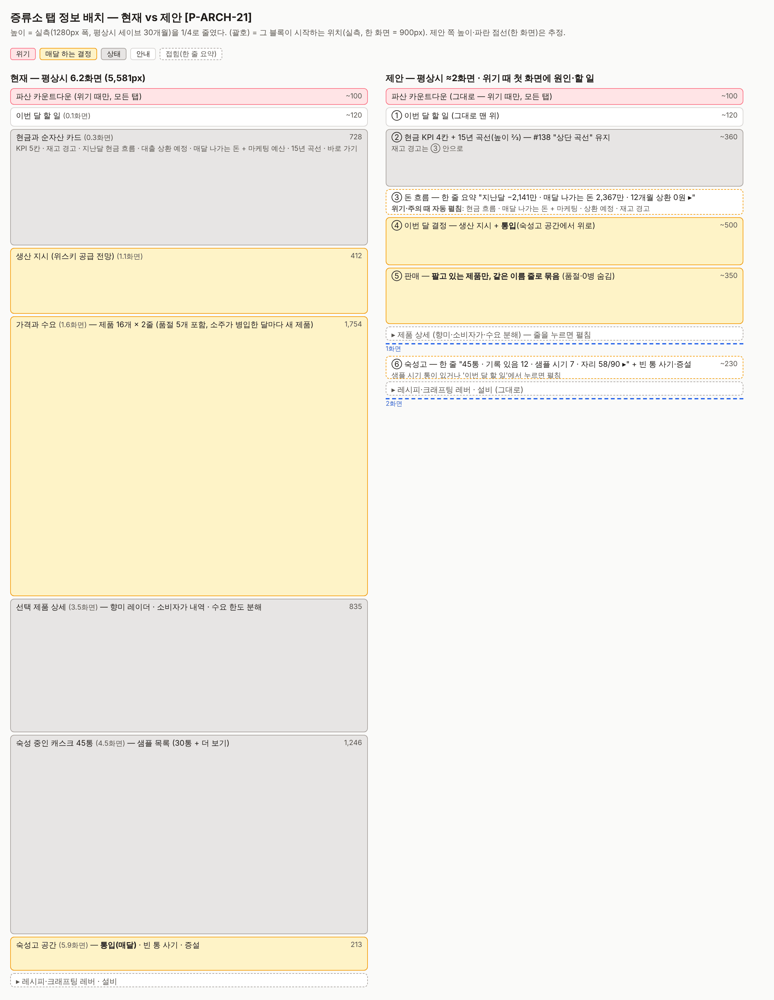

# MVP 정의 · 코어 루프 v0.2

> 상위 문서: [PRD](../PRD.md) §1·§12 · [뼈대 설계](skeleton.md) S-0 · [개발 공정](../PROCESS.md)
> 상태: **v0.2 확정(2026-11-06)** · §6.2 MVP 경제 설정 A1+C 승인(#139, 2026-11-06) — v0.1(#129~#134)에 오너 보완안 4가지(#135~#138: 증류식 소주 병행·샘플링으로만 아는 캐스크·숙성고 공간 압박·재고 평가액 곡선)를 더했다. 남은 `[튜닝]` 수치는 단계 T에서 정한다

---

## 0. 한 줄 정의

**MVP = 한국 1개 입지에서 증류식 소주로 버티며 싱글 몰트 위스키를 15년 키우는, 웹에서 처음부터 끝까지 플레이할 수 있는 재미 검증판.** Godot 이식 전에 "사람이 해도 재미있는가"를 확인하는 마지막 저비용 지점이다.

| 항목 | 내용 | 근거 |
|---|---|---|
| 목적 | 재미 검증용 플레이어블 (웹 프로토타입) | `[결정 #129]` 오너: A안 |
| 범위 | **한국 경기** 1개 입지 · **싱글 몰트 위스키 + 증류식 소주** · 증류소 1개 | `[결정 #130·#135]` 오너. 경기는 기본 입지라 입지 대표 결정을 끈 MVP에서 가장 중립 |
| 한 판의 끝 | **목표형 + 샌드박스 둘 다** — 15년 목표를 달성하거나 실패하면 결과 화면, 그 뒤 원하면 계속 | `[결정 #131]` 오너: 둘 다. 목표 내용은 §3 (#133) |
| 한 판 길이 | **15년(180턴)** · 6~8시간 | `[결정 #133]` §4 |
| 핵심 재미 우선순위 | ① 현금 공백 버티기 ② **크래프팅 — 재료·공정·숙성 방식을 자유롭게 골라 원하는 품질·향미의 술을 만든다** ③ 시간의 복리·헤리티지 ④ 불확실한 정보 속 판단 ⑤ 브랜드 권위·스케일업 ⑥ 리스크 헷징 | `[결정 #132·#134]` 오너 (PRD §1의 4가지를 대체) |
| 크래프팅 자유 원칙 | 모든 주종에서 **재료 · 공정 · 숙성 방식/기간**이 플레이어의 선택이고, 그 선택이 품질·향미로 이어진다. 화이트 스피릿은 증류 방식·재료·숙성 방식(옹기·스테인리스 휴지 등)·기간이, 에이지드 스피릿은 캐스크(종류·크기·재사용·피니싱)가 핵심 레버다 | `[결정 #134]` 오너 |

---

## 1. 코어 루프 (오너 5단계 원안 + 절충)

오너 원안: **매입 → 증류 → 통입·숙성 → 병입 → 판매 → 다시 매입.** 뼈대는 그대로 둔다. 다만 원안만으로는 1순위 재미(현금 공백)와 2순위 재미(공정 → 향미)가 루프 안에서 일어나지 않는다. 그래서 세 가지를 더한다.

```
        ┌──────────────── 매달 고정비가 빠져나간다 (임대·관리·인건비·숙성고 보관비) ────────────────┐
        ▼                                                                                          │
 ① 매입 ──▶ ② 증류 ──▶ ③ 통입·숙성 ──▶ ④ 병입 ──▶ ⑤ 판매 ──▶ 자본금 ──▶ ①                     │
  오크통      레시피 3개      [다음 달]        숙성 판단      수요 한도·가격                         │
  (맥아 자동)  손잡이로 향미     증발·숙성·가치↑                                                   │
                  │                                                                               │
                  └──▶ ②' 뉴메이크를 지금 헐값에 판다 (현금)  ◀── 핵심 결정: 팔 것인가, 묵힐 것인가 ─┘
                       ⑥ 돈을 빌린다 (은행 대출 · 고금리 급전)
```

| 단계 | 오너 원안 | 절충 | 이유 |
|---|---|---|---|
| ① 매입 | 맥아·빈 오크통 구매 | 오크통은 플레이어가 산다(종류 선택 = 향미 결정). **맥아는 생산 지시 때 자동 구매하고 시세만 보여 준다** (#133) | 맥아 재고 관리는 결정 없이 클릭만 늘린다. 원가 비중도 오크통보다 작다. 시세 변동은 이미 있다(원재료 랜덤 워크) |
| ② 증류 | 맥아 → 뉴메이크 | **크래프팅 선택(§1.2):** 재료(맥아 종류) · 공정(효모·발효 기간·증류 횟수·컷) · 숙성(③의 캐스크) → 향미 육각형과 품질이 달라진다 | 2순위 재미(크래프팅, #134)가 이 게임을 공장 짓기 게임과 가르는 코어 액션이다. 향미 모델(`flavor.ts`)과 레시피 변수는 이미 있다. 블렌딩 레이더 **미니게임**은 계속 OUT, 결과 육각형 **표시**만 IN |
| ②' 뉴메이크 판매 | (없음 — 1순위 재미 설명에만 등장) | **뉴메이크 원액 현물 판매** — 숙성 안 한 원액을 B2B로 헐값에 판다 | 1순위 재미의 핵심 결정이다. "지금 팔아 버틸 것인가, 묵혀 가치를 키울 것인가." 이미 있는 `bulk.ts` 현물 판매를 쓴다 |
| ②'' 소주 (#135) | (없음) | **증류식 소주를 함께 만든다** — 숙성 없이 바로 병입해 판다(초반 현금). 원료·효모·상압/감압·컷으로 화이트 스피릿 크래프팅. 뉴메이크 현물 판매는 **비상 수단**으로 남는다 | 뉴메이크 판매 하나로 버티면 판매 마진에 따라 "숙성 안 함"과 "무조건 파산" 사이를 오가는 극단적 밸런스가 된다. "소주로 벌어 오크통을 묻는다"는 전략적 선택이 된다. 소주 시장은 작은 틈새라(#75: 점유 상한 3%) 소주만으로 크기는 어렵다(추측 — 생존 실험에서 확인) |
| ③ 통입·숙성 | 매 턴 원액 0.2% 증발, 연수·가치 상승 | 증발은 **기존 기후 모델**을 쓴다. 한국은 연 약 4.5~5%(월 약 0.4%, 여름에 많다) | 0.2%/월(연 약 2.4%)은 스코틀랜드 수준이다. 한국을 시작 입지로 정했으므로 한국 기후를 따르고, 이 차이가 한국의 정체성이다 |
| ④ 병입 | 숙성 판단 후 병입 → 남은 원액량에 비례해 병 | 그대로 둔다. 한국 위스키 최소 숙성 1년(#63), 어린 위스키 인식 할인은 기존 규칙 | — |
| ⑤ 판매 | 바틀을 시장에 팔아 자본금 | **플레이어가 가격을 정하고, 수요 한도 안에서 팔린다** (기존 수요 공식·가격 탄력성·한국 주세 72%) | 무한히 팔리면 루프가 "만들수록 이득"이 되어 판단이 사라진다 |
| ⑥ 자금 조달 | (원안의 "사채"·월급 압박) | 은행 대출(기존 3종 중 시설·운전) + **고금리 급전**(새 기능, 작음 — 대출 상품 `emergency`: 1억·연 20%·12개월, PRD §8.2 `[결정 #160, 오너 승인 2026-11-06]`. 은행 심사는 플레이테스트 결과를 보고 MGT) + **매달 고정비** (#133) | 고정비가 없으면 현금 공백이 생기지 않는다. 직원 시스템(HR)은 OUT이므로 인건비는 고정비 한 줄로 둔다 |

### 1.1 시기별 긴장 (한 판 15년)

| 시기 | 플레이어의 질문 | 쓰는 재미 |
|---|---|---|
| 0~1년 (Death Valley) | 증류기를 소주와 몰트에 어떻게 나눌까? 전통주 등록에 투자할까? 위급하면 뉴메이크를 팔까, 대출을 질까? | ①② |
| 1~5년 | 어린 위스키를 지금 낼까, 기다릴까? 어떤 캐스크·레시피가 잘 팔리나? | ①② |
| 5~15년 | 숙성고가 꽉 찼다 — 애매한 캐스크를 내보낼까, 증설할까, 새 통을 포기할까(#137)? 12년 플래그십까지 무엇을 남길까? 샘플을 떠 보니 오크가 과하다 — 지금 병입할까(#136)? | ③④⑤ |

### 1.2 크래프팅 레버 (#134) — 무엇이 있고, MVP에서 무엇을 여는가

| 축 | 레버 | 코드 상태 | MVP (싱글 몰트) |
|---|---|---|---|
| 재료 | 맥아 종류(언피티드·피티드 40ppm·국산), 원재료 배합 | ● `Recipe.mashBill`, `INGREDIENTS` | **IN** — 맥아 3종 |
| 공정 | 효모, 발효 기간, 발효조(스테인리스·옹기)·발효실 온도 | ● `yeast`·`fermentDays`, 발효조 설비 | **IN** — 효모·발효 기간. 발효조는 기본 1종 |
| 공정 | 증류 횟수, 컷 포인트, 상압/감압, 증류기 형태(양파·랜턴·웜텁·하이브리드) | ● `runs`·`cut`·`pressure`·증류기 설비 | **IN** — 증류 횟수·컷. 증류기는 기본 1대(형태 선택은 다음 단계) |
| 숙성 | 캐스크 종류(ex-버번·올로로소·한국 참나무·미즈나라), 크기, 재사용(1필·2필…)·재탄화 | ● `CASKS`·캐스크 재사용 | **IN** — 4종 · 신품/재사용 |
| 숙성 | 숙성고 위치(더니지·랙·단 높이 → 온도·증발) | ● 숙성고 공간(#65·#70) | **IN** — 기본 더니지 1동, 단 선택 |
| 숙성 | 숙성 기간 — 언제 병입할지 | ● | **IN** — 코어 루프 ④ |
| 숙성 | **피니싱**(다른 캐스크로 옮겨 마무리) | ○ 자리만 — `caskHistory`·`transferCask` (skeleton §4.3). MVP에서 잠금 | OUT (다음 단계) |
| 숙성 | **비목재 용기 숙성** — 옹기·스테인리스 휴지(화이트 스피릿의 숙성 방식·기간) | ● 옹기 항아리(`onggi_jar`) + 모델 `matureNonWood`(flavor-model §4.5.1, `[결정 #161]`). 스테인리스 휴지 = 탱크 보관(`restLot`) | **IN** — 옹기(숙성고 칸을 쓴다, #137 공간 압박에 들어감) |
| 병입 | 도수, 칠 필터, 병 크기 | ● | **IN** — 도수·칠 필터 |

- **처음 2시간을 지키는 방법:** 레버가 많으면 첫 턴이 무거워진다. **프리셋 레시피**(이미 있음)로 시작하고, "고급 설정"을 열면 위 레버가 보이게 한다. 결과는 향미 육각형 + 품질 점수 + "어떤 선택이 무엇을 바꿨나" 한 줄로 보여 준다
- **구현 (단계 P, PROD — `[결정 #156]`, 오너 승인 2026-11-06):** 생산 패널의 "레시피 · 크래프팅" 카드(`ui/panels/Production.tsx`), 계산은 `production.ts`의 순수 함수(`previewBatch`·`leverEffects`·`leverSummary`, 게임 상태를 바꾸지 않음 — 밸런스·MVP 골든 바이트 동일)
  - 레버: 몰트 = 맥아·효모·발효 기간·증류 횟수·컷 / 소주 = 주원료·발효제(누룩) 비율·효모·발효 기간·상압/감압·컷. 감압은 감압 증류기가 있어야 고를 수 있다(MVP는 그 증류기만 살 수 있다). 샌드박스의 진·그레인·고량주는 이전 자유 편집기
  - **"무엇이 무엇을 바꿨나"** = 기준 프리셋에서 레버를 **하나씩만** 바꿨을 때의 효과(가장 크게 움직인 향미 축 · 이취 · 수율 · 품질)를 큰 순서로 2개 + "외 n개". 레버끼리 상호작용이 있어 합이 전체 변화와 다를 수 있다고 화면에 적는다. 기준 프리셋은 레시피에 출처를 저장하지 않고 이름 → 주원료 → 같은 주종 순으로 추정한다(스키마 변경 없음)
  - **향미 "육각형":** 몰트는 블렌딩 육각형 6축(`blendRadar`)으로 보여 준다 — 뉴메이크 → 숙성고 샘플 기록(`sampleLog`) → 블렌딩 테이블이 같은 축이라 "숙성 뒤 어디로 갈지"를 한 그림에서 읽는다. 소주는 위스키 육각형이 누룩·누룽지 향을 담지 못해(투영 가중치 없음) 소주 범주의 레이더 7축을 쓴다. 대안: 소주 전용 육각형 투영을 만든다(blending-minigame §2.1 제안) — 소주 블렌딩·숙성(옹기)이 들어올 때 함께 정하는 편이 싸다
  - 미리보기의 발효실 온도는 18°C 고정 — 실제 배치는 그달 온도로 발효 기간·향이 달라진다(결정 #67). 화면이 달마다 흔들리지 않게 한 선택이고, 여름 산패 위험은 미리보기에 안 보인다(리스크)
- **증류식 소주의 레버 (#135):** 재료(국산 쌀·가공용 쌀·고구마·보리·누룩) · 효모·발효 기간 · **상압/감압 증류** · 컷 · 도수·병 크기. 숙성 방식: **탱크 휴지(무료) · 옹기 항아리 · 오크 캐스크** (#161). 진·고량주는 MVP 밖
- **전통주 주세 경감**(농업경영체 등록 5천만 원·6개월, #73·#75)은 초반 투자 결정 하나로 그대로 둔다

### 1.3 정보·공간·가치 규칙 (#136~#138)

| 규칙 | 내용 | 코드 상태 | 이유 |
|---|---|---|---|
| **캐스크는 샘플링으로만 안다** (#136) | MVP 화면은 캐스크의 참 향미·품질을 숨긴다. 보여 주는 것은 **마지막 샘플의 추정 육각형 + 오차 범위 + 지난 샘플 대비 변화 화살표 + 추정 품질**뿐이다. 샘플링은 기존 규칙(`sampleCask`): 월 한도, 1회 3만 원, 원액 소량 손실, 캐스크당 횟수 상한. **행동력(AP) 시스템은 도입하지 않는다** | 샘플링 행동·월 한도·지각 오차는 있음(#124). **샘플 순간의 읽기 기록(`Cask.sampleLog`, `lastSample`)은 생겼다(S-10).** **참값을 숨기는 MVP 화면은 생겼다(§5.1 증류소 탭).** 개발자 숙성고 패널(`Warehouse.tsx`)은 참값을 보여 주므로 시나리오 게임에서 숨겼다. 블렌딩·병입·원액 B2B 탭에는 아직 샌다(§5.1) | 12년을 기다리지 않아도 크래프팅 결과를 중간에 확인한다(②). "오버 오크면 지금 병입"이 실제 판단이 된다 — 오크 타닌 상한 초과 감점은 이미 품질 공식에 있다(`flavor.ts`)(④) |
| **숙성고 공간 압박** (#137) | MVP 시작 숙성고 용량을 빡빡하게 둔다(기본 150통보다 훨씬 작게, 값 `[튜닝]`). 증설은 비용 + 준비 기간. 캐스크 보관비(#61)는 그대로 | 용량·증설·보관비 모두 있음 — **MVP 설정값만** | 중반(5~12년)이 "다음 턴만 누르는 방치형"이 되지 않게, 공간이 매달의 결정을 만든다. 증설이 너무 싸면 압박이 사라지고, 불가능하면 짜증이 난다 → 튜닝 단계에서 조정 |
| **재고 평가액 곡선** (#138) | 화면 상단에 **현금(런웨이) 선 + 재고 평가액 선**을 주식 창처럼 매달 그린다. 평가액은 **지금 실제로 받을 수 있는 가치** — `[결정 #146]`(오너 승인 2026-11-06): 15년 목표 판정의 순자산과 **같은 정의**(`netWorth` — 현금 − 대출 + 매출채권 + 원액 현물가 + 재고 원가). 병 가격으로 매기지 않는다 — 수요 상한 때문에 다 팔 수 없다 | 원액 시가 함수(`bulkValuePerLPA`)·봇의 시가 평가 있음. **곡선 화면은 생겼다(§5.1)** — 월 보고서 `netWorth` | 현금이 아슬아슬해도 자산이 자라는 것이 보여야 다음 턴을 누른다(③). **선행 조건 해결:** 병 가격의 숙성 반영(PRD §6.2.1, #117) — 병 가격이 원액 시가와 같은 속도로 오른다. 남은 문제: 숙성고 전체를 병 가격으로 평가하면 그만큼 팔 수요가 없다(수요 상한) → 곡선의 평가 방식은 #138 화면 작업 때 정한다 |

---

## 2. 범위 — IN / OUT 절충

| 오너 원안 | 절충 | 비고 |
|---|---|---|
| IN 단일 주종: 싱글 몰트 | **싱글 몰트 + 증류식 소주** (#135) | 다른 주종(진·고량주·그레인 등) 코드는 남기고 MVP 모드에서 끈다 |
| IN 단일 지역: 스코틀랜드 스페이사이드 | **한국 1개 입지로 변경** (오너의 나중 답을 따름) | ⚠ 원안과 답이 달라 확인 필요. 스페이사이드는 설계 v0.2만 있고 구현은 ciosryu/distillery#9가 옛 구조에서 진행 중이다 |
| IN 기초 재화: 자본금·맥아·빈 오크통·병 | 자본금·빈 오크통(종류 2~3)·숙성 캐스크·병 + **뉴메이크 원액**. 맥아는 자동 구매 | §1 ① |
| IN 턴 시스템 | 그대로 + 기존 "다음 알림까지" 자동 진행 | 15년 = 180턴이므로 후반 빨리감기가 필수 |
| IN 숙성 수학: 증발·가치 상승 | 그대로 + **병 가격도 숙성에 맞춰 오른다** (PRD §6.2.1, #117) | 병 숙성 프리미엄을 원액 시가 상승률(`BULK`)에서 읽는다. 경기 캐스크 1통의 병입 순수입이 3 → 12년 −6%에서 +38%로 바뀌었다 |
| (없음) | **IN 추가:** 증류식 소주(#135), 샘플링·참값 숨김(#136), 빡빡한 숙성고(#137), 재고 평가액 곡선(#138), **비지터 센터 베이직 투어**(#139), 크래프팅 레버(§1.2)·향미 프로필 표시, 뉴메이크 현물 판매, 대출 + 급전, 고정비, 가격 설정·수요 한도, 한국 주세(자동 계산·내역 표시), 세이브 | §1 |
| OUT 2D 타일맵·캐릭터 | 그대로 | 단일 화면 UI |
| OUT 나머지 지역·주종 | 그대로 (끄기만, 지우지 않음) | — |
| OUT 직원·테크트리·R&D | 그대로. 인건비는 고정비 한 줄 | 원안의 "R&D 포인트"는 원래 설계에 없다(#46: 연구 자원 = 현금 + 기간 + 담당자) |
| OUT 평론가·재해 등 랜덤 이벤트 | 그대로 OUT. **원재료 시세 변동은 IN**(이벤트가 아닌 랜덤 워크) | ⚠ 변동 요소가 없으면 한 가지 최적 전략이 생긴다(#37). 재미 검증 단계에서는 감수하고 다음 단계에서 이벤트를 켠다 |
| OUT 블렌딩 레이더 미니게임 | 그대로 OUT. 결과 육각형 표시만 | — |
| (원안에 없음) | **OUT:** 대규모 상업 티어(#140 — 수출·대형 원액 계약 업데이트 때 연다)·수출·입지 대표 결정·원액 계약(현물 판매만 IN)·브로커·비지터 센터 상위 단계(VIP·레스토랑 — 베이직 투어는 IN, #139)·투자·캐스크 오너십·다른 입지·방재 설비 | 모두 기능 플래그로 끈다 |

---

## 3. 한 판의 목표 (#133)

**15년 목표 (모두 달성하면 "헤리티지 달성" 결과 화면)**
1. 파산하지 않는다
2. **12년 숙성 플래그십**을 병입해 판매한다 — 3순위 재미("내가 이 위스키를 키웠다")의 상징
3. 순자산 목표 = **시작 자기자본 × N** (`[결정 #141]`, N = 3 `[튜닝]`). 자기자본은 규모 티어가 정하고 시작 대출은 넣지 않는다 — 대출 슬라이더가 목표를 움직이지 않는다

- **실패:** 파산(현금 부족 3개월 연속, 기존 규칙)
- **판정 (구현, skeleton §4.4, `[결정 #145]`):** 180개월째(또는 파산한 달)에 한 번 — 플래그십은 숙성 144개월 이상 위스키가 **한 병이라도 팔렸는지**(라벨 연수는 가장 어린 원액 기준이라 "경과 12년"이 아니라 "숙성 12년"), 순자산은 "지금 정리하면 받는 돈"(현금 − 대출 + 매출채권 + 원액 현물가 + 재고 원가). 등급: **A** = 목표 모두 달성 · **S** = A + 순자산 목표의 1.5배 + 플래그십 품질 80↑ + 인지도 20%↑ · **B** = 버티고 하나 더 달성 · **C** = 버티기만 · 파산 = 등급 없음. 기준 `[튜닝]`
- **봇 측정 (20시드, 실제 판정):** 소규모 — 균형·몰트 위주 헤리티지 A 20/20, 소주 위주·위스키만 B 20/20 · 표준 — 균형 A 19/20, 몰트 위주 A 16/20. S는 0 — 한국 기후에서 12년 플래그십 품질이 75 안팎이라 80에 못 닿는다(사람이 캐스크·레시피로 노릴 자리). **목표가 소규모에는 쉽다**(#141 발견과 같음) → 단계 T
- **결과 화면:** 등급(S·A·B·C — 순자산·플래그십 품질·브랜드 인지도), 15년 연표(첫 증류·첫 병입·위기·플래그십)
- **그 뒤:** "계속 운영"을 누르면 샌드박스로 이어진다. 목표 없이 마일스톤만 남는다
- 15년인 이유: 12년 숙성 플래그십을 내려면 3년 차까지는 통입해야 한다. 그래서 15년이 "가장 짧으면서도 헤리티지 서사가 완성되는" 길이다

---

## 4. 한 판 길이·플레이 시간 (#133) — 상업성 근거

| 목표 | 값 | 근거 |
|---|---|---|
| 한 판 | 15년 = 180턴 | §3 |
| 한 판 플레이 시간 | **6~8시간** (턴당 평균 2~2.5분, 후반은 자동 진행) | 같은 장르의 "턴 = 시간 흐름" 타이쿤인 Game Dev Tycoon의 본편 클리어가 약 8.5시간(HowLongToBeat 집계, Deku Deals 인용). 짧은 한 판 + 재도전 구조가 맞다 |
| **처음 2시간 안에 줄 것** | 첫 현금 위기, 첫 대출 또는 뉴메이크 판매 결정, **첫 위스키 병입·판매**(한국 최소 숙성 1년 → 13~15턴) | Steam은 플레이 2시간 이내 환불을 자동 승인한다. 타이쿤 리뷰를 보면 2시간 안에 그만둔 사람과 넘긴 사람의 플레이 시간이 크게 갈린다(Game Dev Tycoon 리뷰어 평균 약 1시간 대 16.5시간, Vaporlens 집계 — 리뷰 기반 추정이고 공식 통계가 아니다). **→ 첫 24턴을 90분 안에 끝낸다** |
| 전체 수명 | 여러 판 재도전 + 샌드박스 계속 → 20~30시간 | 같은 집계에서 2시간을 넘긴 타이쿤 리뷰어들의 평균이 16~26시간 `[추측: 리뷰어 표본 편향 있음]` |

---

## 5. 만드는 방법 (#133)

- **사업 계획서로 시작한다 (`[결정 #140·3]`, 2026-11-06):** 새 게임 첫 화면은 ① 증류소 규모 ② 시작 자금 조달 ③ 재무 시뮬레이터. 구현은 `src/ui/BusinessPlan.tsx` → `newScenarioGame` (§6.3)
- **새로 짜지 않는다.** 기존 시뮬레이션에 **MVP 모드**(시나리오 설정: 지역·입지·주종·켜는 시스템 목록)를 두고 나머지 시스템은 기능 플래그로 끈다. 이 시작 설정이 뼈대 S-8(JSON 시나리오 초기화)의 첫 사용처가 된다
- 화면은 **MVP 전용 단일 화면**이다: 상단 현금·재고 평가액 곡선(#138)과 런웨이(몇 달 버티나), 숙성고 목록(연수·남은 양·샘플 추정치·빈 자리, #136·#137), 생산 지시(소주·몰트), 병입·가격, 자금
- 기존 웹 패널 11개는 개발자용 디버그 화면으로 남긴다

### 5.1 MVP 단일 화면 — 구현 (2026-11-06, 설계 세션) — `[결정 #159, 오너 승인 2026-11-06]`

시나리오 게임은 첫 탭 **증류소**(`src/ui/MvpHome.tsx`, 코어 UI)로 연다. 샌드박스에는 이 탭이 없다.

| 영역 | 보이는 것 | 행동 |
|---|---|---|
| 상단 — 현금·순자산 곡선 (#138·#146) | 현금 · 순자산(목표 대비 %) · 재고 평가액 · 대출 잔액 · 가장 오래된 자체 원액(플래그십 기준까지). 15년 축 위에 **현금 선 + 순자산 선 + 순자산 목표 점선**, 호버하면 그 달 값 | 바로 가기: 생산 지시 · 블렌딩·병입 · 판매·가격 · 원액 현물 판매 · 대출·급전 · 월 결산표 |
| 생산 지시 (#156) | PROD `Orders` 그대로 — 레시피별 배치당 산출·원가·뉴메이크 품질·월 배치 수 | 월 배치 수 |
| 판매 (#154) | MKT의 `PriceDesk`(`ui/panels/Sales.tsx`) 그대로 — 가격·이번 달 수요 한도·지난달 수요→판매·병당 공헌이익·주세 내역 | 출고가 변경 |
| 숙성 중인 캐스크 (#136) | 통 종류·필 회차·원액 이름·**숙성 기간·남은 양**·위스키 표기 가능 여부 + **아는 값**(`knownRead`, #157 — 블렌딩 테이블과 같은 규칙): 자기 샘플 기록(추정 품질 ±오차, 강한 향 3개, 직전 대비 변화, 몇 개월 전), 없으면 **형제 통**(같은 배치·같은 통 종류) 기록을 흐리게. 숙성 칸은 나무 = 오크 개월, 옹기 = "옹기 N개월"(#161). 몰트를 옹기에 담으면 "위스키 숙성에 안 들어감" 경고. **참 향미·품질은 쓰지 않는다** | 통 골라 샘플(월 여력·1회 3만 원) · "오래 안 뜬 통 고르기" · 오염이 드러난 통 폐기 |
| 숙성고 공간 (#137) | 자리 사용(빈 통·주문 중 포함)/용량 · 남은 자리 · 건설 중인 숙성고 | 숙성고 증설(카탈로그 설비) · 탱크 원액(몰트·소주) → 빈 통 통입(63.5%, 원액이 더 낮으면 원액 도수 그대로 — 소주) · 원액에 맞는 통을 먼저 고른다(소주 → 옹기, 몰트 → 나무) · 빈 통 주문/즉시 구매 |

- **곡선 데이터:** 월 보고서에 `netWorth`(그 달 말 순자산), 연 요약에 `netWorthEnd`를 기록한다(선택 필드 — 구버전 세이브의 보고서에는 없고, 그 구간은 선이 비어 보인다. 스키마 버전은 올리지 않는다). 보고서는 최근 120개월만 남으므로 그 앞은 연 요약(12월 말)으로 잇는다. 재고 평가액 = 순자산 − 현금 + 대출 − 매출채권(= 원액 현물가 + 제품 재고 원가)
- **변화 화살표는 오차보다 클 때만:** 두 샘플 읽기의 차이는 두 오차가 겹친다(√(σ₁²+σ₂²)). 그 안의 변화는 "≈"로 보인다 — 노이즈를 숙성 변화로 읽지 않게. 초반(오차가 클 때) 피드백이 약하게 느껴지는지는 **사람 플레이테스트에서 확인**한다 — 약하면 원문대로 늘 표시로 되돌린다
- **순자산 곡선과 참 품질 `[결정 #167]`(오너 승인 2026-11-07 — 그대로)** (#164 MKT가 전함): 순자산의 원액 항은 현물 매각가 = 액량 × 도수 × `spotBidPerLPA`이고, 이 값은 **참 품질**(`qualityFactor` — 품질 1점 = 값 1.5%)로 매긴다. 곡선·"재고 평가액"에서 캐스크 품질을 거꾸로 짐작할 여지가 있다. 판단:
  - **권장: 지금 그대로(참 품질)** — ① #146의 정의가 "지금 정리하면 받을 돈"이고 사는 쪽은 맛을 보고 값을 매기므로 참 품질이 경제적으로 맞다 ② 새는 것은 **전체 합계**뿐이다. #136이 지키려는 판단("어느 통을 지금 병입할까")은 통마다의 값이 필요해 여전히 샘플을 떠야 한다 ③ 현물 지수가 매달 ±3% 흔들려(품질 약 2점어치) 달마다 차이로 품질을 읽기 어렵다 ④ 통 하나의 참값을 드러내는 행동(병입·현물 판매)은 원래 그 순간 참값을 공개한다
  - 반론: 초반에 통이 1~2개뿐이면 합계 ≈ 그 통의 값이라, 공식을 아는 플레이어는 평균 품질 추세를 읽을 수 있다
  - 대안 ⓐ 화면만 아는 값(샘플 추정, 없으면 평균)으로 — 샘플을 뜨면 순자산이 바뀌고 15년 판정 값과 곡선이 어긋난다 ⓑ 화면만 품질 없이(장부가) — 판정 때 차이가 한꺼번에 드러난다. 둘 다 "곡선 = 판정 값"(#146)을 깬다
  - 플레이테스트에서 이 역산을 시도하는 모습이 보이면 ⓑ로 바꾼다(`spotBidPerLPA`의 `quality` 인자로 한 줄)
- **런웨이** = 최근 3개월 자체 현금 흐름(차입·투자 유치·선급금 제외) 평균이 적자일 때 현금 ÷ 월 적자 — 대시보드와 같은 계산
- **생산 지시는 곡선 바로 아래에 펼쳐 둔다**(PROD `Orders` — 매달 바꾸는 결정). **크래프팅 레버(`RecipeEditor`, #156)·설비(`Equipment` — 비지터 센터 베이직 투어·증류기)는 화면 맨 아래에 접어 둔다** — 자주 안 바꾸고, 처음 2시간을 가볍게(§1.2). 세 컴포넌트는 PROD 파일에서 `export`만 더했다
- 통입 원액 목록은 몰트·그레인이 먼저 — 기본 루프는 몰트 → 오크 통이라, 소주를 실수로 버번 통에 담지 않게
- 통입 원액 목록의 **소주는 레시피별 한 줄**(가장 오래 쉰 탱크) — 소주는 달마다 탱크가 따로 남는다(#166은 몰트·그레인만 합친다). 탱크에서 쉬는 것도 숙성이라(#161) 오래된 것부터 담는다
- **참값이 아직 새는 곳 (파트 작업 — 플레이테스트 전에 고친다, 오너 승인 2026-11-06):** 블렌딩·병입 탭(캐스크 향 노트·병입 미리보기 품질 — PROD), 원액 B2B 탭(캐스크째 판매 품질 — MKT). 개발자 숙성고 탭(`Warehouse.tsx`)은 시나리오 게임에서 숨겼다
  - **블렌딩·병입 탭(PROD) — 고침 (`[결정 #162]`):** 캐스크 행 = 샘플 기록, 미리보기 = 추정 육각형·추정 품질 ±오차, 권장 출고가 = 병입 후 공개(PRD §5.6). 생산 화면의 `Orders`·`RecipeEditor`·`ProfileRadar`를 내보냈다 — 이 화면에 끼울 수 있다(ARCH)
  - **플레이테스트에서 볼 것:** MVP는 블렌더가 없어 대표가 맛본다 — 첫 샘플의 추정 품질 오차가 ±14(실측: 참 65 → 추정 86)다. 샘플을 더 뜨면 1/√(1+n)로 준다. 너무 헷갈리면 `QUALITY_SIGMA_PER_HEX`(#143 `[튜닝]`)를 단계 T에서 본다

### 5.2 증류소 탭 정보 배치 — `[결정 #182, 오너 승인 2026-11-08 "권장안대로"]` (설계 세션)

**결정:** ① 안 A(4층 + 신호 자동 펼침) ② 판매 묶음 줄에서 값을 바꾸면 **묶인 제품 모두** 같은 값 ③ 2차 플레이테스트 **전에** 넣는다.

**구현 결과(실측, 같은 세이브):** 평상시 **6.2 → 2.5화면**, 위기 6.3 → 2.5화면. 위기 첫 화면 = 파산 배너·할 일·KPI·돈 흐름(펼침: 재고 경고·지난달 현금 흐름·매달 나가는 돈)까지(0.1~0.8화면). 곡선은 돈 흐름 바로 아래(평상시 0.9화면 — 위기 때 KPI와 돈 흐름이 붙도록 그림의 ②에서 한 칸 내렸다). KPI는 5칸 그대로 두었다
- 접힘: 신호가 있으면 기본 펼침, 없으면 접힘. 직접 펼치거나 접으면 그 브라우저에 기억하고, 신호가 생기거나 사라지면 기본값으로 돌아간다(평상시에 접어 둔 돈 흐름도 위기가 오면 펼쳐진다). "이번 달 할 일" 링크는 그 블록을 연다. 돈 흐름의 신호 = 현금 경고(`cashAlert`)·재고 과잉·거치 종료 3개월 안
- 판매(`PriceDesk compact`, PROD `Sales.tsx`): 재고 있는 제품만, 같은 범주·병·도수·병입 회차 뗀 이름("한빛 소주 13" → "한빛 소주")은 한 줄 — 합계 재고·수요·매출, 출고가 범위, ▸로 제품별 줄. 설명·각주·품절 제품은 판매 탭(전체 표는 그대로)
- 통입은 생산 지시 바로 아래 카드로(`FillCard`), 빈 통 사기·증설은 숙성고 공간 카드에 남았다

— 아래는 제안 당시의 실측·근거다 —

**배경.** 1차 플레이테스트(§7.3·§7.4)에서 "위기 때 할 일이 안 보였다", "돈이 어디로 나가는지 몰랐다"가 나왔고, 여러 세션이 증류소 탭 **위에서부터** 덧붙였다(파산 카운트다운·이번 달 할 일 #90, 지난달 현금 흐름·대출 상환 예정 #90, 매달 나가는 돈 #96(#181), 위스키 공급 전망 #178, 향미 레이더 #175, 샘플 목록 #177).

**실측** (1280px 폭, 평상시 세이브 30개월 · 위기 세이브 17개월 현금 −630만):

| 블록 | 시작 위치 | 높이 |
|---|---|---|
| 이번 달 할 일 · 현금과 순자산 카드(KPI·재고 경고·현금 흐름·상환 예정·매달 나가는 돈·곡선) | 0.1 · 0.3화면 | ~120 · 728px |
| 생산 지시 | 1.1화면 | 412px |
| 가격과 수요 — **제품 16개 × 2줄**(품절 5개 포함 — 소주를 병입한 달마다 새 제품이 생긴다) | 1.6화면 | **1,754px** |
| 선택 제품 상세(향미·소비자가·수요 분해) | 3.5화면 | 835px |
| 숙성 중인 캐스크(샘플 목록) | 4.5화면 | 1,246px |
| 숙성고 공간 — **매달 하는 통입**이 여기 | **5.9화면** | 213px |
| 전체 | | **6.2화면** (위기 6.3) |

- **위기 때 첫 화면은 이미 된다** — 위기 세이브의 첫 화면에 파산 카운트다운·이번 달 할 일·KPI·재고 경고(실제 원인)·지난달 현금 흐름·매달 나가는 돈이 다 들어온다
- 문제는 **평상시**: 매달 하는 결정(통입)이 5.9화면 아래로 밀렸고, 판매·숙성 목록이 판이 길어질수록 계속 길어진다(제품·통이 늘수록)
- 중복: KPI의 "이 속도면 N개월 버팀"과 파산 배너, "매달 나가는 돈"과 "지난달 현금 흐름의 고정비"가 같은 숫자를 두 번 보인다

**원칙 — 4층:** 위기(있을 때만) → 이번 달(안내 + 매달 하는 결정, 펼침) → 상태(한 줄 요약으로 접고 **신호가 있으면 자동 펼침**) → 참고(접힘). 전체 정보는 판매·재무·대시보드 탭에 그대로 남는다.



| 순서 | 블록 | 평상시 | 신호가 있을 때 | 고칠 파일 |
|---|---|---|---|---|
| 0 | 파산 카운트다운 | 없음 | 위기·주의 때 모든 탭 맨 위 (그대로) | — |
| ① | 이번 달 할 일 | 펼침, 맨 위 (그대로) | | — |
| ② | 현금 KPI 4칸 + 15년 곡선 | 펼침 — 곡선 높이 ⅔. #138 "상단 곡선" 유지 | | 코어 `MvpHome` |
| ③ | **돈 흐름** = 지난달 현금 흐름 + 매달 나가는 돈·마케팅 + 상환 예정 + 재고 경고 | **한 줄 요약** "지난달 −2,141만 · 매달 2,367만 · 12개월 상환 0원 ▸" | **위기·주의(`cashAlert`)·재고 경고·거치 종료 3개월 안이면 자동 펼침** | 코어 `MvpHome`·`AlertsView`(+ MGT `FixedCost`는 그대로 끼움) |
| ④ | **이번 달 결정** = 생산 지시(공급 전망 포함) + **통입**(숙성고 공간에서 위로) | 펼침 | | 코어 `MvpHome`, PROD `Orders` 그대로 |
| ⑤ | 판매 | **팔고 있는 제품만, 같은 이름(병입 회차 뺀 이름)끼리 한 줄**, 설명 줄·제품 상세는 줄을 누르면 펼침 | 재고 경고 범주는 펼침 | **PROD `Sales.tsx`**(#173 임시 소유) — `PriceDesk`에 `compact` 옵션. 판매 탭은 지금처럼 전체 |
| ⑥ | 숙성고 | **한 줄 요약** "45통 · 기록 있음 12 · 샘플 시기 7 · 자리 58/90 ▸" + 빈 통 사기·증설 | "샘플 시기" 할 일을 누르거나 직접 펼침 | 코어 `MvpHome` |
| ⑦ | 레시피·크래프팅 레버·설비 | 접힘 (그대로) | | — |

효과(추정): 평상시 **6.2화면 → 약 2화면**. 위기 때 첫 화면 내용은 지금과 같거나 더 위(③이 자동으로 펼쳐져 원인·숫자가 ② 바로 아래).

**대안**
- **A (권장)** 위 4층 + 신호 자동 펼침
- **B** 증류소 탭 안에 하위 탭(돈 / 생산·판매 / 숙성고) — 스크롤은 거의 없어지지만 위기 원인(재고·돈)과 결정(생산·판매)이 다른 탭으로 갈라진다. #159 "단일 화면"과 충돌
- **C (최소)** 순서는 그대로 두고 판매 표의 품절 숨김 + 제품 상세 접기 + 숙성 목록 접기만 — 6.2 → 약 3화면(추정). 가장 싸고 안전하지만 통입은 여전히 맨 아래, 돈 흐름은 늘 펼쳐진 채

**리스크·반론**
- 접으면 1차 플레이테스트가 원한 정보("돈이 어디로")가 다시 숨는다 → 한 줄 요약에 핵심 숫자 + 위기·주의 때 자동 펼침. 그래도 **평상시에 돈 흐름을 보지 않다가 위기를 늦게 알 위험**은 남는다(주의 단계 = 런웨이 3개월이 그 완충)
- 자동 펼침·접힘이 달마다 바뀌면 화면이 출렁인다 → 사람이 직접 펼치거나 접은 상태는 그 브라우저에 기억(편의 기능, 게임 상태 아님)
- ⑤ 묶음 줄에서 값을 바꾸면 **묶인 제품 모두 같은 값**으로 할지(권장 — 같은 술이다) 개별만 바꿀지는 오너 결정. 병입 회차마다 원가·품질이 조금씩 달라 권장 출고가가 다르다
- 2차 플레이테스트 직전의 큰 화면 변경 — 시뮬레이션은 그대로지만 화면 회귀 위험. `playtest-dryrun.cjs` 셀렉터도 같이 고친다
- 판매 표가 길어지는 근본 원인은 "병입할 때마다 새 제품"이다. 같은 이름이면 기존 제품에 합치는 규칙은 **규칙 변경**이라 이 제안 밖(PROD·단계 P 판단)

**오너 결정 질문:** ① A / B / C ② A·C라면 묶음 줄 값 변경 = 묶인 제품 모두(권장) / 개별만 ③ 2차 플레이테스트 **전에** 할지(권장 — 지금 길이로는 2차 피드백이 "스크롤"에 묻힐 것 `[추측]`) / 뒤에 할지

## 6. 먼저 확인할 위험

| 위험 | 확인 방법 |
|---|---|
| **소주 + 위스키로 한국 경기에서 첫 1년을 버티는가, 그리고 한쪽이 지배하지 않는가** — 지금까지 한국 봇은 소주·고량주·비지터 센터를 함께 썼다. MVP는 고량주·비지터 센터가 없다 | MVP 모드 봇 전략 3개(소주 위주·균형·몰트 위주)를 2~10시드로 돌린다. 못 버티면 시작 자본·대출·고정비를, 소주만 하는 전략이 이기면 소주 시장 상한을 MVP 설정에서 조정한다 `[확인 불가 — 실험 전]` |
| 재미 검증을 봇으로 대신하게 되는 것 | MVP 완료 기준에 **사람 플레이테스트**를 넣는다(§7) |
| 한국은 고난도 지역이다(#73, 주세 72%) | 위 실험 결과를 보고 판단한다. 너무 어려우면 MVP 한정 완화 설정 |

### 6.1 생존 실험 결과 (2026-11-06) — ⚠ 현재 수치로는 MVP 조건에서 버티지 못한다

`npx tsx scripts/experiments/mvp-survival.ts 10 180` — 한국 경기, 소주 + 몰트만(고량주·진·비지터 센터·원액 계약·수출·브로커·매입 원액 없음), 디스틸러 1 + 영업 1, 기존 은행·정책 대출, 현금이 바닥나면 뉴메이크 현물 판매. 게임 규칙은 바꾸지 않았다. 칸 = 10시드 중 파산 수.

| 설정 | 소주 위주 (4·3배치) | 균형 (2·5) | 몰트 위주 (1·7) | 위스키만 (0·7, 대조) |
|---|---|---|---|---|
| 이벤트 끔 · 전통주 등록 안 함 · 12개월부터 병입 | 10/10 | 7/10 | 8/10 | 10/10 |
| 이벤트 끔 · **전통주 등록** · 12개월부터 병입 | 10/10 | 7/10 | 7/10 | 10/10 |
| 이벤트 **켬** · 전통주 등록 · 12개월부터 병입 | 10/10 | 10/10 | 9/10 | 10/10 |
| 이벤트 끔 · 전통주 등록 · **36개월부터** 병입 | 10/10 | 10/10 | 10/10 | 10/10 |
| (참고) 기존 브랜드형 봇 15년 — 고량주·비지터 센터·매입 원액 브리지·수출 포함 | 1/10 · 비지터 센터 끄면 3/10 | | | |

- **파산 시점은 5~7년 차(53~86개월)다.** 첫 1년은 대출(최대 잔액 약 12억)로 버틴다. 거치 기간이 끝나 원금 상환(연 2~2.4억)이 시작되면 무너진다
- **원인은 생산이 아니라 시장 크기다** (균형, 시드 1, 5년 차):
  - 위스키는 수요를 거의 다 채워 팔아도 연 약 5,200병, 2.9억이다. #85 한국 싱글몰트 점유 상한
  - 소주는 0.9억이다. #75 증류식 소주는 작은 틈새
  - 나가는 돈은 관리비 1.2억 · 급여 1.3억 · 마케팅 0.6억 · 생산 0.56억 · 원금 상환 2.4억이다
- **"소주 공장 게임" 위험은 없다.** 소주 위주가 가장 나쁘다(10/10). 대신 소주만으로는 초반 현금을 감당하지 못한다
- **36개월까지 기다리면 더 나쁘다** — 어린 위스키 병입이 파산 원인은 아니다
- 한계: 봇은 생산·마케팅을 고정하고 비용을 줄이지 않는다. 사람은 더 버틸 수 있다(추측). 다만 고정비 2.4억(관리비 + 급여)만으로도 5년 차 매출의 2/3라 구조적 적자에 가깝다

**함의 — 결정이 필요하다 (설계 세션 첫 안건):** MVP의 경제 규모를 시장 크기에 맞춘다. 후보:
- A. **MVP 증류소 규모 축소** — 관리비·급여·마케팅 기본값을 소규모 크래프트에 맞춘다. 한국 크래프트 위스키 증류소가 실제로 소규모라는 고증과도 맞다(추측)
- B. **시작 자본·대출 조건 완화** — 상환이 시작되는 5~7년 차 절벽을 늦춘다. 문제를 미룰 뿐이라 단독으로는 약하다
- C. **현금원 하나 되살리기** — 기존 봇이 기대던 비지터 센터(베이직 투어)를 MVP에 넣는다. 끄면 기존 봇의 파산이 1/10 → 3/10이 됐다
- D. **수요 상한 완화** — 웹 조사로 맞춘 #85를 MVP 한정으로 푼다. 고증과 충돌해 비권장
- 공정 규칙상 "명백한 붕괴"라 단계 S에서 고친다([PROCESS.md](../PROCESS.md) §2). 수치 확정은 단계 T

### 6.2 경제 규모 후보 비교 (2026-11-06, 설계 세션) — `[결정 #139]` A1+C 승인

`VARIANT=<토큰> FARM=1 npx tsx scripts/experiments/mvp-survival.ts 20 180` — §6.1과 같은 봇·조건(이벤트 끔·전통주 등록·12개월부터 병입)에 후보만 바꿨다. 값은 실험 스크립트 안에서만 바꿨고 게임 콘텐츠는 그대로다. 칸 = 20시드 중 파산 수. **1위** = 시드마다 살아남은 전략 중 15년 순자산이 가장 큰 전략.

| 변형 | 바꾼 것 | 소주 위주 | 균형 | 몰트 위주 | 위스키만(대조) | 1위 분포 | 생존 순자산 평균 (균형 · 몰트) |
|---|---|---|---|---|---|---|---|
| base | — | 20/20 | 15/20 | 15/20 | 20/20 | 전멸 15 · 균형 5 | 9.7억 · 2.5억 |
| A1 | 관리비 월 1,000만 → 500만 | 9/20 | 4/20 | 3/20 | 20/20 | 균형 16 · 전멸 3 · 몰트 1 | 14.2억 · 7.5억 |
| A2 | 관리비 → 400만 + 인건비 ×0.8 + 봇 마케팅 500만 → 300만 | 0/20 | 1/20 | 0/20 | 6/20 | **균형 19** · 몰트 1 | 20.8억 · 14.3억 |
| B (10시드) | 시작 자본 5억 → 10억 | 5/10 | 1/10 | 3/10 | 8/10 | 균형 9 · 전멸 1 | 10.4억 · 6.3억 |
| Bg (10시드) | 시설·지자체·창업 대출 거치·기간 +24개월 | 10/10 | 6/10 | 6/10 | 10/10 | 전멸 6 · 균형 4 | 8.7억 · 2.5억 |
| C | 비지터 센터 베이직 투어를 시작 때 짓는다 | 14/20 | 4/20 | 1/20 | 20/20 | 균형 10 · 몰트 9 · 전멸 1 | 16.6억 · 14.5억 |
| D | 위스키 점유 상한 0.0055 → 0.01 (#85 이전) | 20/20 | 1/20 | 0/20 | 8/20 | **몰트 20** | 4.4억 · 16.2억 |
| A1+B | A1 + 시작 자본 10억 | 0/20 | 0/20 | 0/20 | 3/20 | **균형 20** | 18.3억 · 12.8억 |
| **A1+C** | A1 + C | 0/20 | **0/20** | 0/20 | 5/20 | **몰트 10 · 균형 10** | 24.6억 · 24.5억 |
| A2+C | A2 + C | 0/20 | 0/20 | 0/20 | 0/20 | 균형 11 · 몰트 9 | 31.8억 · 31.5억 |

견고성 (20시드, A1+C):

| 조건 | 소주 위주 | 균형 | 몰트 위주 | 위스키만 | 1위 분포 |
|---|---|---|---|---|---|
| 이벤트 **켬** (base는 같은 조건에서 20 · 20 · 19 · 20 파산) | 12/20 | 0/20 | 0/20 | 7/20 | 몰트 15 · 균형 5 |
| 전통주 등록 **안 함** | 0/20 | 0/20 | 0/20 | 1/20 | 몰트 16 · 균형 4 |

- **B·Bg는 파산을 늦출 뿐이다.** Bg는 평균 파산 월이 69 → 91개월로 밀렸지만 파산 수는 그대로다. 예상대로 단독으로는 약하다
- **D는 한 전략을 압도하게 만든다**(몰트 위주 20/20 1위, 소주 위주 전멸). 게다가 조사로 맞춘 #85와 충돌한다
- **A만으로는 부족하거나 한 전략이 이긴다.** A1은 균형이 4/20 파산. A2는 파산은 풀리지만 균형이 19/20 1위다
- **C는 몰트 쪽 전략을 살린다.** 관광 수입은 1년 차 0.6억 → 15년 차 1.5억이고(유지비 연 0.36억), 입소문(localBuzz)이 인지도를 올려 위스키 수요도 늘린다(5년 차 4,770병 → 5,211병, 균형 시드 1). 그래서 C가 들어가면 균형·몰트 위주의 1위가 나뉜다
- **A1+C가 성공 기준을 모두 맞추는 가장 작은 조합이다:** 균형 0/20 파산, 1위가 몰트 위주·균형 10 : 10, 첫 위스키 병입 14~15개월(24턴 안). 긴장도 남는다 — 최대 대출 잔액 평균 7.4억(base 12.5억), 위스키만 하는 대조군은 5/20 파산이다(소주가 여전히 의미가 있다)
- **A2+C는 너무 느슨하다:** 대조군까지 전원 생존, 순자산 32억. 소주를 안 만들어도 산다

**`[결정 #139]` MVP 경제 설정 = A1 + C** (오너 승인 2026-11-06) — MVP 시나리오 설정(S-8)의 경제 값으로 넣는다. 기본 게임(비MVP)의 수치는 바꾸지 않는다.
1. MVP 관리비 월 500만 원(한국 기본 1,000만의 절반). 값은 `[튜닝]` — 단계 T에서 다시 잰다
   - **→ 월 300만 원 (`[결정 #190]`, 2차 MVP 플레이테스트 2026-11-08, 오너 선택):** 소규모 크래프트 티어만. 근거는 §7.5
2. 비지터 센터 **베이직 투어만** MVP에 넣는다(VIP·레스토랑은 OUT 유지). §2의 OUT 목록에서 뺀다
3. 시작 자본·대출·수요 상한(B·D)은 바꾸지 않는다

**대안:** ① A2 단독(비지터 센터 없이 범위를 그대로 지킨다) — 파산은 풀리지만 균형 배분이 19/20 이긴다. 배분 문제라 "가운데가 최적"인 게 자연스럽다고 볼 수도 있다 ② A1+B — 균형이 20/20 이긴다 ③ A2+C — 더 쉬운 MVP. 첫 플레이테스트가 "너무 어려워서 그만둠"을 피하는 게 목적이면 검토할 만하다

**리스크·반론:**
- **A1에서는 비지터 센터가 사실상 필수다**(없으면 균형 4/20 파산). "짓는가 마는가"가 결정이 아니라 정답이 된다. 대응: 결정을 "언제 지을까"(8,000만 원·4개월 준비가 Death Valley와 겹침)로 만든다 — 봇은 0개월에 지었다. 늦게 지으면 어떻게 되는지는 아직 재지 않았다 `[확인 불가 — 미측정]`
- **소주 위주는 어느 변형에서도 1위를 한 번도 못 한다**(A1+C 순자산 6.1억 대 24.6억, 이벤트 켜면 12/20 파산). "소주로 벌어 오크통을 묻는다"는 성립하지만 소주 비중을 높이는 쪽이 늘 손해다. 소주 점유 상한(#75) 조정은 단계 T
- **이벤트 켬·전통주 미등록에서는 몰트 위주가 75~80% 1위다.** 20시드라 노이즈가 크다(§16.27). 판정은 단계 T 40시드
- 봇 한계는 §6.1과 같다: 생산·마케팅이 고정이고, 현금이 2억 아래면 대출을 바로 당긴다. 사람은 더 버틸 수도, 더 일찍 무너질 수도 있다(추측). "2시간 안에 첫 위스키 판매"는 봇 기준 14~15턴이라 턴 수로는 맞지만, **시간**은 사람 플레이테스트로만 확인된다
- 관리비 500만 원이 실제 소규모 크래프트 증류소의 비용과 맞는지는 근거가 없다 `[확인 불가]`. 게임 단순화 값이다
- 측정 수정: 원래 스크립트의 "3년간 소주 매출 비중"·`YEARLY`는 게임이 최근 24개월만 상세 리포트로 남기는 탓에 15년을 살아남은 판에서 0%가 됐다. 매달 따로 모으도록 고쳤다(§6.1 표의 파산 수에는 영향 없음)

### 6.3 규모 티어·시작 자금 조달 (2026-11-06) — `[결정 #140·3·4]`

**오너 결정 (2026-11-06):**
- **#140 규모 티어:** 소규모(Micro)·표준(Standard)만 연다. **대규모 상업(Commercial)은 잠근다** — 국내 점유 상한(#75·#85) 때문에 자본이 매출로 바뀌지 않아 MVP에서는 함정이다(50억으로 시작하면 15년 뒤 순자산 ≈ 시작 자본, §6.2 실험). 수출·대형 원액 계약 업데이트의 스케일업 재미로 아껴 둔다. 화면에는 자물쇠 + "글로벌 수출 업데이트 때 해금"
- **#141 자금 조달·목표:** 시작 대출 슬라이더는 새 돈이 아니라 **기존 정책·시설자금 한도를 미리 당겨 받는** 구조다(같은 상품은 게임 중에 다시 받을 수 없다 → 한도가 겹치지 않는다). 순자산 목표는 **시작 자기자본 × N**으로 통일한다

**구현한 값 (모두 `[튜닝]`):**

| 티어 | 자기자본 | 관리비/월 | 숙성고 | 고정 인력 | 시작 대출 (금리 낮은 상품부터) | 15년 목표 (×3) |
|---|---|---|---|---|---|---|
| 소규모 | 5억 | 500만 (#139) | **90통** (#137 압박) | 디스틸러 + 영업 1 | 0~5억: 지자체 2% → 창업 2.5% | 15억 |
| 표준 | 8억 | 1,000만 (한국 기본) | 150통 | 디스틸러 + 영업 1 | 0~10억: 지자체 → 창업 → 시설 5% | 24억 |
| 상업형 🔒 | (자리표시 50억) | (3,000만) | (600통) | — | — | — |

- 영업 직원을 티어에 넣은 이유: MVP는 HR이 꺼져 있지만 유통 커버리지가 영업 직원에서 나온다(없으면 0.03, 1명이면 약 0.14 → 위스키 수요 약 1/5). 고정비만 줄이고 사람을 빼면 판매가 무너진다
- 표준 자기자본 8억은 실험으로 골랐다: 지금 고정비에서 15억이면 최저 현금 3억·대출 2.6억으로 긴장이 없고, 8억 + 비지터 센터에서 균형 0/20 파산·최대 대출 7.1억으로 소규모와 긴장이 비슷하다

**실제 입구로 측정 (`MVP=<티어> LOAN=<원> VISITOR=<월> FARM=1 npx tsx scripts/experiments/mvp-survival.ts 20 180`, 20시드):** 칸 = 소주 위주 · 균형 · 몰트 위주 · 위스키만

| 조건 | 파산 | 순자산 목표(×3) 달성 | 1위 분포 | 균형 생존 순자산 · 최대 대출 |
|---|---|---|---|---|
| 소규모, 시작 대출 0 | 0 · 0 · 0 · 0 | 0 · **20 · 20** · 0 | **균형 19** · 몰트 1 | 25.5억 · 6.2억 |
| 소규모, 2.5억 | 0 · 0 · 0 · 0 | 0 · 20 · 20 · 0 | 균형 18 · 몰트 2 | 25.6억 · 6.1억 |
| 소규모, 5억 (최대) | 0 · 0 · 0 · 0 | 0 · 20 · 20 · 0 | 균형 19 · 몰트 1 | 25.4억 · 7.0억 |
| 소규모, 비지터 센터 12개월 차 | 0 · 0 · 0 · 0 | 0 · 20 · 20 · 0 | 균형 20 | 24.8억 · 6.8억 |
| 소규모, 비지터 센터 24개월 차 | 0 · 0 · 0 · 0 | 0 · 20 · 20 · 0 | 균형 20 | 24.2억 · 8.0억 |
| 소규모, 비지터 센터 **안 지음** | 4 · 0 · 0 · 20 | 0 · **3** · 0 · 0 | 균형 20 | 13.5억 · 8.8억 |
| 표준, 시작 대출 0 | 0 · 0 · 0 · 0 | 0 · 19 · 9 · 0 | 균형 17 · 몰트 3 | 25.6억 · 5.4억 |
| 표준, 5억 | 0 · 0 · 0 · 0 | 0 · 16 · 9 · 0 | 균형 16 · 몰트 4 | 25.5억 · 6.4억 |
| 표준, 10억 (최대) | 0 · 0 · 0 · **19** | 0 · 13 · 6 · 0 | 균형 15 · 몰트 5 | 24.3억 · 10.0억 |
| (참고) 표준 + 영업 2명, 대출 0 | **20** · 0 · 0 · 0 | 0 · 0 · 20 · 0 | 몰트 20 | 7.4억 · 5.0억 |

**발견 — 다음 결정의 근거:**
1. **시작 대출 슬라이더가 결과를 거의 바꾸지 않는다(소규모), 많이 받을수록 나빠진다(표준).** 원안의 "대출을 많이 받으면 캐스크를 많이 사 순자산이 커진다"가 성립하지 않는다. MVP 시장에서는 **자본이 병목이 아니기** 때문이다 — 병목은 수요 상한과 숙성고 공간이다. 시작 대출은 "같은 대출을 언제 받느냐"의 선택이 되고, 봇에서는 최적점이 0 쪽 끝이다. 단, 봇은 숙성고를 증설하지 않는다 — 사람이 증설에 돈을 쓰면 자본이 병목이 될 수 있다 `[확인 불가 — 증설하는 봇 없음]`
2. **소규모에서 비지터 센터는 짓는 것 자체가 사실상 필수다(안 지으면 목표 달성 3/20). 언제 짓는지는 거의 상관없다(0·12·24개월 차 차이 약 1.3억).** §6.2에서 걱정한 "정답 설비" 리스크가 확인됐다
3. **숙성고 90통에서는 균형이 19/20 이긴다** — 몰트 위주의 이점이 공간에 막힌다(150통이면 10 : 10, §6.2). 역시 증설하지 않는 봇의 한계가 섞여 있다
4. **목표 ×3은 소규모에 쉽고(균형·몰트 20/20) 표준에 어렵다(균형 19/20, 몰트 9/20).** 같은 시장에서 고정비만 크니 표준은 자기자본 대비 수익률이 낮다. N을 티어마다 다르게 할지, 표준에 다른 이점을 줄지는 단계 T
5. **영업 2명은 병목을 시장에서 생산으로 옮긴다** — 위스키 수요가 약 2배(연 1.3만 병)가 되자 봇이 12개월짜리를 내다 팔아 병당 매출이 5.6만 → 3.1만 원으로 떨어졌다. "표준 = 시장 도달력이 큰 증류소"라는 정체성 후보지만, 사람이 숙성을 지키며 쓸 수 있는지는 봇으로 알 수 없다

**발견에 대한 오너 결정 (2026-11-06, 권장안 승인):** ① 슬라이더는 MVP에서 지금 구조 그대로 두고 사람 플레이테스트 뒤 판단한다(대안: 자본금 일부를 투자자 지분 희석으로 — 투자 시스템을 켜야 함) ② 비지터 센터 필수 문제 ③ 티어별 목표 배수는 단계 T

**`[결정 #142]` 시나리오 구조 (S-8, 오너 승인 2026-11-06):** 시나리오 정의를 데이터로 두고 새 게임 때 `GameState.scenario`(v8)에 **복사**한다(세이브가 자기 규칙을 들고 다닌다 — 콘텐츠가 바뀌어도 진행 중인 판은 그대로). 기능 플래그는 잠금 키 목록 하나다(테크 게이트와 같은 키 규칙 + `system:`·`kind:`). 끈 시스템의 코드는 지우지 않는다. 대안: ① 시나리오 id만 저장하고 정의를 매번 읽기 — 세이브가 작지만 콘텐츠 수정이 옛 판의 규칙을 몰래 바꾼다 ② 시스템마다 boolean 필드 — 타입이 명확하지만 행동·설비·주종 잠금을 따로 표현해야 한다

## 7. MVP 완료 기준 (#133)

1. MVP 모드로 새 게임 → 15년 목표 달성/실패 → 결과 화면 → 계속 운영까지 웹에서 끊김 없이 된다
2. 봇: MVP 설정에서 소주·몰트 배분이 다른 전략 3개(소주 위주·균형·몰트 위주)가 각각 살아남을 수 있고, 어느 하나가 압도하지 않는다(10시드 스모크 — 판정은 단계 T)
3. **사람 플레이테스트:** 오너가 한 판을 끝까지 플레이한다. 첫 24턴 ≤ 90분이고, 처음 2시간 안에 첫 위스키 판매가 일어난다
4. 공통 검사([PROCESS.md](../PROCESS.md) §6)

### 7.1 플레이테스트 사전 점검 (2026-11-07, 설계 세션)

`scripts/experiments/playtest-dryrun.cjs` — 사람처럼 **화면만 눌러** 새 판을 진행한다(사업 계획서 → 첫 위스키 판매). 정책은 일부러 순진하게: 소주 2·언피티드 몰트 3배치, 비지터 센터 베이직 투어, 매달 몰트 통입·**탱크 소주 전부 병입**(25%·375ml), 12개월 넘은 캐스크 2통으로 첫 위스키(샘플 없이), 대출 안 받음. 소규모 티어·기본 대출.

| 확인 | 결과 |
|---|---|
| 막히는 곳(화면 경로가 없거나 오류) | **없음** — 생산 지시·통입·빈 통 주문·설비·소주 병입·위스키 병입·진행 모두 증류소 화면 + 블렌딩·병입 탭으로 됐다. 콘솔 오류 0 |
| 첫 소주 판매 · 첫 위스키 병입·판매 | 1개월 · **13개월**(같은 달 104병 판매) — "2시간 안에 첫 위스키 판매"의 턴 수는 충분히 짧다. 시간(90분)은 자동 진행으로 잴 수 없다 `[확인 불가]` |
| 한 달에 누르는 횟수 | 약 11번(위스키 병입 달 17번) → 24턴 ≈ 270번 |
| **현금** | **17개월에 음수**(최저 −1,159만). 봇(`mvp-survival`)은 같은 시기에 버틴다 — 차이는 아래 함정 + 봇은 현금이 줄면 대출을 받는다 |

**발견과 조치:** (1·2의 조치 = `[결정 #165]`, 오너 승인 2026-11-07 — 재고 경고 6개월치, 여러 달 진행 멈춤 조건)
1. **소주 과잉 병입 함정** — 탱크 소주를 매달 전부 병입하면 17개월에 재고 4.1만 병 = 판매 **39개월치**. 병입하면 병·포장비가 바로 나가서 현금이 묶인다(봇은 재고 1,500병 미만일 때만 병입해서 피한다). 화면에 아무 경고가 없었다 → **증류소 화면 상단에 재고 경고**(범주별 재고가 최근 3개월 판매의 6개월치를 넘으면, 기준은 화면 안내값이지 규칙이 아니다)
2. **"분기 진행"·"1년 진행"이 현금이 음수가 돼도 멈추지 않았다** — 손쓸 틈 없이 3개월 연속 음수 → 파산까지 갈 수 있었다. "다음 알림까지"만 멈췄다 → **여러 달 진행은 현금 부족 경고·파산·게임 종료·목표 판정에서 멈춘다**(`store/game.ts`). 확인: 16개월 차에 "1년 진행" → 2개월 뒤 "현금 부족 경고"로 멈춤
3. (PROD 몫, ciosryu/distillery#58로 고침) **소주 병입 결과 문구가 노이즈다** — 탱크 원액 하나를 병입해도 대표(블렌더 없음)의 읽기 오차를 "예상"으로 삼아 위스키 육각형 축으로 "피트가 예상보다 약했다 (−21)" 같은 문장을 매달 낸다. 섞은 것이 없고, 소주에는 피트 축의 뜻이 없다. 조사도 틀린다("과일**가**"·"플로럴**가**" → 이). 제안: 탱크 원액 하나·소주 병입에는 결과 공개 문구를 내지 않고, 조사는 받침에 맞춘다
4. 샘플 없이 첫 위스키를 병입할 수 있다(경고 문구만) — #136대로다. 플레이테스트에서 사람이 샘플을 뜨는지 본다

**재점검 (#165·#166 머지 뒤, 2026-11-07):** 같은 결과 — 막힘 없음, 첫 위스키 13개월, 17개월 현금 음수(같은 순진한 정책), 재고 경고 표시, "1년 진행"은 1개월 뒤 현금 부족 경고로 멈춤, 콘솔 오류 0. 몰트 탱크는 하나로 합쳐 보이고(#166), 소주는 증류소 탭 통입 목록에서 레시피별 한 줄로 묶었다(탱크 6개 → 1줄)

**플레이테스트 때 볼 것:** ① 재고 경고를 보고 병입·생산을 줄이는지 ② 현금이 줄 때 대출·급전·원액 현물 판매를 찾는지(봇과 사람의 차이) ③ 샘플을 뜨는지, 형제 통 표시를 이해하는지 ④ 첫 24턴의 실제 시간

### 7.2 플레이 기록과 피드백 (2026-11-07, 설계 세션) — `[결정 #168]` 플레이 시간 = 보이는 화면 + 최근 2분 안 입력

사람 플레이테스트의 시간 기준(첫 24턴 ≤ 90분 · 2시간 안에 첫 위스키 판매)은 자동 점검으로 잴 수 없다(§7.1) → 게임이 직접 잰다.

- **플레이 시간**: 시나리오 게임의 머리글에 "플레이 H:MM". 화면이 보이고 **최근 2분 안에 입력이 있었던 시간만** 센다(창을 켜 두고 자리를 비운 시간은 빠진다). 달이 넘어갈 때마다 그때까지의 시간·행동 수를 남긴다. 새 판을 시작하면 0부터
- **기록 내보내기**(머리글 버튼): 세이브 + 플레이 기록을 한 JSON 파일로 내려받는다. **불러오기**로 같은 판을 그대로 연다(옛 세이브는 마이그레이션). 기록은 `GameState` 밖(`localStorage` 별도 키)이라 세이브 스키마는 그대로다
- **오너가 할 일**: 이상한 곳·막힌 곳을 만나면 그 자리에서 "기록 내보내기" → 파일 + 한 줄 설명을 세션에 준다. 한 판(또는 24턴)을 마치면 한 번 더 내보낸다
- **세션이 할 일**: `npx tsx scripts/experiments/playlog-report.ts <파일>` → §7 기준 판정(✅/❌), 오래 걸린 턴 5개, 턴당 시간·행동 수, §7.1 볼 것(최저 현금·대출·샘플 수·재고 개월 수·옹기). 화면 재현은 "불러오기"

### 7.3 첫 사람 플레이테스트 (2026-11-07, 오너) — **개발자 샌드박스로 진행됨 → MVP 판정에 쓰지 않는다** (PROD 세션 정리)

오너가 한 판을 했는데, 나중에 확인해 보니 **개발자용 샌드박스**였다. 증류소 탭이 없었고 숙성고·수출 탭이 있었으며, 브로커에서 해외 원액을 사 블렌딩해 10턴에 위스키를 팔았다(브로커는 MVP에서 잠겨 있다). 샌드박스는 모든 시스템이 켜져 있고 MVP 경제 설정(#139 — 관리비 절반·비지터 센터 등)이 없다. 이 기본 경제는 봇도 소주+몰트로 70~100% 파산하는 조건이다(§6.1). 그래서 **시간·파산 결과는 MVP 기준(§7)으로 판정하지 않는다.** PC로 했고, 기록 내보내기(#168) 이전 빌드라 로그 파일은 없다.

| 항목 | 결과 (샌드박스) |
|---|---|
| 시간 | 첫 소주 판매 5분(5턴) · 12턴 20분 · **파산 25분** |
| 첫 위스키 | 10턴 — 브로커 매입 원액을 섞어 병입(샌드박스 경로. 규칙 위반 아님) |
| 파산 | 현금 부족 첫 달에 할 일을 몰랐고, 다음 턴 파산도 몰랐다. **"파산 전에 미리 경고해 달라"**, "파산 조건을 6개월 연속으로 완화해도 될 것 같다"(오너, 확정 아님). 돈이 어디로 나갔는지 "모르겠다" |
| 현금 출구 | 대출·급전·원액 현물 판매를 몰랐다(샌드박스는 재무·원액 B2B 탭에 흩어져 있다) |
| 재미 | 재미: 병입·블렌딩·판매 / 지루함: 재무, 첫 판매 전 초반 |
| PROD | 고급 설정 버튼을 찾기 힘듦 · 샘플 방법 모름(샌드박스는 블렌딩 테이블 탭) · 병입 전 출고가가 안 보여 **곤란** · 옹기 방법 모름(샌드박스는 숙성고 탭) · 달별 소주 원액 쌓임은 **괜찮음** |
| 추가 요청 | **"내가 만들 술의 원가와 판매가의 임팩트를 알기 쉽게"**(생산·판매 예측), **"판매 시스템이 알기 힘들다"** |

**모드와 상관없이 유효한 것:** 생산·병입·판매 화면은 MVP와 같다 → 고급 설정 찾기, 병입 가격, 원가 대 판매가, 판매 구조 이해. 위기 때 할 일이 안 보이는 문제도 MVP에서 다시 확인한다.

**할 일 (오너 승인 "권장안대로" 2026-11-07)**

| # | 할 일 | 담당 | 비고 |
|---|---|---|---|
| 0 | **지금 어느 모드인지 보이게** — 머리글에 "MVP" / "개발자 샌드박스" 표시, 사업 계획서의 샌드박스 입구를 개발용으로 분명히 | ARCH | 이번 판이 샌드박스였던 것을 오너도 몰랐다 |
| 1 | **파산 카운트다운** — 현금이 음수가 된 첫 달부터 상단 고정 경고("n개월째 — 연속 N개월이면 파산") + 그 자리에 [대출·급전] [원액 현물 판매]. **파산 조건 3 → 6개월 완화**는 오너 의견(확정 아님) — MVP 플레이테스트 뒤 판단 `[제안]` | ARCH (코어 `step.ts` `BANKRUPT_AFTER_MONTHS`) | |
| 2 | "이번 달 할 일" 줄(통입 대기·샘플 시기·재고·현금 경고) | ARCH | MVP에서 아래쪽 기능을 못 찾는지는 다음 판에서 확인 |
| 3 | 지난달 현금 흐름 한 줄 | ARCH · MGT | |
| 4 | 병입 전 **예상 출고가 범위** | PROD | ciosryu/distillery#73, `[결정 #172]` |
| 5 | 고급 설정 버튼 강조, MVP 증류소 탭에서 펼치면 바로 열림 | PROD | #73 |
| 6 | 미숙성 몰트 이름 "곡물 스피릿(3년 미만)" → "몰트·곡물 스피릿(위스키 숙성 전)" | PROD | #73 |
| 7 | **원가 대 판매가 한눈에** — 레시피별 병당 원가·예상 출고가·병당 이익·한 달 수요 대 월 생산(생산 탭 "한 병에 얼마 남나"), 판매 화면 세 줄 설명 + 제품별 한 줄 요약·할 일 | PROD — 판매 화면(`Sales.tsx`)도 MKT 종료 뒤 **PROD가 임시로 맡는다**(오너 2026-11-07) | `[결정 #173]` |

**1차 MVP 플레이테스트(2026-11-08, 117개월째 파산) 뒤 반영 — 오너 "권장안대로 1~4 반영" (코어 UI PR, PROD 세션 작성 · ARCH 검토):** 위 #1~#3과 MGT 몫 대출 상환 예정을 **화면만으로** 넣었다(규칙·수치 불변, `ui/alerts.ts` 계산 · `ui/AlertsView.tsx` 화면 — ARCH 사후 검토에서 대소문자만 다른 `Alerts.tsx`를 이름 변경).

| # | 무엇 | 어디 | 기준 |
|---|---|---|---|
| ① | **파산 카운트다운** — 현금 부족 n개월째면 "월말 m번 더 마이너스면 파산"(1이면 "이번 달 말"), 지금 현금이 마이너스면 "이번 달 말까지 메우지 못하면 1개월째", 플러스여도 최근 3개월 자체 현금 흐름으로 **3개월 안에 바닥나면 미리 노랑**. 그 자리에 [대출·급전] [원액 현물 판매] [값 낮춰 재고 팔기] [생산 지시 줄이기] [월 결산표] | 모든 탭 맨 위 (`App.tsx`) | `step.ts` `BANKRUPT_AFTER_MONTHS`·`negativeCashMonths`와 같은 기준. 파산 조건 완화(3 → 6)는 하지 않았다(오너 결정 대기 #16) |
| ② | **대출 상환 예정** — 이번 달 말 원리금 · 앞으로 12개월 합 · 가장 많은 달 · **거치가 끝나 납부가 뛰는 달** | 증류소 탭 현금 카드 | `loans.ts` `runFinance`와 같은 식(테스트로 실제 결산과 일치 확인). 새 대출·조기 상환은 반영하지 않는다 |
| ③ | **이번 달 할 일** — 대출 거치 종료 3개월 안 · 탱크 몰트·그레인 통입 대기(빈 통·남은 자리) · 위스키 재고 2개월 치 미만인데 숙성을 채운 통 · 소주 재고 2개월 치 미만인데 탱크 소주 · 샘플 기록 6개월 넘은 통. 버튼이 그 카드로 스크롤하거나 탭을 연다 | 증류소 탭 맨 위 | 안내 기준(2·6개월)은 화면용이고 규칙이 아니다 `[튜닝 아님]` |
| ④ | **지난달 현금 흐름 한 줄** — 들어옴(제품 매출·원액·수출·비지터·차입) − 나감(고정비·대출 상환·생산·유통비·병입·통·설비…) = 순현금 | 증류소 탭 현금 카드 | 대시보드 결산표와 같은 원천을 묶기만 한다(합 = `netCash`, 테스트) |
| ⓪ | **모드 표시** — 머리글 이름 옆에 "MVP · 소규모 크래프트"(초록) / "개발자 샌드박스 — 플레이테스트용 아님"(노랑) 배지. 사업 계획서의 샌드박스 버튼·샌드박스 새 게임 줄·샌드박스 시작 가이드에 "플레이테스트용 아님 — 사업 시작으로"를 적고, 기록 파일 이름에 모드를 넣는다(`distillery-mvp-micro-y…` / `distillery-sandbox-y…`) | 머리글 (`App.tsx`) · `BusinessPlan.tsx` · `store/playlog.ts` | 코어 UI PR(PROD 작성) — 화면만 |

### 7.4 1차 MVP 플레이테스트 (2026-11-08, 오너) — 117개월째 파산 (PROD 세션 정리, 오너 메모 받으면 보탠다)

MVP 판(한국·안동, 소규모)으로 10년 10개월까지 했다. 기록 파일(#168)과 세이브로 본 사실이다. 원인 해석은 PROD 세션의 진단이다(추측 포함).

| 항목 | 결과 |
|---|---|
| 시간 | 첫 24턴 39분 · 첫 위스키 16개월째(33분) — 시간 기준은 통과 |
| 결말 | **117개월째 파산** · 대출 누적 20억 실행(시설 10억·운전 3억 등, 파산 때 잔액 약 7.2억) · 고정비 약 3억/년 |
| 위스키 공급 끊김 | 2~5년 차에 몰트 생산을 줄여 **7~8년 차 위스키 판매가 해마다 약 1,600~1,900병으로 줄었다** — 생산을 줄인 결과가 몇 년 뒤에 나타나는데 화면에서 보이지 않았다 (진단) |
| 과잉 병입 | 9~10년 차 병입비 약 3.4억. 소주 500ml 한 제품을 **15,271병**(병당 원가 약 1만 원) 병입했는데 그 제품은 월 82병 팔린다 → **약 186개월 치**. 현금이 매대에 묶였다 |

**대응 (오너 "권장안대로 A, B 둘 다" 2026-11-08, `[결정 #178]`):** A = 생산 지시 옆 **위스키 공급 전망**(n년 뒤 팔 수 있는 위스키 대 판매 속도), B = 병입 미리보기 **재고 개월 수**(12개월 초과면 두 번 눌러 확인). 규칙·수치는 그대로 두고 보이게만 한다. 업로드 세이브에서: 연 판매 속도 4,108병(실제 판매) 대 1년 차 공급 15,528병(탱크 몰트 5,371L를 통입한다고 보면 — 200L 통 약 27개, 숙성고 남은 자리 41개), 소주 2,034병을 더 병입하면 분류 재고 약 16.4개월 치 → 강한 경고. 재고 경고는 **분류 합계** 기준이라 한 제품만 쌓인 경우(186개월 치)는 덜 드러난다 — 판매 화면의 제품별 재고 개월 수(#173)로 본다

**다른 파트 후보 (`[제안]`, 오너 결정 대기):** MGT — 대출 상환 예정표·상환 경고, 고정비 조절 수단 · ARCH — 파산 카운트다운(§7.3 #1), "이번 달 할 일" 줄, 지난달 현금 흐름 한 줄 · BAL(단계 T) — MVP 고정비 대비 수요 규모, 파산 조건 3 → 6개월 · META — 목표(순자산 ×3) 진행 표시

### 7.5 2차 MVP 플레이테스트 (2026-11-08, 오너) — 43개월째 파산 (PROD 세션 정리)

MVP 판(한국 경기, 소규모 크래프트, 시작 대출 0)으로 했다. 기록 파일 `distillery-mvp-micro-y4m8`(#168)과 세이브로 본 사실, 그리고 오너 답변이다.

| 항목 | 결과 |
|---|---|
| 시간 | 43턴 53.5분 · 첫 소주 판매 6개월째 · 첫 위스키 21개월째(약 32분) — 시간 기준 통과 |
| 결말 | **43개월째 파산**(현금 부족 40개월째부터 3개월) · 순자산 −2.04억 · 자본금 5억 + 대출 3억(정책 2억 1개월째, 지자체 1억 28개월째) |
| 고정비 대 매출 | 매달 나가는 돈 월 2,000만(시작) → 3,000만(전통주 등록·비지터 센터·대출 상환). 가장 좋았던 3년 차도 제품 매출 1.86억 + 비지터 0.86억 = 연 2.7억 |
| **생산 중단** | 몰트 23개월째, 전체 27개월째부터 0. 생산비는 월 약 300만(1년 차 연 3,600만)뿐이라 아낀 돈은 작고 3~5년 차 위스키가 사라졌다. **오너 답변: "현금 아끼려고 + 경고의 '생산 지시 줄이기'를 보고"**(#90 경고 버튼) |
| 공급 전망(#178) | **오너 답변: "봤는데 의미를 몰랐다"** — 병 수·색만으로는 생산을 줄이면 무엇을 잃는지 전달되지 않았다 |
| 위스키 | 12~24개월 숙성 3.5만~4.4만 원으로 4,126병(1.55억) |
| 소주 | 같은 이름 「남양주 옹기소주」 제품이 10개 넘게 생김 → **재고 보충 요청**(#112). 고가 옹기소주(4.1만~5만 원)가 제품당 약 1,000병씩 팔렸다(좋은 신호) |
| 버그 | 옹기 소주 샘플을 떠도 향미 그래프가 안 나옴 → #106~#108. Windows·Mac 흰 화면 → ARCH #100, 재발 방지 테스트 #113 |

**사람형 봇 실험 (PROD 세션, 판정용 아님):** 2차 판을 흉내 낸 봇(소주 2·몰트 2배치, 비지터 센터 4월, 전통주 등록 6월, 대출 3억까지, 12시드 × 15년). 봇 실험(§6)은 쓸 수 있는 대출을 모두 당겨 쓴다는 점이 사람과 가장 크게 다르다.

| 조건 | 파산 | 최저 현금 중앙값 |
|---|---|---|
| 관리비 500만 · 생산 중단(2차 판처럼) | **12/12** (평균 58개월) | −0.49억 |
| 관리비 500만 · 생산 유지 | 7/12 | −0.04억 |
| 관리비 300만 · 생산 중단 | **12/12** | −0.38억 |
| **관리비 300만 · 생산 유지** | **0/12** | +0.17억 |
| 관리비 400만 · 생산 유지 | 0/12 | +0.14억 |
| 급여 ×0.8 · 생산 유지 | 0/12 | +0.18억 |

6시드로 따로 본 것(참고): 마케팅 0 → 6/6 파산, 평균 32개월로 **더 빨리**. 영업 직원 없이 시작·몰트 4배치도 6/6로 더 빨랐다. 수요가 줄거나 팔리지 않는 원액이 쌓이기 때문이다. 해석은 다음과 같다.
- **생산을 멈추면 관리비를 낮춰도 100% 파산한다** → 화면 수정이 핵심이다.
- 생산을 유지하면 관리비 500만은 경계값이다(7/12 파산).
- 마케팅·영업을 줄이는 것은 해결책이 아니다.

**대응 (오너 승인 2026-11-08 "권장안대로 1·2 진행" + 고정비 선택):**
1. 파산 경고에서 [생산 지시 줄이기]를 빼고, 생산비 대 고정비 사실과 [매달 나가는 돈 줄이기]를 둔다 — 코어 UI #118
2. 생산 지시 아래에 월 생산비(고정비의 %) → n개월 뒤 해마다 위스키 m병 ≈ 매출·이익, 몰트 0이면 빨강, 공급 전망 칸에 글자 — `[P-PROD-15]` #117
3. **소규모 크래프트 관리비 월 500만 → 300만** (`[결정 #190]`, 오너 선택 — 권장안은 400만이었다). 봇 실험(§6) 영향은 아래 PR 본문에 적는다
4. 기존 제품 재고 보충 — `[P-PROD-14]` #112

**리스크:**
- 사람형 봇은 근사치이고 12시드다. 판정은 단계 T 40시드로 한다.
- 300만은 봇에게 조금 쉬워진다(목표 달성 수는 아래 PR 본문 참고).
- 관리비 300만이 실제 소규모 증류소 비용과 맞는지는 근거가 없다 `[확인 불가]`.

**다음 플레이테스트:** 사업 계획서에서 **"사업 시작"**으로 MVP 판을 연다(맨 앞에 **증류소** 탭이 있어야 한다). 머리글의 **기록 내보내기**(#168)로 파일을 남긴다

### 7.6 사람처럼 하는 MVP 판 실험 — 결정 대기 19(고정비 대비 매출)·16(파산 3 → 6개월) 판단 자료 (2026-11-08, 설계 세션)

(§7.5는 2차 플레이테스트 기록 자리 — 43개월 파산, STATUS 참고)

1·2차 사람 판은 파산했고(117·43개월) 봇은 살아남는다. **봇과 사람의 차이를 하나씩 켜고 끄는 정책**으로 15년을 돌려 어떤 결정이 판을 가르는지 본다. `scripts/experiments/mvp-human.ts` — 게임 규칙 무변경, 10시드 × 180개월, 이벤트 끔, 소주 2·언피티드 몰트 3배치, 위스키 병입은 봇과 같은 규칙. "배너 보고 대출" = 파산 배너(주의: 런웨이 3개월 이하, 위험: 현금 < 0)가 뜬 뒤에야 싼 대출부터 한 건씩, 현금이 음수면 급전·뉴메이크 현물 판매. 6개월 파산 규칙은 같은 판에서 스크립트가 따로 센다.

**소규모·시작 대출 0** (ciosryu/distillery#127 런웨이 수정 반영):

| 정책 | 파산 3개월 규칙 (중앙 월) | 파산 6개월 규칙 | 최대 대출 잔액 | 6~9년 차 위스키 판매 | 15년 순자산 (생존) | 목표 ×3 |
|---|---|---|---|---|---|---|
| A 봇 기준(미리 대출) | 0/10 | 0/10 | 6.1억 | 25,488병 | 8.6억 | 0/10 |
| **B 사람 — 배너 보고 대출** | 0/10 | 0/10 | 3.1억 | 25,700 | 9.1억 | 0/10 |
| C B + 소주 전부 병입 | 0/10 | 0/10 | 3.0억 | 28,726 | 8.7억 | 0/10 |
| D B + 경고를 처음 보고 생산 중단(중앙 18개월째) | **6/10 (121월)** | 6/10 (124월) | 10.6억 | 10,259 | 9.1억 | 0/10 |
| D2 B + 27개월째 생산 중단(2차 판 그대로) | **10/10 (137월)** | 10/10 (140월) | 16.1억 | 969 | — | 0/10 |
| E B + 2~5년 몰트 감산(1차 판) | 0/10 | 0/10 | 14.2억 | 18,690 | **−3.4억** | 0/10 |
| F B + 대출 안 씀 | **10/10 (25월)** | 10/10 (28월) | 0 | 0 | — | 0/10 |
| G B + 비지터 센터 안 지음 | 0/10 | 0/10 | 14.0억 | 26,348 | −3.3억 | 0/10 |
| **I B + 확장(몰트 5배치·발효조 2기·전통주 등록)** | 0/10 | 0/10 | 5.2억 | 29,229 | **24.6억** | **10/10** |
| I1 B + 전통주 등록만 | 0/10 | 0/10 | 3.4억 | 25,885 | 12.1억 | 0/10 |
| I2 B + 몰트 5배치·발효조 2기만 | 0/10 | 0/10 | 5.0억 | 29,277 | 21.3억 | 10/10 |
| J I + 경고를 처음 보고 생산 중단 | **10/10 (101월)** | 10/10 (104월) | 15.8억 | 0 | — | 0/10 |

**다른 조건:** 시작 대출 5억 — F(대출 안 씀) 6/10 파산(65월)·D2 10/10·I 10/10 목표. 표준 티어 — 생존은 같지만 목표가 어렵다(B 순자산 3.6억, I 6/10, I2 1/10), G(비지터 센터 안 지음) 2/10 파산.

**발견**
1. **대출은 MVP 경제의 필수 장치다** — 대출을 안 쓰면 소규모 10/10이 25개월, 표준 10/10이 40개월에 파산한다. 반대로 "배너가 뜬 뒤에야" 받아도 충분하다(B는 봇보다 대출이 적고 순자산은 같다)
2. **생산을 멈추는 것이 가장 치명적인 실수다** — 2차 판 그대로(27개월째 중단) 10/10 파산, 확장한 판도 경고를 보고 멈추면 10/10 파산. 생산비는 고정비보다 훨씬 작고(월 약 300만 대 2,000만~3,000만), 멈춘 해는 몇 년 뒤 위스키 공급 0으로 온다. #118(경고에서 [생산 지시 줄이기] 제거)·#185는 맞는 방향
3. **파산 3 → 6개월 완화(결정 대기 16)는 판을 구하지 못한다** — 모든 정책에서 파산 수가 같고 파산 월만 3개월 늦다
4. **15년 목표(×3)의 열쇠는 생산 규모다** — 몰트 5배치 + 발효조 2기면 사람 정책으로도 소규모 10/10, 전통주 등록만으로는 0/10. 6~9년 차 위스키 판매는 +14%뿐인데 15년 순자산은 +12억 — **순자산을 키우는 것은 판매보다 숙성 재고의 현물 가치(#146)**다. 즉 "고정비 압박 → 생산을 줄인다"는 사람의 직관이 이 게임의 이기는 길(생산을 늘려 숙성 재고를 쌓는다)과 정반대다
5. 소주 과잉 병입은 대출이 있으면 치명적이지 않다(현금이 묶여도 배너 대출로 건넌다). 1차 판의 몰트 감산·비지터 센터 안 짓기는 파산까지는 아니어도 대출 14억·순자산 마이너스로 목표와 멀어진다
6. 부수 발견(고침): 시작 직후 설비 구매가 "약 3개월 뒤 현금 바닥" 오경보를 냈다 → ciosryu/distillery#127

**함의 — 결정 대기 19에 대한 `[제안 P-ARCH-23]`**
- **권장: MVP 경제(고정비·티어)는 지금 바꾸지 않고, "생산 = 미래 순자산"을 보이게 한다.** 구조는 사람도 살아남고 목표에 닿을 수 있다(B·I) — 사람이 틀린 방향(생산 감축)으로 가는 것이 문제다. 후보: ① 순자산 곡선 옆에 "숙성 재고 평가액이 매달 얼마나 자라는지"(#146의 재고 부분) ② 목표 진행 예측 — "이 속도면 15년 순자산 ≈ ○억(목표 15억)" + "몰트 배치를 늘리면 ≈ ○억"(STATUS 다음 할 일 2의 META 후보 "목표 진행 표시"와 같은 것) ③ 생산 지시 화면의 "생산을 줄이면 n년 뒤 위스키·순자산이 얼마 준다"(#185·#178의 연장)
- **결정 대기 16(파산 6개월): 바꾸지 않는 것을 권장** — 파산을 3개월 늦출 뿐 결과가 같다
- 반론·한계: ① 정책은 봇이 흉내 낸 것이다 — 사람은 가격·마케팅·병입 타이밍을 더 다양하게(대개 더 서툴게) 고른다 ② "배너 보고 대출"은 시설자금 10억까지 거리낌 없이 빌린다 — 사람은 큰 대출을 망설일 수 있다(F가 그 극단) ③ 이벤트를 껐다 ④ 3차 판에서 사람이 생산을 유지하고도 파산하면 그때는 구조(고정비)를 다시 본다

출처: [Deku Deals — Game Dev Tycoon (HowLongToBeat)](https://www.dekudeals.com/items/game-dev-tycoon) · [Vaporlens — Game Dev Tycoon 리뷰 플레이 시간](https://vaporlens.app/app/239820/game_dev_tycoon/stats/details) · [Steam Page Analyzer — 환불률](https://www.steampageanalyzer.com/blog/steam-refund-rates-data)

### 7.5 MVP 경제 진단 — 봇은 사는데 사람은 왜 파산하나 (2026-11-08, MGT 세션)

결정 대기 19("고정비 > 초반 매출")에 대한 진단이다. 수치는 바꾸지 않았다. 봇(§6.3)은 소규모 티어 20시드에서 파산 0이었다. 반면 사람은 1차(117개월)·2차(43개월) 모두 파산했다. 그래서 **"봇과 사람의 행동 차이 중 무엇이 파산을 만드는가"**를 쟀다.

`npx tsx scripts/experiments/mvp-gaps.ts 20 180` — MVP 소규모, 시작 대출 0, 이벤트 끔. 기준은 §6.3의 "균형" 봇이다: 소주 2·몰트 5배치, 비지터 센터 0개월, 마케팅 500만, 수요 1.5개월치 병입, 현금이 줄면 은행·정책 대출. 사람 플레이에서 봇과 달랐던 행동을 하나씩 넣었다.

| 변형 | 파산 | 평균 파산 월 | 목표 ×3 | 최대 대출 평균 | 15년 순자산(생존) |
|---|---|---|---|---|---|
| 기준 봇(균형) | 0/20 | — | 20/20 | 6.4억 | 19.5억 |
| **27개월째 생산 0** (2차 판) | **20/20** | 116 | 0/20 | 10.5억 | — |
| **마케팅 0** | **20/20** | 72 | 0/20 | 12.3억 | — |
| 마케팅 100만 | 0/20 | — | **0/20** | 10.0억 | 12.4억 |
| 마케팅 300만 (게임 기본값) | 0/20 | — | 20/20 | 6.6억 | 20.4억 |
| 비지터 센터 없음 | 0/20 | — | **0/20** | 10.7억 | 4.8억 |
| 마케팅 300만 + 비지터 없음 | 0/20 | — | 0/20 | 10.5억 | 6.8억 |
| 비지터 없음 + 27개월 생산 0 | 20/20 | 98 | 0/20 | 10.8억 | — |
| 2~5년 차 몰트 1배치 (1차 판) | 0/20 | — | 0/20 | 5.9억 | 13.3억 |
| 소주 과잉 병입 (1차 판) | 0/20 | — | 20/20 | 5.9억 | 22.7억 |
| 안동 입지 (1차 판) | 0/20 | — | 20/20 | 5.9억 | 23.9억 |
| 안동 + 몰트 감축 + 과잉 병입 | 0/20 | — | 20/20 | 5.0억 | 18.3억 |
| 위 + 비지터 없음 | 0/20 | — | 0/20 | 8.3억 | 1.2억 |

기준 봇 시드 1의 연도별 흐름(억 원). 매출 = 소주 + 위스키 + 관광. 고정비 = `monthlyFixedCost` 12개월 합(대출 원리금 포함):

| 년 | 1 | 2 | 3 | 4 | 5 | 6 | 7 | 8 |
|---|---|---|---|---|---|---|---|---|
| 매출 | 0.76 | 2.33 | 3.79 | 4.78 | 5.53 | 6.59 | 7.36 | 8.22 |
| 고정비 | 2.99 | 3.65 | 3.81 | 4.31 | 4.52 | 4.50 | 4.83 | 4.94 |
| 그중 관광 | 0.60 | 0.92 | 1.03 | 1.12 | 1.20 | 1.27 | 1.33 | 1.38 |

**발견:**
1. **구조 자체는 버틸 수 있다.** 매출이 고정비(대출 원리금 포함, 생산비 제외)와 같아지는 것은 3년 차, 넘는 것은 4년 차다. 1~2년 차 적자(약 3.5억)는 시작 자기자본 5억과 은행 대출로 메운다. "고정비가 매출보다 커서 무조건 망한다"는 아니다
2. **사람이 "아끼려고" 누를 만한 두 레버가 함정이다.** 생산을 0으로 하면(2차 판) 20/20 파산한다. 마케팅을 0으로 하면 20/20 파산하고, 100만으로 줄여도 목표 달성이 0/20이다. 둘 다 아끼는 돈(생산 월 약 300만, 마케팅 월 300만)은 작다. 반면 몇 년 뒤 매출이 사라진다. 생산 쪽은 #185가 화면으로 막았다. **마케팅 쪽은 오히려 #181 "매달 나가는 돈"이 유일한 조절 칸으로 내세운다**("줄이면 인지도가 덜 자란다"는 문구뿐이다)
3. **비지터 센터는 파산을 막지 않지만, 목표를 결정한다.** 짓지 않아도 파산은 없지만 목표 달성이 20/20에서 0/20으로 떨어진다. 관광 수입이 연 0.6~1.4억으로 소주 매출보다 크다(§6.3 발견 2와 같다)
4. **1차 판의 행동(안동·몰트 감축·과잉 병입)만으로는 봇이 파산하지 않는다.** 1차 판이 대출을 20억 쓰고 파산한 데는 다른 이유가 있다 `[확인 불가 — 기록 파일이 저장소에 없다]`. 후보는 마케팅 감액, 비지터 센터 미건설, 숙성고 증설·설비 구매다

**한계:** 봇은 마케팅·생산을 고정하고 병입 규칙이 단순하다. 사람의 실제 마케팅 값과 비지터 센터 건설 여부는 기록이 없어 확인하지 못했다. 이벤트를 켜지 않았다(MVP는 끔). 20시드이며, 판정은 단계 T에서 한다.

**함의 — `[제안 P-MGT-12]` 마케팅 감액의 결과를 돈으로 보인다 (화면만, MGT `FixedCost`)**
- "매달 나가는 돈"의 마케팅 칸 옆에 #185와 같은 방식으로 보인다: **"지금 예산이면 n년 뒤 인지도 a → 위스키 수요 약 m병/년. 0으로 하면 b·m′병"**. 0~100만 원이면 빨강
- 근거: 발견 2. 사람이 찾는 "고정비 줄이기"의 유일한 칸이 가장 큰 함정이다. #185로 생산 감축을 막은 것과 같은 문제다
- 대안: ① 마케팅 하한(예: 100만)을 규칙으로 둔다 — 선택지를 없애는 것이라 비권장 ② 조절 칸을 빼고 판매 탭에만 둔다 — #181 A안 결정을 뒤집는다 ③ 아무것도 하지 않고 3차 판을 본다
- 리스크: 수요 추정은 인지도 성장 공식(`updateAwareness`)을 앞으로 돌려야 해서 판매 속도·가격에 따라 실제와 다르다. 화면만으로 사람의 행동이 바뀐다는 보장은 없다(#178 공급 전망은 "봤는데 의미를 몰랐다")
- 결정 대기 19에 대한 권장: **MVP 경제 수치(관리비·급여·시작 자금)는 지금 바꾸지 않는다.** 구조는 버틸 수 있고, 함정 레버의 정보가 먼저다. 3차 판에서 마케팅·생산·비지터 센터를 기준 봇 수준으로 두고도 파산하면 그때 수치를 본다. #120(관리비 500만 → 300만)은 오너 선택으로 이미 열려 있다. 넣으면 위 표 전체가 더 쉬워지는 쪽으로 움직인다
