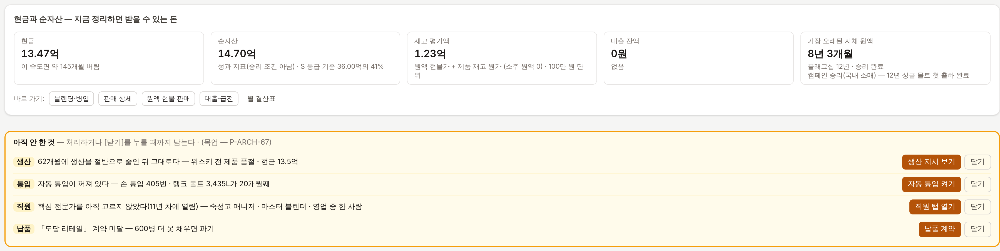

# `[제안 P-ARCH-67]` 홈 위 "아직 안 한 것" 칸 — 그림과 담을 항목 (구현 전 문서)

> 2026-11-20 · 설계 세션(ARCH) · PM 요청("홈 구성이 바뀌는 큰 변화라 구현 전에 그림 한 장과 담을 항목 목록") · **결정 재료 — 코드 없음.** 근거: [`docs/playtest/7/arch.md`](../playtest/7/arch.md) "오너 답" 절.

## 한 문단으로

7차 판 오너 답 여섯 개 중 네 개(생산을 줄이고 깜빡함 · 납품 경고 못 봄 · 자동 통입 못 찾음 · 핵심 전문가 못 봄)가 **"안내는 있었는데 눈에 닿지 않았다"**였다. 반대로 12년 병입은 **홈 위 숫자 칸**(오너 말로 "대시보드")을 보고 알았다. 기록상 판의 22%는 10초 안에 넘긴 턴이었고(121개월 뒤 16/35), 한 번 뜨고 사라지는 안내는 그런 턴에 걸리면 놓친다. 그래서 오너가 **읽는 자리(홈 위 숫자 칸 바로 아래)**에, **행동해야 끝나는 일회성 일만** 오너가 응답할 때까지 남겨 두는 칸을 둔다. 매달 바뀌는 신호(결품·통입 대기 개월 등)는 지금처럼 할 일 목록이 맡는다.

## 그림 (목업)

- 7차 완료 세이브(155개월)를 고정 빌드에서 불러와, 홈 위 "현금과 순자산" 카드 바로 아래에 칸을 **화면에 끼워 넣어 찍은 것**이다(게임 코드는 바꾸지 않았다). 네 줄은 **예시**다 — "납품" 줄은 7차 판 144개월 상황(파기 직전)을 빌려 왔다. 끝 세이브에는 계약이 없다.
- 줄마다 **행동 버튼 하나**(그 일을 하는 곳으로 가거나 바로 실행) + **[닫기]**. 칸 머리에 "처리하거나 [닫기]를 누를 때까지 남는다".
- 줄이 없으면 칸 자체가 보이지 않는다.

## 담을 항목 — "행동해야 끝나는 일회성 일"만

| # | 줄 | 뜨는 조건 | 사라지는 조건 | 버튼 | 근거(7차) | 계산 출처 |
|---|---|---|---|---|---|---|
| 1 | **생산** — 생산을 줄인 뒤 그대로다 | 생산을 줄인 적이 있고 · 위스키 재고가 바닥(품절 또는 1개월 치 미만) · 현금이 넉넉(예: 런웨이 24개월↑) — **PROD "생산 되돌리기" 식** | 생산 지시가 다시 늘거나 [닫기] | [생산 지시 보기] | 오너 답 1 "줄이고 깜빡" — 93개월 절반 생산 · 현금 13억 · 위스키 전 품절 | PROD(대기) |
| 2 | **통입** — 자동 통입이 꺼져 있다 | 자동 통입 꺼짐 · (최근 12개월 손 통입 ≥ 12번 **또는** 통입 대기 warn 이상) | 자동 통입을 켜거나 [닫기] | [자동 통입 켜기](바로 실행) | 오너 답 3 "어딨는지 못 찾았다" · 손 통입 405번 | ARCH(#720 `recentActionCount` · #712 대기 개월) |
| 3 | **직원** — 핵심 전문가를 아직 고르지 않았다 | `y11_specialist` 열림 · 아직 안 고름 | 고르거나 [닫기](= 안 고르기로 함) | [직원 탭 열기] | 오너 답 4 "못 봤다" · 해금 턴 0·0·10초 | MGT `specialistOffers` |
| 4 | **납품** — 계약 미달 | 대형 유통 계약에 누적 미납이 있음 | 미납이 풀리거나 계약이 끝나거나 [닫기] | [납품 계약] | 오너 답 2 "못 봤다" · 2건 파기 | MKT `retailBreakRemaining` |
| (후보) | **12년** — 적격 통이 생겼다 | 승리 전 · 적격 통 있음 | 승리하거나 [닫기] | [블렌딩·병입] | 7차는 홈 숫자 칸으로 봤다 — **넣지 않아도 됨**(이미 홈 칸·할 일·소식·자동 멈춤 #333) | ARCH `flagshipReady` |

**넣지 않는 것:** 결품·품절 · 통입 대기 개월 · 핸드필 빈 개월 · 샘플 시기 · 예보·이벤트 — 매달 바뀌는 신호라 할 일 목록 몫이다. 넣으면 칸이 할 일 목록의 복사본이 되어 다시 안 읽힌다.

## [닫기]를 어디에 남기나

| 안 | 내용 | 좋은 점 | 나쁜 점 |
|---|---|---|---|
| **(가) 세이브에 남김 — 권장** | `GameState`에 선택 필드 하나(닫은 줄 id 목록, 버전 그대로 #187) — 행동 `dismissNotice` | 다른 기기·불러오기에서도 같음 · 기록 파일로 "무엇을 닫았나"를 분석할 수 있음 | 코어 필드 하나 + 행동 하나(ARCH) — 시뮬레이션은 읽지 않으니 출력 불변 |
| (나) 브라우저 저장소 | localStorage | 코어 변경 0 | 기록 파일에 안 남아 분석 불가 · 브라우저를 바꾸면 다시 뜸 |

- 닫은 줄은 **같은 조건이 새로 생기면 다시 뜬다**(예: 납품 계약이 바뀌면 그 계약 id로 새 줄) — 줄 id에 대상 id를 붙인다(`retail:<계약 id>`).

## 할 일 목록·소식 창과의 관계

- **할 일 목록**은 그대로 둔다(매달 다시 계산하는 "이번 달 신호"). 같은 일이 두 곳에 보일 수 있다(예: 통입) — 칸은 "아직 안 함"을, 할 일은 "이번 달 상태"를 말한다.
- **소식 창**의 새 기능 줄은 #732가 맨 위 강조 + [탭 열기]로 바꿨다 — 칸은 그 뒤에도 남는 자리다.
- **결과 카드**(승리 뒤 맨 위)와 칸이 같이 뜨면 결과 카드가 위다.

## 크기 · 리스크

- **크기 `[추정]`:** 화면 반나절(ARCH `MvpHome` 칸 + 항목 계산은 `alerts.ts`에 함수 하나) + (가)면 코어 필드·행동 반나절 + 테스트(6·7차 세이브로 줄 수 확인). 항목 1(생산)은 PROD 식이 들어온 뒤.
- **반론 1 — 안내 자리가 넷이 된다**(할 일 · 소식 창 · 결과 카드 · 이 칸): 그래서 항목을 **4개 종류로 못 박고**, 매달 신호는 넣지 않는다. 대안: 할 일 목록 맨 위에 "고정" 구역을 두는 것 — 새 자리는 없지만, 오너가 할 일보다 홈 숫자 칸을 읽는다는 답(5)과 맞지 않는다.
- **반론 2 — 넘기는 턴에는 이 칸도 안 볼 수 있다:** 칸은 사라지지 않으니 언젠가 보는 날에 남아 있다는 것이 할 일·소식 창과의 차이다. 그래도 못 보면 그 다음 수단은 자동 진행 멈춤(#333 같은)인데, 이 네 가지는 "판에 한 번" 일이 아니라 멈춤은 권하지 않는다.
- **측정:** 8차 판 기록(행동 종류 #681)에서 `dismissNotice`·각 버튼의 행동이 몇 턴 만에 나왔는지로 효과를 본다.

## 오너께 고를 것 (PM 경유)

1. 칸을 둘지 — (A) 둔다(그림대로) / (B) 할 일 목록 맨 위 "고정" 구역으로 / (C) 두지 않는다
2. 담을 항목 — 표의 1~4(권장) · 12년 줄을 더할지
3. [닫기]를 세이브에 남길지 — (가) 권장 / (나)
