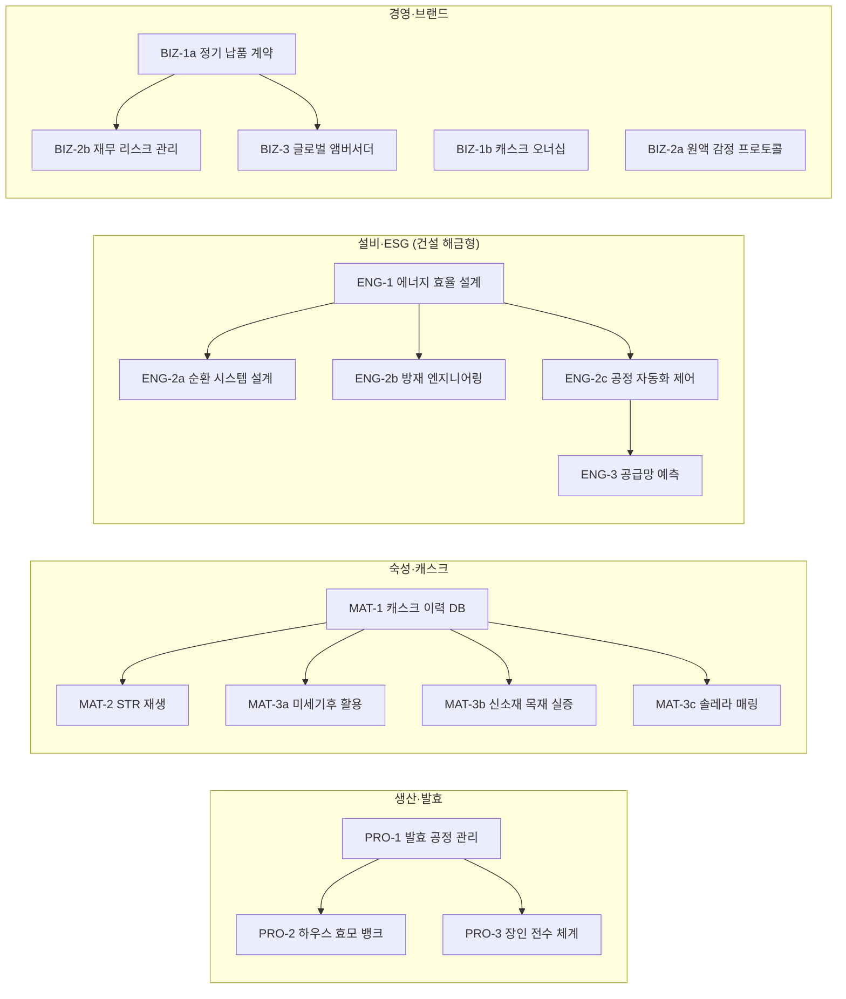
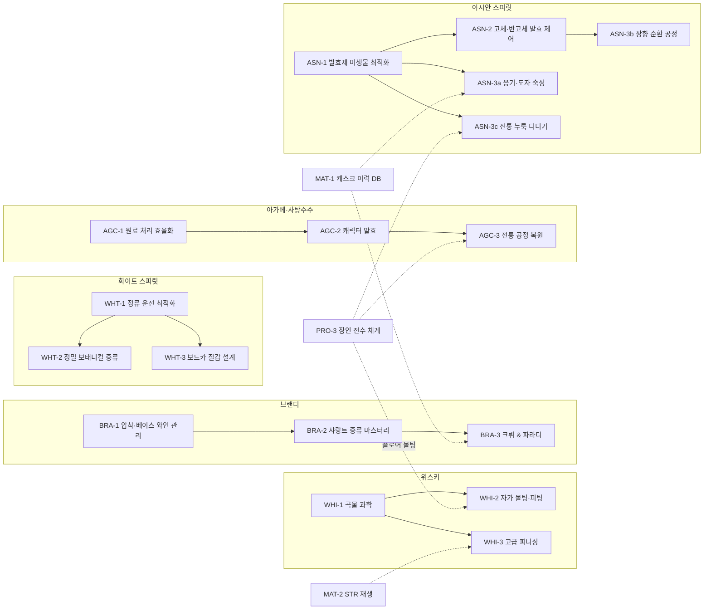

# 테크트리 설계 v0.1

> 상위 문서: [PRD](../PRD.md) · 관련: [향미 모델](flavor-model.md) · 상태: 설계 초안 (오너 원안 → 검토·재구성)
> 표기 규칙은 PRD와 같다 — `[결정]` `[제안]` `[튜닝]` `[확인 필요]`. 이 문서의 수치는 모두 `[튜닝]`이다.

---

## 0. 원안 검토 요약

오너 원안(공통 4계통 + 주종 브랜치 5개, 각 3티어)의 **뼈대는 유지**한다. 다만 원안 노드 상당수가 PRD의 핵심 원칙과 충돌하거나 이미 있는 시스템과 겹쳐서 재구성했다.

### 0.1 유지한 것

- 공통 4계통(생산·숙성·설비·경영) + 주종 브랜치 구조
- **건설 해금형**(설계도 해금 → 별도 자금으로 건설) — 테크와 설비의 역할 분담(§1 P6)에 정확히 맞는다
- 아시안 브랜치의 **"티어별 공통 개념 + 주종별 효과"** 구조 — 가장 잘 짜인 부분이라 다른 브랜치(아가베·사탕수수)에도 그대로 적용
- 정보형 노드(캐스크 이력 DB의 감지 확률 +15%) — PRD 원칙에 이미 맞는다

### 0.2 고친 것 — 6가지 문제

| # | 문제 | 원안 예 | 충돌하는 PRD 원칙 | 처리 |
|---|---|---|---|---|
| 1 | **결과 확률을 직접 올림** | 금메달 수상 확률↑, VIP 납품 확률 극대화 | 결정 #18 "확률은 결과가 아니라 정보에" (§6.1) | 공정 → 향미 → 평가 인과로만 결과가 바뀌게 |
| 2 | **면역·100%·MAX** | IB 판별 100%, 악플 면역, 피해 무효화, 산패 완전 제거, 헤리티지 MAX | 핵심 재미 ③ 정보 불확실성(§5.6), ④ 리스크 헷징(§8.4) — 이 둘을 삭제해 버림 | 크기 감소·조기 경보·대응 선택지 추가로 |
| 3 | **PRD에 없는 지표** | 럭셔리 지수, 헤리티지 점수, 프리미엄 지수, 팬덤, Hype | §7.5 "모든 스탯은 최소 1개 공식에 쓰여야 한다" | 기존 평판 6종(§11)·세그먼트(§9.2)·라벨 속성(§6.3)으로 매핑 (§6) |
| 4 | **기존 시스템과 중복** | 연속식 증류탑, 샤랑트 알람빅, 타호나, 던더, 증기 바스켓, 피니싱, 옹기 숙성, 미세기후 존 | PRD에 이미 설비·레시피 변수로 존재 (§4.1, §4.3, §5.2, §5.5) | 테크 = '숙련·확장'으로 재정의, 일부 기본 기능은 테크 뒤로 이동 제안 (§1.2) |
| 5 | **가격 직접 인상** | 단가 +30% / +50% / +200% | 가격은 플레이어가 정함. 수요 공식(§9.2)의 매력도·기준가를 우회 | 라벨 속성 → 세그먼트별 매력도·기준가 배수 (§6) |
| 6 | **사실관계 오류** | 아래 표 | 리얼리즘 원칙(§1) | 수정 |

**사실관계 수정**

| 원안 | 문제 | 수정 |
|---|---|---|
| 럼 1티어 "효소 당화 — 끓이거나 찌는 시간 단축" | 당밀·사탕수수즙은 이미 발효 가능한 당이라 **당화·증자가 필요 없다**. 효소 가수분해가 의미 있는 건 아가베(이눌린) 쪽 | 럼은 '발효 운전 최적화'로 교체 |
| 진 2티어 "콜드 컴파운딩 → 크래프트 진, 단가 +50%" | 콜드 컴파운딩은 증류 없이 에센스·추출물을 섞는 **저가 방식**이다. EU 기준으로 '진'은 되지만 '디스틸드 진'·'런던 진'은 표기할 수 없다 | 콜드 컴파운딩은 기본 제공 저가 옵션으로, 2티어는 분리 증류·감압 증류로 |
| 백주 2티어 "고체 발효 기법 해금" | 고체 발효는 백주의 **정의 자체**(PRD §3.3 "고량 + 곡 고체 발효")라서 잠글 수 없다 | 고체 발효는 기본, 2티어는 교지(窖池) 양생으로 |
| 테킬라 3티어 "프리미엄 메즈칼/테킬라로 분류" | 메즈칼은 별도 원산지 표시(오악사카 등)라서 공정으로 얻을 수 없다 | 메즈칼 언급 삭제. 필요하면 지역 추가로 다룰 사안 |
| 브랜디 3티어 "그랑 샹파뉴 떼루아 모방" | 표기는 **그랑드 샹파뉴(Grande Champagne)**. 크뤼는 지리적 표시라 공정으로 '모방'할 수 없다 | 크뤼 포도 계약 재배 + 파라디(장기 보관)로 교체 |
| 아시안 1티어 "밑술(醪) 산패" | 醪는 **술덧**이다. 밑술은 주모(酒母) | 술덧(醪)으로 수정 |
| 보드카 3티어 "백금·다이아몬드 여과 → 품질 최상급 고정" | 이런 여과의 실제 향미 효과는 근거가 약하고 마케팅 요소로 보는 시각이 일반적이다 (통설, 원문 미확인). 또 '품질 고정'은 향미 모델의 purityMode 평가식을 우회한다 | 향미 효과 0인 **마케팅 라벨 옵션**으로. 품질은 질감 설계(순도 ↔ 바디)로 |

### 0.3 구조 문제

- **선형 1→2→3:** 고를 게 없다. → 티어 안에 노드 2~3개를 두고 계통 간 선행 관계를 넣었다. 긴장은 연구 슬롯과 현금(Death Valley)에서 나온다(§2).
- **연구 자원 미정의:** R&D 포인트가 어디서 나오는지 없음. → §2에서 정의.

### 0.4 원안 27개 노드 처리 대조표

| 원안 노드 | 처리 | 새 노드 |
|---|---|---|
| 생산 1 상업 효모·발효 제어 | 유지 + 레시피 선택지 추가 | PRO-1 |
| 생산 2 하우스 효모 배양실 | 유지·구체화 (야생 효모 분리 → 재현) | PRO-2 |
| 생산 3 전통 장인 공정 | 재구성: 공통 '장인 전수 체계' + 공정 자체는 각 주종 브랜치로 이동 (타호나가 생산 3티어와 테킬라 3티어에 중복돼 있었음) | PRO-3 → WHI-2, AGC-3, ASN-3c |
| 숙성 1 캐스크 이력 DB | 유지 | MAT-1 |
| 숙성 2 STR 재생 | 유지·구체화 (리차와 차별화, 버번 불가) | MAT-2 |
| 숙성 3 미세기후 맵핑 | 재정의: 공개는 설비(PRD §5.5), 테크는 활용(로테이션·재고 감사) | MAT-3a |
| 설비 1 에너지 효율 | 유지 | ENG-1 |
| 설비 2 친환경 순환 | 수정: "리스크 0%" → 가동 중 조건부 면제 + 고장 리스크 | ENG-2a |
| 설비 3 AI 공급망 예측 | 수정: "피해 무효화" → 선행 예측 정보 | ENG-3 |
| 경영 1 지역 바틀샵 네트워크 | 수정: 채널 개척은 영업 직원 몫 → 테크는 정기 납품 계약 '형태'를 해금 | BIZ-1a |
| 경영 2 IB 검증반 | 수정: "판별 100%" → 감지↑ + 보증 조건부 매입 | BIZ-2a |
| 경영 3 글로벌 앰버서더 | 수정: "면역·프리패스" → 피해 감소 + 진입 장벽 완화 | BIZ-3 |
| 위스키 1 매시빌 최적화 | 유지 + 헤리티지 보리 | WHI-1 |
| 위스키 2 전통 피팅 | 수정: 자가 몰팅·피팅 (ppm 연속 조절) | WHI-2 |
| 위스키 3 장인급 우드 피니시 | 수정: PRD 기본 피니싱의 확장판 | WHI-3 |
| 화이트 1 연속식 정제 | 수정: "속도 2배"(설비 몫) → 회수율·편차·Grain-to-Glass | WHT-1 |
| 화이트 2 콜드 컴파운딩·베이퍼 | 사실 수정 → 분리 증류·감압 증류 | WHT-2 |
| 화이트 3 울트라 프리미엄 여과 | 수정 → 보드카 질감 설계 | WHT-3 |
| 브랜디 1 과실 착즙 | 유지 + AOC 압착 제약 | BRA-1 |
| 브랜디 2 샤랑트 증류기 | 구체화 (앙금 증류, 세콩드 재투입) | BRA-2 |
| 브랜디 3 그랑드 샹파뉴 모방 | 대체 → 크뤼 계약 + 파라디 | BRA-3 |
| 아가베·당밀 1 효소 당화 | 사실 수정 (테킬라만 해당) | AGC-1 |
| 아가베·당밀 2 오픈 배트·던더 | 유지·보강 (테킬라 섬유질 발효 추가) | AGC-2 |
| 아가베·당밀 3 타호나 | 수정 (메즈칼 삭제, 가격 → 라벨) + 럼 레토르트 증류 추가 | AGC-3 |
| 아시안 1 발효제 미생물 | 유지 ("완전 제거" → 대폭 감소) | ASN-1 |
| 아시안 2 고체/반고체 발효 | 소주 유지, 백주는 교지 양생으로 교체 | ASN-2 |
| 아시안 3 옹기 숙성 | 유지·구체화 + 백주 장향 순환 공정·소주 전통 누룩 추가 | ASN-3a·b·c |

**신규 노드:** MAT-3b 신소재 목재 실증(PRD §5.1의 "미검증 신소재 연구"를 담당), MAT-3c 솔레라 매링, ENG-2b 방재 엔지니어링, ENG-2c 공정 자동화, BIZ-1b 캐스크 오너십, BIZ-2b 재무 리스크 관리.

---

## 1. 설계 원칙

| # | 원칙 | 내용 |
|---|---|---|
| P1 | **숫자보다 동사** | 모든 노드는 '새로 할 수 있는 것'을 최소 1개 해금한다(레시피 선택지, 건설권, 정보 도구, 라벨 자격, 계약·채널, 이벤트 선택지). 순수 % 보정만 있는 노드는 만들지 않는다 |
| P2 | **확률은 정보에** | 테크는 관측 오차 σ, 감지 확률, 예측 기간을 바꿀 수 있다. 메달·납품·발견 같은 결과 확률은 직접 올리지 않는다 |
| P3 | **면역 금지** | 리스크는 크기 감소, 조기 경보, 대응 선택지 추가로 다룬다. 0%는 조건부(예: 시설 가동 중)일 때만 허용 |
| P4 | **트레이드오프 내장** | 전통 공정 = 향미·라벨↑, 속도·비용↓ / 효율 공정 = 반대. 트레이드오프는 회사 단위가 아니라 **제품(레시피·라벨) 단위**로 건다 — 한 회사가 디퓨저 테킬라와 타호나 테킬라를 함께 만드는 것은 현실에서도 가능하다 |
| P5 | **새 지표 금지** | 효과는 PRD에 있는 변수에만 연결한다: 향미 축(flavor-model §3), 평판 6종(§11), 세그먼트(§9.2), 라벨 속성(§6.3), 비용·수율·용량·리드타임 |
| P6 | **역할 분담** | 아래 표 |
| P7 | **점진적 공개** | 테크트리는 PRD의 복잡한 시스템을 순서대로 여는 튜토리얼 역할도 한다. 고급 금융 상품·로테이션·더블 피니싱 같은 UI는 해금 전까지 숨긴다 |

### 1.1 역할 분담 (P6)

| 시스템 | 질문 | 예 |
|---|---|---|
| 설비 | 무엇을 **가졌나** (돈으로 산다) | 증류기, 숙성고, 실험실, 온습도 모니터링 |
| 직원 | 얼마나 **잘하나** (스탯) | 컷 정확도, 누수 감지, 감정력 |
| 레시피 | 무엇을 **고르나** | 매시빌, 컷, 효모, 캐스크 |
| **테크** | 무엇을 **아나** (노하우) | 선택지 해금, 편차·손실 감소, 정보 도구, 라벨 자격, 계약 형태 |

**구현 원칙:** 테크는 '게이트'만 가진다. 해금된 공정의 향미 효과는 공정 효과 데이터(flavor-model §4)에 둔다. 그래야 향미 수치의 출처가 한 곳으로 유지된다.

### 1.2 PRD 기본 기능 중 테크 뒤로 옮기자는 제안 `[제안 — 승인 필요]`

PRD 본문은 수정하지 않았다. 승인되면 해당 절에 반영한다.

| PRD 기능 | 현재 PRD | 제안 | 이유 |
|---|---|---|---|
| 피니싱 (§5.2) | 전부 기본 | 기본 = 1회 피니싱, 버번·셰리 시즈닝. 이국 시즈닝·더블/트리플 → WHI-3 | 초반 선택지 과부하 방지(P7), 후반 목표 제공 |
| 타호나 (§4.1 테킬라 추출) | 기본 선택지 | 기본 = 롤러 밀. 타호나 → AGC-3 | 전통 공정은 장인 전수 체계와 묶음 |
| 던더 (§4.1 럼) | 기본 변수 | 기본 = 사용 가능하나 `acetic` 위험·편차 큼. 안정화·하이 에스터 → AGC-2 | 기능은 열어 두고 숙련만 테크로 |
| 캐스크 오너십 선도판매 (§8.2) | 1년차~ | BIZ-1b 해금 후 | 운영 체계(계약·이력 관리)가 필요한 상품 |
| 고급 헷징 (§8.4 선물환·금리 스왑·신용보험·팩토링) | 기본 | BIZ-2b 해금 후. 보험·고정금리 대출·선도계약은 기본 유지 | P7 대표 사례 |
| 숙성고 로테이션 | 언급 없음 | MAT-3a | 신규 |

---

## 2. 연구 시스템

### 2.1 연구 프로젝트 = 기간 + 월 연구비 + 담당자 `[제안]`

별도 'R&D 포인트' 화폐를 만들지 않는다. 연구비는 **현금**에서 나간다 → Death Valley 동안 연구는 생존 자금과 경쟁하는 선택이 된다 (핵심 재미 ①과 직결).

```
월 진행도 = (1 / 기본기간) × (1 + 담당자 관련 스탯 / 200) × 실적 보너스
실적 보너스 = 1 + min(0.3, 관련 누적 실적 / 기준 실적 × 0.3)     # 해 보면서 배운다 — 최대 +30%
```

| 항목 | 규칙 `[튜닝]` |
|---|---|
| 담당자 | 노드마다 담당 직군이 정해져 있다(예: 발효 = 마스터 디스틸러, 숙성 = 숙성고 매니저, 경영 = 백오피스·영업). 연구 중 본업 효율 −30% |
| 동시 연구 슬롯 | 기본 1. 실험실(PRD §4.3) +1, 상위 실험실 +1 |
| 중단·재개 | 언제든 가능. 진행도 보존, 연구비 정지 → 현금 위기 때 조절 수단 |
| 담당자 이탈 | 진행도 −25% |
| 실적 예 | 진 누적 배치 수, 캐스크 누적 통입 수, 매입 원액 감정 건수 |
| 비용 규모 (신생 크래프트 월 고정비 기준) | T1 ≈ 1~2개월분 / T2 ≈ 3~5개월분 / T3 ≈ 8~12개월분 |
| 기간 | T1 2~3개월 / T2 4~6개월 / T3 8~12개월 |
| 페이싱 목표 | Death Valley(36턴) 동안 T1 2~3개 + T2 1개 정도 |

> **티어 = 비용·기간 등급**이다. 선행 관계(깊이)와 꼭 일치하지는 않는다(예: MAT-3b는 MAT-1만 요구하지만 수년이 걸리는 T3).

### 2.2 테크를 '사는' 방법 — 외부 획득

| 경로 | 효과 | 비용·리스크 |
|---|---|---|
| 컨설턴트 계약 | 기간 ×0.5, 담당자 불필요 | 비용 ×2 |
| 경력직 채용 | 해당 테크 경험 특성(Trait)을 가진 직원 → 연구 기간 ×0.5, T1은 즉시 해금 | 연봉↑, '철새' 특성 확률↑ (§7.2) |
| 증류소 인수 (PRD §3.4) | 피인수 사이트의 테크를 회사 지식으로 승계 | 인수 비용 |
| 이벤트 | 장인 은퇴·기술 전수 제안, 대학 공동연구 공모, 보조금 연계 R&D | 조건부 |

### 2.3 지식의 범위

- 테크는 **회사 단위 지식**이다 → 다지역 사이트(§3.4)가 공유한다.
- 단, 건설권형 테크의 시설은 사이트마다 따로 건설한다.
- 주종 브랜치는 그 주종을 생산할 수 있는 사이트를 1곳 이상 보유해야 연구할 수 있다 (지역 게이팅, PRD §3.2). 보유 전에는 UI에서 숨긴다 (P7).

### 2.4 시나리오 초기화 (PRD §12.2)

시나리오 JSON에 `research.unlocked`를 포함한다. 예: **아버지의 증류소** = 전통 노드(PRO-3, WHI-2 플로어 몰팅 등) 보유, 효율·정보 노드(ENG, MAT-1, BIZ-2b) 미보유 → "레거시 노하우 + 낡은 시스템"이라는 서사가 테크 상태로 표현된다.

---

## 3. 트리 개요

### 3.1 공통 계통



### 3.2 주종 브랜치 (점선 = 다른 계통의 선행 조건)



**노드 수:** 공통 18 + 주종 17 = 35. 전부 한 번에 만들지 않는다 → §8 단계별 도입.

---

## 4. 공통 계통

표기: **해금 유형** — `레시피` 레시피 선택지 · `건설` 건설권 · `정보` 정보 도구 · `라벨` 라벨 자격 · `계약` 계약·채널·금융 · `이벤트` 이벤트 대응 선택지 · `손실` 손실 감소

> **수율 보너스는 '손실 감소'로 표현한다.** `실제 수율 = 이론 수율 × (1 − 기본손실 × Π(1 − 감소율ᵢ))` → 여러 테크가 쌓여도 이론 수율을 넘지 않는다. 원안의 "+5%·+10%·+15%"를 곱연산으로 쌓으면 생기는 인플레이션을 막는다.

### 4.1 생산·발효 (PRO) — 수율·일관성 → 하우스 스타일

| 노드 | 선행·요건 | 해금 | 효과 | 트레이드오프·연결 |
|---|---|---|---|---|
| **PRO-1 발효 공정 관리** (T1) | — | `레시피` 단계별 발효 온도 프로파일 · `정보` 발효 로그 | `손실` 발효 손실 감소(원안 수율 +5% 상당), 배치 간 편차 −30%, `acetic` 위험 −30% | flavor-model §4.2 |
| **PRO-2 하우스 효모 뱅크** (T2) | PRO-1, 실험실 | `레시피` **균주 분리·보존** — 야생 효모 배치 중 결과가 좋았던 배치의 균주를 분리해 자사 균주로 등록 · `라벨` "자사 효모" | 자사 균주 = 고유 에스테르 벡터(`fresh_fruit`·`tropical`·`floral` 조합, 시드 기반) + 편차는 상업 효모 수준 | **운(야생 효모의 숨김 편차)을 자산(재현 가능한 하우스 스타일)으로 바꾸는 장치.** 균주 오염·변이 이벤트 → 외부 백업 보관 계약으로 헷징. 원안 "럭셔리 지수 +10" → 라벨 속성(§6) |
| **PRO-3 장인 전수 체계** (T3) | PRO-1, 가동 36개월↑ | 주종 브랜치의 **전통 공정 노드 연구 자격** (WHI-2 플로어 몰팅, AGC-3, ASN-3c) · `이벤트` 장인 은퇴 시 전수 선택지 · 비지터 센터 '전통 공정 견학' 코스 | 수작업 공정의 숙련 곡선(도입 직후 편차↑ → 반복할수록 안정), 지역사회 평판↑ | 원안의 "인건비 폭증"은 개별 전통 공정에 붙인다. 원안 "헤리티지 점수 MAX" → 매니아 신뢰·지역사회 평판·비지터 매력도로 분해 |

### 4.2 숙성·캐스크 (MAT) — 원가와 시간 가치 통제

| 노드 | 선행·요건 | 해금 | 효과 | 트레이드오프·연결 |
|---|---|---|---|---|
| **MAT-1 캐스크 이력 DB** (T1) | — | `정보` 캐스크 이력 자동 기록(필 횟수·시즈닝·리차·샘플링) · 캐스크 순환 위임(§7.6) | 누수·오염 **감지** 확률 +15%p (원안 유지 — 정보형), 샘플링 후 예측 신뢰구간이 넓어지는 속도 −30% (flavor-model §7) | 다수 노드의 선행 조건 |
| **MAT-2 STR 재생** (T2) | MAT-1, 쿠퍼리지(외주 가능) | `레시피` STR 처리 — 내벽 깎기(Shave) → 토스트(Toast) → 재탄화(Re-char) | activity → 0.85 (리차는 0.7, PRD §5.1), 토스트 프로필 재설정(`vanilla_caramel`·`wood_spice`), 비용 = 새 캐스크의 30~40% | 벽이 얇아져 누수 위험↑, 캐스크당 1회 한정, 시즈닝 향 완전 소실. **새 오크가 아니므로 버번 숙성 불가**(PRD §3.3 → 레시피 법규 검증에 표시) |
| **MAT-3a 미세기후 활용** (T3) | MAT-1, 온습도 모니터링 설비 | `레시피` 캐스크 로테이션 지시(층·구역 간 이동) · `정보` **재고 감사** — 전 캐스크 간이 스크리닝으로 극단값(레어·이상) 후보 표시 · `건설` 숙성고 신축 시 층고·환기·단열 설계 → 슬롯 미세기후 분포 설계 | 숙성 속도·도수 변화를 의도적으로 제어 (상층 = 가속·도수↑, 하층 = 완만·도수↓, PRD §5.3) | 이동비·이동 손실, 숙성고 매니저 업무량↑. **분담:** 슬롯 값 공개는 설비(PRD §5.5), 활용은 테크. 원안 "레어 캐스크 발견 확률" → 레어 캐스크는 이미 숨김값으로 존재하고, 테크는 그것을 **알아보는** 확률을 올린다(P2) |
| **MAT-3b 신소재 목재 실증** (T3) | MAT-1, 실험실 | `정보` **실험 캐스크 프로그램** — 소형 캐스크로 시험 숙성 → 경과 개월 수에 따라 해당 목재의 숨김 특성(추출 벡터·누수율·`incense` 발현)이 단계적으로 공개 · `라벨` "○○ 오크" | 미즈나라·한국 참나무 등 신소재 사용 시 예측 정확도↑, 지역 시그니처 | PRD §5.1 "신갈나무 = 미검증 신소재 → 연구로 특성 공개"를 이 노드가 담당. **연구 기간 = 실제 숙성 시간**(수년)이라 다른 노드와 진행 방식이 다름. 실험 원액 소모 |
| **MAT-3c 솔레라 매링** (T3) | MAT-1, 매링 뱃 | `레시피` 솔레라(퍼페추얼) 뱃 — 뱃을 일부만 비우고 보충 | 배치 간 일관성↑↑ → 코어 레인지 유지(§6.1 일관성 점수)가 쉬워짐 | 라벨 연수 = 투입 원액 중 최저 연수(§6.2) → 고연산 표기가 어려움, 뱃 용량만큼 원액·자본 고정. 위스키·럼·브랜디 공통 |

### 4.3 설비·ESG (ENG) — 건설 해금형 (원안 구조 유지)

| 노드 | 선행·요건 | 해금 | 효과 | 트레이드오프·연결 |
|---|---|---|---|---|
| **ENG-1 에너지 효율 설계** (T1) | — | `건설` 열교환기, 고효율 보일러(증기 재압축 포함) | 완공 시 에너지비 −15% (원안) | 건설비·리드타임 별도 |
| **ENG-2a 순환 시스템 설계** (T2) | ENG-1 | `건설` 바이오가스(혐기성 소화) 설비, 폐액 정화 시설 | **가동 중** 폐액 규제 이벤트 면제(P3 조건부), 에너지비 추가 절감, ESG↑, 부산물 매출, 보조금 심사 가산(PRD §2.4) | 원안 "리스크 0%" → 고장·정비 중에는 노출됨. 정비 직원 필요 |
| **ENG-2b 방재 엔지니어링** (T2) | ENG-1 | `건설` 상위 방재 설비(감지·자동 소화·방화 구획 숙성고) | 화재 피해 규모↓, 재산·재고 보험료↓ (PRD §8.4) | 숙성고는 에탄올 증기 때문에 화재가 큰 리스크 — 방재 단계(§8.4)를 테크로 연다 |
| **ENG-2c 공정 자동화 제어** (T2) | ENG-1 | `건설` 자동화 제어 시스템 | 증류 오퍼레이터 실수율↓, 필요 인원↓, **상시 지시(§7.6) 품질 하한↑** | 월 단위 턴을 지루하지 않게 하는 위임 시스템(PRD §2.1)을 강화. 고장 시 생산 중단, 정비 직원 필요 |
| **ENG-3 공급망 예측** (T3) | ENG-2c | `정보` R&D만으로 즉시 적용(원안 유지) — 원자재 가격 지수 3~6개월 선행 예측(신뢰구간 표시), 매크로 이벤트 조기 경보(N개월 전 징후) | 예측 정확도 = 백오피스 스탯 | 원안 "피해 무효화" → **정보만 준다.** 대응은 플레이어가 선도계약·비축(§8.4)으로 한다 — 헷징 게임플레이 보존 |

### 4.4 경영·브랜드 (BIZ) — 마진·네트워크·재무 안정

| 노드 | 선행·요건 | 해금 | 효과 | 트레이드오프·연결 |
|---|---|---|---|---|
| **BIZ-1a 정기 납품 계약** (T1) | — | `계약` 리쿼샵·바틀샵·바와 6~12개월 고정 물량·고정가 계약 | Death Valley 현금흐름 안정 | 고정가 → 트렌드 상승 시 기회손실, 미납 시 위약금. 채널 개척 자체는 영업 직원(§8.5), 테크는 계약 '형태'를 연다 |
| **BIZ-1b 캐스크 오너십 프로그램** (T1) | — | `계약` 캐스크 선도판매(PRD §8.2) | 즉시 현금 | 미래 프리미엄 재고 상실, 과다 판매 시 매니아 신뢰↓. MAT-1 보유 시 오너 만족도↑ |
| **BIZ-2a 원액 감정 프로토콜** (T2) | 실험실 | `정보` 매입 원액 위조·오표기 감지 확률 +25%p (마스터 블렌더 감정력과 합산, **상한 95%**) · `정보` 브로커 신용 이력 공개 · `계약` **보증 조건부 매입**(감정 불일치 시 환불, 대신 호가 +5~10%) | 원액 매입 루프(§8.3)의 리스크 관리 | 원안 "판별 100%"는 정보 불확실성(핵심 재미 ③)을 없앰 → 감지↑ + 헷징 수단으로 대체 |
| **BIZ-2b 재무 리스크 관리** (T2) | BIZ-1a | `계약` 선물환, 금리 스왑, 매출채권 신용보험, 팩토링 | 환율·금리·거래처 부도 헷징(PRD §8.4) | 기본(보험·고정금리 대출·원자재 선도계약)은 처음부터. P7의 대표 사례 |
| **BIZ-3 글로벌 앰버서더 프로그램** (T3) | BIZ-1a, 마케팅 직원 | `계약` 면세·하이엔드 채널 입점 협상 · `이벤트` 인플루언서 역풍 시 '앰버서더 대응' 선택지 | 역풍 이벤트 피해 −50%, 면세·VIP 채널 진입 평판 요건 완화, 수출 시장 대중 인지도↑ | 월 운영비. 원안 "악플 면역·프리패스" → 감소·완화(P3) |

---

## 5. 주종 브랜치

공통 패턴: **티어 = 대체로 공정의 상류 → 하류** (T1 원료·전처리 → T2 발효·증류 → T3 숙성·마무리·전통). 같은 티어 안에서 주종별 효과가 갈린다 (원안 아시안 브랜치 구조를 전 브랜치로 확장).

### 5.1 위스키 (WHI) — 스코틀랜드·켄터키·한국

| 노드 | 선행·요건 | 해금 | 효과 | 트레이드오프·연결 |
|---|---|---|---|---|
| **WHI-1 곡물 과학** (T1) | — | `레시피` **헤리티지 보리 품종** · `라벨` "헤리티지 보리" | `손실` 곡물 전환 손실 감소(원안 그레인·버번 수율 +10% 상당) | 헤리티지 보리 = 수율 −15%, `cereal` 복합미↑ → 트레이드오프 내장의 예 |
| **WHI-2 자가 몰팅·피팅** (T2) | WHI-1, 몰팅 플로어/킬른 | `레시피` **ppm 연속 조절**(기본 = 매입 몰트의 고정 ppm 등급 중 선택), 초고 ppm(100+) 영역, 피트 산지 선택 · PRO-3 보유 시 `레시피`·`라벨` **플로어 몰팅** | 자사 피팅 원가↓, 피트 스타일 정밀도↑ | 원안 "팬덤 2배" → 매니아 세그먼트의 피트 선호와 일치하면 수요가 자연히 오름 + 피트 붐 트렌드(§9.3)에서 차별화. 피트 산지(해안/내륙)의 향미 차이는 `peat_smoke` 단일 축으로 표현 불가 → 축 분할 검토(§9 미결). '이탄수'는 향미 기여가 미미하다는 게 업계 통설이라 마케팅 텍스트로만 |
| **WHI-3 고급 피니싱** (T3) | WHI-1, MAT-2 | `계약` 이국 시즈닝 캐스크 조달(테킬라·럼·사케·IPA·아이스와인 등) · `레시피` 더블/트리플 캐스크, 자사 리시즈닝 · `정보` 피니싱 진행 예측(월별 시즈닝 전이 곡선) | 피니싱 스타일 확장 | PRD §5.2 기본 피니싱을 축소하자는 제안(§1.2)과 짝. 원안 "가격 +30%" → 라벨 속성 "○○ 캐스크 피니시"(§6) |

### 5.2 화이트 스피릿 (WHT) — 진·보드카·주정, 현금 창출원

| 노드 | 선행·요건 | 해금 | 효과 | 트레이드오프·연결 |
|---|---|---|---|---|
| **WHT-1 정류 운전 최적화** (T1) | — | `라벨` **Grain-to-Glass**(자가 베이스 스피릿 100%일 때) · 주정(95%↑) 등급 안정 | `손실` 헤드·테일 재정류 회수 손실 감소, 원료별 편차 −50%(원안 유지), 컬럼 처리량 +15% | 원안 "속도 2배"는 설비 증설의 영역(P6). 베이스 스피릿 매입(PRD §4.1)은 계속 가능 — 싸지만 라벨 없음 |
| **WHT-2 정밀 보태니컬 증류** (T2) | WHT-1 | `레시피` **분리 증류**(보태니컬별 개별 증류 후 블렌딩 → 보태니컬마다 컷 따로 조정) · `건설` 감압 진 스틸(저온 증류로 섬세한 시트러스·플로럴 보존) · `레시피`·`라벨` 지역 보태니컬 자사 재배 | 컨템포러리·지역 시그니처 스타일 도달 정밀도↑ | 증기 바스켓은 PRD 기본(§4.5). **콜드 컴파운딩은 기본 제공 저가 옵션**으로 둔다 — 원가↓·속도↑, 대신 '디스틸드 진'·'런던 드라이' 표기 불가 → Death Valley 현금용 `[제안]`. 원안 "단가 +50%" → 라벨 속성(§6) |
| **WHT-3 보드카 질감 설계** (T3) | WHT-1 | `레시피` 여과 매체(활성탄 / 자작나무 숯 / 기타) × 여과 강도 · 원료별 질감 프로파일 정밀화(감자 = 바디↑, 밀 = 부드러움, 호밀 = 스파이시) · `라벨` 프리미엄 여과 표기(마케팅 옵션) | purityMode 평가(이취 0 + 자극↓ + 질감)에서 **순도 ↔ 바디** 트레이드오프를 조절 — 과여과는 이취·자극을 지우지만 바디도 깎는다 | 원안 "품질 최상급 고정" 삭제. "백금·다이아몬드 여과"는 향미 효과 0, 비용↑, 선물 세그먼트↑·매니아↓ 라벨로. "VIP 납품 확률"은 하이엔드 채널 품질 요건 충족으로 자연 발생 |

### 5.3 브랜디 (BRA) — 코냑·가스코뉴·노르망디 (+ 범용 브랜디)

| 노드 | 선행·요건 | 해금 | 효과 | 트레이드오프·연결 |
|---|---|---|---|---|
| **BRA-1 압착·베이스 와인 관리** (T1) | — | `레시피` 와인 보존 관리 — 증류 대기 중 베이스 와인 열화 속도↓ | `손실` 착즙 손실 감소(원안 수율 +15% 상당), 3/31 증류 마감(PRD §2.3)까지 스케줄 유연성 | **고수율 연속식 스크류 압착은 코냑 AOC에서 금지**(복수 자료 일치, 원문 `[확인 필요]`) → 사용 시 '포도 브랜디'로 강등(§4.5 법규 검증). 코냑 베이스 와인은 SO₂를 넣지 않아 빨리 상한다고 알려짐 `[확인 필요]` → 이 노드의 명분 |
| **BRA-2 샤랑트 증류 마스터리** (T2) | BRA-1, 샤랑트 알람빅(PRD §4.3) | `레시피` **앙금(lie) 포함 증류** 여부 — 포함 = 견과·크리미한 바디(`oily_waxy`·`body`↑), 미포함 = 깨끗 · `레시피` **세콩드(2차 증류 후류) 재투입 대상** — 다음 와인 vs 브루이(1차 증류액) → 하우스 스타일 차이 | 2회 증류 간 에스테르 편차↓(원안 유지) | 실제로 하우스마다 앙금 사용 여부가 다르다. 칼바도스(페이 도주 단식 2회)·아르마냑(알람빅 아르마냐케) 변형 포함 |
| **BRA-3 크뤼 & 파라디** (T3) | BRA-2, MAT-1 | `계약`·`라벨` **크뤼 포도 계약 재배**(PRD §8.4) → 크뤼 표기(그랑드 샹파뉴, 핀 샹파뉴 = 그랑드 50%↑ + 쁘띠뜨 샹파뉴) · `레시피` **파라디 보관** — 고연산 원액을 유리 데미존으로 옮겨 숙성을 멈춤(데미존 기간은 연수 미산입) · `정보` 고연산 블렌딩 시 `nutty_rancio` 인지 오차↓ | 레거시 재고 '보존', XO 블렌딩 정밀도 | 원안 "떼루아 모방 → 금메달 확률↑" 대체: 크뤼는 지리적 표시라 모방할 수 없고(리얼리즘), 메달은 향미 인과로만(P2). 시나리오 '아버지의 증류소'의 레거시 재고와 연결 |

### 5.4 아가베·사탕수수 (AGC) — 테킬라·럼

| 노드 | 선행·요건 | 테킬라 | 럼 |
|---|---|---|---|
| **AGC-1 원료 처리 효율화** (T1) | — | `건설` 디퓨저(+ 효소·산 가수분해), 오토클레이브 운전 최적화 → 쿠킹 시간↓, 턴당 생산 +20%(원안). **트레이드오프:** 디퓨저 = `cooked_agave ×0.6`, `herbal ×1.4`(flavor-model §4.1) + 매니아 신뢰↓ — 디퓨저 사용은 업계에 알려지므로 숨길 수 없다 | (원안 사실 오류 수정) `레시피` **고속 발효 운전** → 발효 기간 단축, 턴당 생산 +20%, 대신 에스테르·`funk`↓ (라이트 럼 노선). 아그리콜(사탕수수즙)은 착즙 즉시 발효해야 함 → 수확기에만 생산(PRD §2.3 캘린더에 추가) |
| **AGC-2 캐릭터 발효** (T2) | AGC-1 | `레시피` 자연 발효 + **섬유질 동반 발효** → `herbal`·`cooked_agave` 복합미↑, 수율↓, 편차↑ (PRO-2 하우스 효모와 시너지) | `레시피` 오픈 배트 + 던더 + **머크 피트** 운영 → `funk` 상한↑(하이 에스터), `acetic` 위험 관리 · `계약` **에스터 등급(마크) 원액**을 B2B 블렌더에 판매 |
| **AGC-3 전통 공정 복원** (T3) | AGC-2, PRO-3 (테킬라) | `레시피`·`라벨` 벽돌 오븐(오르노) 장시간 증자 + **타호나** 착즙 → `cooked_agave ×1.3`(flavor-model §4.1), 생산 속도 −60%. 원안 "가격 200%" → 프리미엄·매니아 세그먼트 기준가 배수 + 향미 품질(§6) | `건설` **레토르트 단식 증류기** — 1회 증류로 고도수 + 무거운 에스테르 보존 → 헤비 럼 스타일 품질 상한↑. 마크 블렌딩으로 일관성 확보 |

> 묶음 유지 여부: 테킬라와 럼은 공정이 거의 겹치지 않는다. "티어별 공통 개념(전처리 → 캐릭터 발효 → 전통·헤비 증류)"으로 묶을 수는 있지만, 분리하는 편이 데이터가 더 깔끔하다. → §9 미결.

### 5.5 아시안 스피릿 (ASN) — 소주·백주 (원안 구조 유지·구체화)

| 노드 | 선행·요건 | 공통 | 소주 | 백주 |
|---|---|---|---|---|
| **ASN-1 발효제 미생물 최적화** (T1) | — | 누룩·곡(曲) 미생물 비율 제어. `손실` 당화 손실 감소(원안 수율 +15% 상당). 술덧(醪) 산패 위험 −70% (원안 "완전 제거" → P3) | `레시피` 입국 균종 선택(개량누룩·입국) | `레시피` **제곡 온도** 선택 — 고온 대곡 = 장향 경향, (중고온 = 농향, 저온 = 청향 경향 `[확인 필요]`) |
| **ASN-2 고체·반고체 발효 제어** (T2) | ASN-1 | 증류 전 발효 방식 고도화 | `레시피` **이양주·삼양주 덧술**(원안 유지) → `floral`·`fresh_fruit`↑, 발효 기간↑. `라벨` "삼양주 원주" | (원안 수정 — 고체 발효는 기본) `레시피` **교지 양생** — 인공 노교니(窖泥) 배양으로 새 교지의 연식을 앞당기고, 교니 보수로 유지 → 농향 `tropical`(카프로산 에틸, 파인애플 계열) 상한↑. PRD §4.3 "진흙 교지 = 연식이 오래될수록 가치↑, 이전 불가 자산"과 연결 |
| **ASN-3a 옹기·도자 숙성** (T3) | ASN-1, MAT-1 | `레시피` 옹기 등급(소성 온도·유약 유무 → 통기성) 선택 · `라벨` "옹기 N년 숙성" | 장기 옹기 숙성 | 도자 독 장기 저장 |
| **ASN-3b 장향 순환 공정** (T3) | ASN-2 | — | — | `레시피` **장향식 1년 주기 공정** — 단오 무렵 고온 대곡 제조 → 중양절 무렵 첫 고량 투입(下沙) → 1년간 여러 차례 발효·증류, 회차(轮次)별 원액 성격이 다름 → 회차 블렌딩. 흔히 "12987"(1년 주기·2회 투료·9회 증자·8회 발효·7회 취주)로 요약됨 |
| **ASN-3c 전통 누룩 디디기** (T3) | ASN-1, PRO-3 | — | `레시피`·`라벨` 자가 누룩 제조(디디기·띄우기) → 매입 누룩과 다른 고유 미생물 프로필 (PRO-2와 같은 '분리·보존' 메커니즘 공유) | — |

**ASN-3a 보충 — 숙성 모델 확장 필요:** flavor-model §4.5는 목재 캐스크를 전제로 한다. 옹기는 `②추출 = 0`(오크 향 없음), `①제거`·`③반응` 유지(미세 기공 산화), 엔젤스 셰어 ×0.5(원안 수치, `[튜닝]`)로 정의해야 한다. 원안 "오리엔탈 럭셔리 특성 발동" → 신규 특성 대신 ① 평론가 NPC에 '옹기 숙성 선호' 성향 추가 ② 라벨 속성으로 처리. (명칭 참고: 'Oriental'은 영어권에서 낡은 표현으로 여겨지는 경우가 있어, 공개 배포 시 다른 이름을 권장)

**ASN-3b 보충 — 월 턴과 궁합이 가장 좋은 노드:** 1년짜리 장기 공정 + 계절 이벤트(단오·중양) + 회차별 원액 = 블렌딩 퍼즐. 기본 공정으로는 `fermented_umami` 상한을 낮게 두어, 장향 스타일 프리셋은 이 노드가 있어야 도달하도록 설계 `[제안]`. 트레이드오프: 1년간 교지·자본 고정, 수율 낮음.

---

## 6. 라벨 속성 → 수요 연결 (원안의 가격 프리미엄을 담는 자리)

원안의 "단가 +30% / +50% / +200%", "럭셔리 지수", "헤리티지 점수"가 노린 효과를 PRD 수요 공식(§9.2) 안으로 넣는다.

```
라벨 속성 k의 효과 = 세그먼트 s별 (매력도 가산 a[k,s], 기준가 배수 b[k,s])
매력도(p, s)  += Σ_k a[k,s]
기준가(p, s)   = 기준가[m, 주종] × Π_k b[k,s]        # 같은 판매가라도 '비싸 보이지 않게' 됨
```

**품질 연동 — 라벨은 기대치를 올린다:** 라벨 속성이 있는데 품질(flavor-model §6)이 해당 스타일 기준에 못 미치면, 매니아 신뢰가 깎이고 `a[k,s]`가 음수로 뒤집힌다. 라벨만 붙이고 품질을 안 챙기는 전략을 막는 장치다.

| 라벨 속성 | 해금 | 대중 | 프리미엄 | 매니아 | 선물 | 온트레이드 |
|---|---|---|---|---|---|---|
| 자사 효모 | PRO-2 | 0 | + | ++ | 0 | + |
| 플로어 몰팅 | WHI-2 + PRO-3 | 0 | + | ++ | + | 0 |
| 헤리티지 보리 | WHI-1 | 0 | + | ++ | 0 | 0 |
| 이국 캐스크 피니시 | WHI-3 | 0 | + | + | ++ | 0 |
| Grain-to-Glass | WHT-1 | 0 | + | ++ | 0 | + |
| 디스틸드/런던 드라이 | 기본 (콜드 컴파운딩이면 불가) | 0 | + | + | 0 | ++ |
| 프리미엄 여과 표기 | WHT-3 | + | + | − | ++ | 0 |
| 크뤼 표기 | BRA-3 | 0 | ++ | + | ++ | 0 |
| 타호나 | AGC-3 | 0 | ++ | ++ | + | + |
| 옹기 N년 숙성 | ASN-3a | 0 | + | + | ++ | 0 |
| 전통 누룩 / 삼양주 원주 | ASN-3c / ASN-2 | 0 | + | ++ | + | 0 |

`+` = 매력도 +5 / 기준가 ×1.05 · `++` = +10 / ×1.15 · `−` = 매력도 −5 `[튜닝]`

**원안 지표 매핑**

| 원안 지표 | 매핑 |
|---|---|
| 럭셔리 지수 | PRD §6.3에 이름만 있고 정의가 없다 → **제품 단위 속성**으로 정의 `[제안]`: 패키징 + 라벨 속성의 프리미엄·선물 세그먼트 가중합 |
| 헤리티지 점수 | 매니아 신뢰 + 지역사회 평판(§11) + 비지터 센터 매력도 |
| 프리미엄 지수 | 위 표의 프리미엄 세그먼트 기준가 배수 |
| 팬덤 | 매니아 신뢰(§11). PRD에서도 "팬덤"은 느슨하게 쓰임(§8.2, §10.2) |
| Hype | 대중 인지도의 단기 변동 — 인플루언서 이벤트(§10.2)가 이미 표현 |

---

## 7. 데이터 구조

```ts
type TreeId =
  | 'production' | 'maturation' | 'engineering' | 'business'
  | 'whisky' | 'white' | 'brandy' | 'agave_cane' | 'asian';

type TechUnlock =
  | { kind: 'recipe_option'; path: string; add: string[] }        // 예: { path: 'ferment.vessel', add: ['open_vat_dunder'] }
  | { kind: 'build_permit'; facilityId: string }                   // 건설비·리드타임은 설비 데이터에
  | { kind: 'info'; target: string; sigmaMul?: number; detectAdd?: number; forecastMonths?: number }
  | { kind: 'label_claim'; claimId: string }                       // §6 표
  | { kind: 'contract'; contractId: string }                       // 계약·채널·금융 상품
  | { kind: 'event_choice'; eventId: string; choiceId: string }    // 이벤트 대응 선택지 추가
  | { kind: 'loss_reduction'; target: LossTarget; value: number; scope?: CategoryId[] }
  | { kind: 'risk_scale'; riskId: string; mul: number; condition?: Expr };  // mul = 0이면 condition 필수 (P3)

interface TechNode {
  id: string;                         // 'MAT-3a'
  nameKo: string;
  tree: TreeId;
  tier: 1 | 2 | 3;                    // 비용·기간 등급
  prereq: string[];                   // 모두 충족(AND)
  requires?: {
    facilities?: string[];            // 예: ['lab']
    categoryAvailable?: CategoryId[]; // 지역 게이팅
    operatingMonths?: number;         // 예: PRO-3 = 36
  };
  research: {
    baseMonths: number;
    monthlyCost: number;
    leadRoles: RoleId[];
    leadStat: StatId;
    milestone?: { metric: MetricId; target: number };  // 실적 보너스 기준 (최대 +30%)
    mode?: 'standard' | 'maturation_trial';            // MAT-3b: 진행도 = 실험 캐스크 숙성 개월 수
  };
  unlocks: TechUnlock[];
  conditionalUnlocks?: { ifTech: string; unlocks: TechUnlock[] }[];  // 예: WHI-2 + PRO-3 → 플로어 몰팅
}

interface ResearchState {
  unlocked: string[];
  active: { techId: string; progress: number; leadStaffId?: string; paused: boolean }[];
  slots: number;
}
```

**아키텍처 요구사항 (Phase 1부터):** 엔진은 모든 선택지·설비·계약을 `isUnlocked(state, key)`로 조회한다. Phase 1에서는 전부 `true`를 돌려주면 된다. 이걸 미리 해 두지 않으면 나중에 테크로 잠글 때 시스템마다 조건문을 다시 넣어야 한다 — 지금은 비용이 거의 없고, 나중에 붙이면 비싸다.

---

## 8. 단계별 도입 `[제안]`

| 단계 | 범위 |
|---|---|
| Phase 1 (샌드박스 MVP) | 연구 시스템 **미도입**. `isUnlocked` 조회 구조와 `TechNode` 스키마만 |
| Phase 2 | 연구 시스템(§2) + 공통 4계통 + WHI·WHT(MVP 주종) + 라벨 속성 연결(§6) |
| Phase 3 | BRA·AGC·ASN (지역 추가와 함께), 증류소 인수 시 테크 승계 |
| Phase 4 | 시나리오 초기 테크 상태(§2.4) |

---

## 9. 리스크와 반론

| 리스크·반론 | 내용 | 대응 |
|---|---|---|
| **반론: 이 게임에 테크트리가 필요한가?** | PRD에는 이미 설비·직원·레시피라는 성장 축이 3개 있다. 테크트리가 '버프 상점'이 되면 4번째 축이 기존 축의 의미를 흐린다 | 테크는 게이트·정보·라벨·계약만 다루고, % 보정은 손실 감소형으로 소수만(P1, P6). **'할 일'을 못 만드는 노드는 삭제**하는 게 맞다 |
| 지배 전략 | 효율 노드(손실↓·속도↑)는 모든 플레이에 이득이고 전통 노드는 특정 세그먼트에만 이득 → 전통 노드를 아무도 안 찍을 위험 | balance-sim(PRD §13)으로 "전통 노선 ROI ≥ 효율 노선 ROI × 0.8" 같은 기준 검증 `[튜닝]` |
| 죽은 콘텐츠 | 지역 게이팅 때문에 1지역 샌드박스에서는 주종 브랜치 대부분이 비활성 | 해당 주종 사이트가 없으면 숨김(P7). 브랜치 제작은 지역 추가와 같이(Phase 3) |
| Death Valley 난이도 상승 | 연구가 현금을 먹어서 초보자가 연구하다 파산 | T1 일부(BIZ-1a·1b, WHT-1)를 현금흐름 개선형으로 설계 → 초반 연구가 생존을 돕는다. 일시정지 허용 |
| 리얼리즘 충돌 | 노하우가 아니라 돈(설비)으로 해결되는 것을 테크로 막으면 어색 (예: 레토르트 증류기) | 건설권형은 '설계·운전 노하우' 명분. 어색하면 설비 카탈로그로 옮긴다 |
| 개발량 | 35노드 × 공정 데이터·라벨·계약 | §8 단계 분할 |
| 확장 아이디어: 지식의 인적 귀속 | 전통 공정 숙련을 직원에게 귀속시키면(장인 은퇴 → 숙련 손실) HR 승계(§7.3)와 강하게 연결되지만 복잡도↑ | 후속 `[제안]` |

---

## 10. 미결 사항 (오너 결정 필요)

1. **연구 자원 모델** — 현금 + 기간 + 담당자(권장) vs 별도 R&D 포인트
2. **상호배타 선택(전통 vs 혁신 교리)** — 권장: 도입 안 함. 긴장은 슬롯·현금에서, 트레이드오프는 제품 단위로
3. **PRD 기본 기능 이동 승인** (§1.2) — 피니싱 확장, 타호나, 던더 숙련, 캐스크 오너십, 고급 헷징
4. **테킬라·럼 묶음 유지 vs 분리** (§5.4)
5. **럭셔리 지수 정의** — 제품 단위 속성으로 정의(권장) vs 회사 단위 지표
6. **향미 축 추가** — 피트 성격 분할(해안/내륙) 필요 여부 (flavor-model §3)
7. **옹기 숙성 모델** — 목재 외 용기를 flavor-model §4.5에 추가
8. **`[확인 필요]` 사실관계** — 코냑 연속식 압착 금지 원문, 베이스 와인 SO₂ 무첨가, 백주 제곡 온도와 향형의 대응(장향 = 고온 대곡은 확인, 농향·청향은 미확인)
