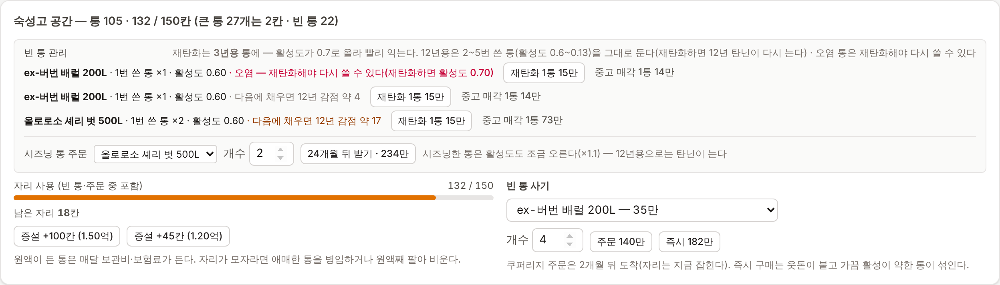

# 9차 판 — ARCH 분석

> 설계 세션(ARCH). PM 요청(2026-11-24) ①~⑥ 순서. 판이 진행 중이라 **한 시점(64개월 중간 기록) 관찰만 적고 판단은 얹지 않는다.** 수리안은 `[제안]`이고 코드는 draft(빌드 고정 #294).
> 기록: `distillery-mvp-standard-y6m5-202611240759.json`(64개월 · 빌드 `92c888d`). 화면 확인은 main `5524a2a` 빌드(게임 코드가 고정 빌드와 같다 — `src` 차이는 시험 2파일)에 이 세이브를 불러 1,280 너비로 봤다.
> 표기: `[사실]` 기록 · 코드 · 화면에서 직접 확인 / `[추정]` 기록에 근거가 없거나 간접 / `[확인 필요]` 다른 세션 · 오너 몫.

## 64개월 중간 기록 (2026-11-24)

### ① N1 — 자동 통입 (반복)

**N1 표** (`playlog-report` #855 draft를 이 기록에 돌린 값) `[사실]`

| 판 | 손 통입 | 월당 | 자동 통입 설정을 처음 바꾼 달 | 결산에 "자동 통입 n통"이 처음 남은 달 |
|---|---|---|---|---|
| 7차 | 405회 | 2.61 | 없음 | 없음 |
| 9차 64개월 | 178회 | 2.78 | 없음 | 없음 |

**화면 사실**
- 64개월 할 일 둘째 줄(warn)에 「탱크 몰트·그레인 1,388L 통입 대기 …」가 있고, 그 아래에 주황 **[자동 통입 켜기]** 빠른 버튼이 보인다 `[사실 — 화면, arch-64m-home.png]`.
  - 이 버튼은 기본 설정 `{}`으로 켠다(매달 · 몰트·그레인 · 새 통 먼저 · 63.5%).
  - 통입 카드의 설정 줄도 꺼져 있고 원액이 기다리면 노랗게 칠해진다(7차 뒤 수리).
- 자동 통입 설정에는 간격 · 원액(몰트/그레인) · 빈 통 순서(새 통 먼저/재사용 먼저) · 통입 도수만 있다. **통 종류(버번 / 셰리 벗)는 고를 수 없다** `[사실 — 코드 autoFill.ts · AutoFill.tsx]`.
  - 같은 순서 안에서는 활성도 높은 통 → id 순이다. 이 판처럼 새 버번과 새 벗이 섞여 있으면(둘 다 활성도 1.00) 어느 원액이 벗에 들어갈지 플레이어가 정할 수 없다.
- 자동 통입은 **소주를 다루지 않는다** `[사실 — 코드]`. 지금 원액이 든 통 가운데 소주가 든 나무 통 13개 · 옹기 6개가 있다(오크소주 · 옹기소주). 이 통입은 자동 통입을 켜도 손으로 해야 했다. 178회 가운데 소주 통입 수는 행동 인자가 기록에 없어 셀 수 없다 `[확인 불가]` — 지금 남아 있는 통으로 본 하한은 19회다.
- 지금 몰트가 든 통의 통 종류 `[사실]`
  - 피티드: 버번 13 · 벗 8
  - 언피티드: 버번 11 · 벗 9
  - 그레인: 버번 15 · 벗 3
  - 원액별로 한 통 종류만 쓰는 패턴은 없다. 오너가 통입마다 통 종류를 골랐는지는 이것만으로 알 수 없다 `[추정 불가]`.
- 통입은 3 ~ 6개월마다 몰아서 했다(PM README 1.2). 64개월에는 그레인 522L이 6개월째 탱크에 있다 `[사실]`.

**`[제안 P-ARCH-82]` "화면 한 곳" 수리안 — 오너 답(PM이 "봤나 · 왜 안 켰나"를 여쭘)에 따라 고른다.** 지금 draft는 만들지 않는다. 답에 따라 손댈 곳이 달라서다.

| 오너 답 | 안 | 손댈 곳 · 몫 | 크기 |
|---|---|---|---|
| (가) "통 종류를 직접 고르려고" | 자동 통입 설정 줄에 **원액별 통 종류**(몰트 → 셰리 벗 먼저 / 버번 먼저 / 가리지 않음)를 더한다. 선택 필드 `AutoFillSettings.caskType?`(버전 올림 없음 #187) | PROD `autoFill.ts` · `AutoFill.tsx` (설정 줄 한 곳) | 작음 |
| (나) "못 봤다 · 몰랐다" | 빠른 버튼은 64개월 화면에 이미 보인다. 그래서 할 일이 아니라 **켜는 순간 설명**을 고친다: 버튼 확인 글에 "버번 · 벗을 가리지 않고 활성도 순으로 넣는다 — 통 종류를 고르려면 손 통입" 한 줄 | ARCH `alerts.ts` 빠른 버튼 문구 | 한 줄 |
| (다) "몰아서 하는 게 편했다" | 고치지 않는다. 대신 N1의 재는 값을 **"손 통입 횟수"에서 "원액이 탱크에서 기다린 개월"로** 바꾼다. 통입 횟수는 문제가 아니고, 숙성 시작이 늦어지는 것이 비용이다 | ARCH `playlog-report` (측정) | 작음 |

- 반론: (가)는 설정이 하나 늘어 자동 통입 줄이 복잡해진다. 또 소주 통입은 그대로 손으로 남는다. N1 횟수가 크게 줄지 않을 수 있다.
- 리스크: 답이 셋 다 아닐 수도 있다. 그때는 판 끝 기록에서 원액의 탱크 대기 개월((다)의 값)을 다시 본다.

### ② `handfillIdle` 화면 숫자 ≠ 기록

**원인** `[사실 — 기록 · 코드]`
- 핸드필 판매 메모: 결산 27 ~ 44(통 K16, 44에 "비었다") → 46 ~ 48(통 K306, 48에 "남은 155L")에서 끝난다. K306은 "비었다" 메모 없이 지정이 풀렸다.
- K306은 지금 `fills 2 · filledMonth 59`다. 48 ~ 59 사이에 한 번 비었다가 다시 채워졌다.
- 판매가 멈춘 그달(결산 49 직전 턴)의 행동은 **병입 4번뿐**이다(`playlog.turns`). 자동 납품 · 원액 판매(`bulk.ts`) · 자동 보충(`economics.ts`)은 핸드필 통을 건너뛴다. 피니싱은 61개월에 열렸다.
  - 그래서 손 병입이 K306을 비운 것으로 본다 `[추정 — 행동 인자(어느 통)는 기록에 없다]`.
- 손 병입(`executeBlend`)은 핸드필 통을 막지 않는다. 통이 비면 `emptyCask`(maturation.ts 176)가 `handfill`을 **메모 없이** 지운다 `[사실 — 코드]`.
  - 병입 · 블렌딩 화면에는 "핸드필" 표시가 없다(`src/ui`에서 핸드필을 쓰는 화면 파일은 홈 · 할 일 · 소식 · CaskCare · Handfill 패널뿐).
- `handfillIdle`은 마지막 "비었다" 메모(결산 44)부터 센다. 그래서 「20개월째」가 나왔다. 기록상 마지막 판매는 결산 48이라 16개월이다.

**수리(draft, `arch/handfill-idle`)**
- `handfillIdle`이 마지막 핸드필 **판매** 달부터 센다.
- 문구를 「핸드필 판매가 멈춘 지 n개월째(그 전 월 약 …)」로 바꾼다.
- 시험: 9차 세이브 16개월(새로 넣음), 6차 세이브 16개월(그대로).
- 결과: test 984 · build 통과 · `ui:reach` REACH_OK.

**15 ~ 20개월 지정하지 않은 까닭 — 화면 쪽 사실** `[사실 — 화면 · 코드]` (왜 안 했는지는 오너 답 몫)
- 이 warn은 64개월 할 일의 **첫 줄**이고 「통 고르기 →」(숙성고로 이동)가 붙어 있다. 그 자리에서 고르는 빠른 버튼은 없다. 숙성고 머리에는 「핸드필 통 없음 — 펼쳐서 고르기」 배지가 있다.
- 지정이 풀린 **그달 소식 창에는 아무것도 뜨지 않았다.** 소식 창은 「핸드필 … 비었다」 메모만 줍는데(TurnBrief 31), 병입으로 비면 그 메모가 없다. warn은 다음 달부터 할 일에 떴다.
- 핸드필 통 고르기 목록의 첫 후보는 **K226 · 품질 100**(샘플 추정 100 ±14)이다. K226은 아직 모르는 TCA 오염 통이다(숨은 값, `musty` 22.5). 화면은 아는 값만 쓰므로 규칙대로다. 기록만 남긴다.

**`[제안 P-ARCH-83]` (PROD 몫 — 병입 쪽)**
- 병입 화면 원액 목록에서 핸드필 통에 「핸드필」 표시를 붙인다.
- 병입으로 핸드필 통이 비면 결산 메모 「핸드필 통 K306이 병입으로 비었다 — 다음 핸드필 통을 지정하세요」를 남긴다. 소식 창이 지금 패턴(`핸드필 .*비었다`)으로 줍는다.
- 반론: 핸드필 통을 일부러 병입하는 것도 정당한 선택이라 막지는 않는다. 알리기만 한다.

### ③ 12년 준비가 화면에서 전해지는가

**힌트 조건** `[사실 — 코드]`
- `flagshipCaskHint`(gradeHints.ts)는 **v16 판 · 24개월 전**(`EARLY_CASK_HINT_MONTHS = 24`)에만 통입 카드의 몰트 · 그레인 원액 줄에 뜬다(MvpHome 594). 그래서 64개월 null은 설계대로다.
- 몰트를 첫 통(활성도 1.00)에 넣은 달은 2 ~ 16이다(K10 ~ K19 · K66 · K73 · K74 · K75 등). 이 달들은 힌트가 뜨는 기간 안이다.
  - 힌트가 실제로 화면에 보였는지는 화면 기록이 없어 모른다 `[추정 — 코드상 몰트 원액 통입 카드에 표시]`.

**지금(64개월) 화면이 보이는 것** `[사실 — 화면]`
- 숙성 중 통 표의 각 줄: 「활성도 1.00 · 12년 감점 약 19」(버번), 「… 약 31」(벗), 「… 약 34」(37개월 벗)
- 빈 통 관리(CaskCare): "12년용은 2~5번 쓴 통(활성도 0.6~0.13)을 그대로 둔다" · 빈 통마다 "다음에 채우면 12년 감점 약 4"(1번 쓴 버번) / "약 17"(1번 쓴 벗)
- 플래그십 예비 4통(자동): K10 · K12 · K13 · K74 — 모두 첫 통 · 감점 19 / 31
- 피니싱(61개월에 열림) 줄의 탄닌 전망: 0회 사용이라 화면 확인 대상이 아니다

**`tanninOutlook` 값(이 세이브)** `[사실]`
- 가장 오래된 몰트 통 18개 모두 활성도 1.00 · 첫 통이다.
- 144개월 탄닌 68(버번) / 84 ~ 87(벗), 상한 45, 감점 19 ~ 20(버번) / 31 ~ 34(벗)

**"품질 80으로 갈 길"이 화면에 보이는가** `[확인 필요 — PROD]`
- 감점은 보이지만, 지금 가진 첫 통 원액을 12년용으로 낫게 만드는 행동이 화면에 있는지는 확인하지 못했다. 후보 행동은 원액 빼기 → 재사용 통에 다시 넣기, 피니싱이다. 다만 `tanninOutlook`이 쌓인 탄닌을 어떻게 이어 세는지 ARCH가 확인하지 않았다.
- 새로 넣는 원액을 1번 쓴 통에 넣으면 감점 약 4다(빈 통 관리 줄).

**오염 통** `[사실 — 기록 · 코드]`

| 통 | 오염 · 알게 된 결산 | 몰트 숙성 | `musty` | 화면 샘플 추정 | 예비 |
|---|---|---|---|---|---|
| K11 버번 | 곰팡이 · 13 (QC) | 62개월 | **40(상한)** | 41 ±8 | 아님 |
| K75 벗 | 곰팡이 · 41 (QC) | 59개월 | **40(상한)** | 38 ±10 | 아님 |
| K226 벗 | TCA · 모름 | 44개월 | 22.5 | 100 ±14 | 아님 |

- **계속 숙성하면:** 오염 통은 매달 `musty`가 +1(곰팡이) / +1.5(TCA) 늘고 상한은 40이다(warehouse.ts 184). `musty`는 결점 향 합(`offnoteLoad`)에 그대로 들어간다. K11 · K75는 이미 상한이라 더 나빠지지 않고, 나무 숙성 개월만 는다.
- **화면이 권하는 것:** 아는 오염 통 줄에 「오염」 배지와 [원액 빼기] · [폐기] · [피니싱] 버튼이 있다. 문구로 권하는 행동은 없다. 빈 통이 된 뒤 CaskCare만 "재탄화해야 다시 쓸 수 있다"고 쓴다.
- **막히는 것 / 안 막히는 것** `[사실 — 코드]`

| 막힌다 | 안 막힌다 |
|---|---|
| 자동 예비 보호(tags.ts 48) | **손 병입**(`executeBlend`에 오염 검사 없음) |
| 블렌딩 위임(blendTable 480) | **12년 적격 · 후보 셈**(`caskEligibility` · `isCampaignCandidate`) |
| 핸드필 지정(handfill.ts 39) | |

  - 그래서 오염 통이 후보 지평에 들면 홈 「후보」 수(`reserveCandidateCount`)가 아는 오염 통도 셀 수 있다 `[사실 — 코드]`. 지금 홈은 「후보 0통」이라 화면 차이는 없다. 후보가 생기는 때 다시 본다.

**오너 안건 준비 — 아는 오염 통을 손 병입 · 12년 적격 · 후보 셈에서 어떻게 할까** (PM 2026-11-24 · 판 뒤 안건 · 규칙 변경)

- **공통:** 대상은 **아는 오염**(`contaminationKnown`)만이다. 모르는 오염은 세 안 모두 그대로 쓴다. F5b [결정 #310]의 "QC로 알게 될 때까지 모르는 통에 넣는 것이 규칙"과 정보 비대칭(I1 · I2)을 지키기 위해서다.
- **옛 판(legacy-v15):** 세 안 모두 그대로다. 막기 · 경고 모두 `usesObservedValuation(s)`(v16 판)로 가른다. X0L 바이트 동일이 기대값이다.

| 안 | 내용 | 손댈 곳 · 몫 | v16 봇 출력 |
|---|---|---|---|
| (가) 막는다 | 손 병입에서 아는 오염 통을 원액으로 못 고르고(오류 문구), 12년 적격 · 후보 셈에서도 뺀다 | `blending.ts executeBlend`(PROD — 위임 `delegatePlan`과 같은 거르기) · `ledger.ts caskEligibility` · `isCampaignCandidate`(코어 — 원장 헬퍼) · 병입 화면 원액 표(PROD — 고를 수 없음 표시) | **바뀔 수 있다** — 봇은 빈 오염 통에는 넣지 않지만, 숙성 중 오염이 드러난 통은 병입할 수 있다. 구현 PR에서 v16 X0 전후를 재야 한다 `[확인 필요]` |
| (나) 경고만 | 규칙은 그대로 두고, 병입 화면 원액 표에 「오염 — 결점 향(musty)이 섞인다」 표시와 확인을 붙인다. 홈 「후보」 수는 아는 오염 통을 빼고 센다(표시만) | 병입 화면(PROD) · `progress.ts reserveCandidateCount`의 화면 쪽 셈 또는 홈 표시(ARCH) | 그대로(sim 판정 불변) |
| (다) 그대로 | 결점 향(`musty` ≤ 40)이 품질을 깎는 것이 대가다. 화면은 지금처럼 「오염」 배지 · [폐기]만 둔다 | 없음 | 그대로 |

- **반론**
  - (가)는 "오염 통도 섞어서 희석해 쓴다"는 선택을 없앤다. 실제 증류소에서도 하는 일이고, 품질 셈이 이미 대가를 매긴다.
  - (다)는 12년 승리를 오염 통으로 가져갈 수 있게 둔다. 승리는 적격만 보고, 판정 품질에서 깎일 뿐이다.
  - (나)는 그 사이다. 지금 화면의 빈틈(병입 화면에 오염 표시 없음 · 후보 수에 섞임)만 메운다.
- **사실:** 이 판에서 아는 오염 통 둘(K11 · K75)은 가장 오래된 몰트 통 여섯 가운데 둘이다. K11은 QC 뒤 51개월째 숙성 중이다. 오너가 일부러 두었는지는 오너 답 몫이다.

### ④ F5d — 「블랜디드 퍼스트 배치」 리뷰 0

- 제품 P327(첫 병입 결산 27 · 누적 6,610병)을 결산 64에 1,123병 보충했다(로트 `P327:64:0`). 지금 표시는 「품질 추정 60 ±12 (병입 때)」 · 리뷰 0이다(참 68.2) `[사실]`.
- **#346 규칙대로다** `[사실 — 코드]`: `restockPrior`는 보충 원액의 레시피 목록이 제품과 같을 때만 지금 추정 · 리뷰를 잇는다. 다르면 전역 사전값으로 다시 시작한다. 결정문의 "같은 레시피만 잇는다" 그대로다.
- **화면이 "왜 다시 모르게 됐는지" 알려 주는가 — 알려 주지 않는다** `[사실 — 코드 검색]`
  - 병입 화면은 같은 레시피일 때 이은 값(`carried`)을 보이기만 한다. "구성이 달라 리뷰 n건을 잇지 않는다"는 문구가 없다.
  - 판매 화면 품질 줄은 「(리뷰 n건)」에서 「(병입 때)」로 말없이 바뀐다.
- `[제안 P-ARCH-84]` (PROD 병입 화면 · 한 줄)
  - 보충 대상이 있고 레시피가 다르면 병입 확인 줄에 "이 제품과 원액 구성이 달라 리뷰 n건 추정을 잇지 않는다 — 보충 뒤 「병입 때」 추정(±σ)으로 다시 시작" 을 넣는다.
  - 반론: 정보만 늘고 선택은 바뀌지 않을 수 있다. 다만 6,610병을 판 대표 제품의 리뷰가 0이 되는 것은 큰 변화라 미리 아는 편이 맞다고 본다.
- 가린 제품 6개의 추정 − 참(README 1.6)은 표본이 6개라 치우침을 판단하지 않는다.

### ⑤ #360 미리 보기 — #884 빌드로 이 세이브

- 「숙성고 공간 — 통 105 · **132 / 150칸** (큰 통 27개는 2칸 · 빈 통 22)」 · 남은 자리 **18칸** · 증설 「+100칸」 · 「+45칸」 `[사실 — 화면]`
- 넘치지 않는다. 할 일 warn `slots-over`는 뜨지 않는다.
- 지금 빌드에서 남은 자리는 **45통**이다. #884가 들어가면 같은 세이브에서 **18칸**으로 줄어든다 `[사실]`. 할 일 「통입 대기」의 "남은 자리"도 45통 → 18칸이 된다.

### ⑥ 피니싱 — 기록만

- 결산 60(61개월째)에 단계 `y5_finish`가 열렸고, 소식 메모가 같은 달 이벤트 단계 열림과 함께 남았다 `[사실]`.
- 64개월까지 `transferCask`는 0번이다 `[사실]`.
- 빈 셰리 벗은 7개(새 5 · 1번 쓴 2)다 `[사실]` — 그중 FinishRow가 옮길 곳으로 보이는 통 수는 확인하지 않았다.
- 판 끝 기록에서 다시 본다.

## 다음 (판 끝 기록에서 다시 볼 것)

1. N1: 자동 통입을 켰는가. 켜지 않았다면 오너 답에 따라 `[제안 P-ARCH-82]` 가 · 나 · 다 중 하나.
2. 핸드필: 다시 지정했는가. `[제안 P-ARCH-83]` 병입 알림이 필요한가.
3. 12년: 첫 통 원액을 어떻게 했는가. 후보가 생길 때 후보 수에 오염 통이 섞이는가.
4. F5d: 보충으로 리뷰가 끊긴 제품의 추정이 다시 좁혀지는 속도.
5. 피니싱 사용 여부.

## 오너 답 뒤 — ARCH 제안 (2026-11-24 · 결정 #365 ~ #371 발급 뒤)

> 오너 답(PM 전달): 자동 통입 "타이밍을 내가 조정하고 싶었다. 200L가 안 되는데 마음대로 통입해 쓸데없이 통을 낭비한 사례가 있어 불신" · 핸드필 warn "못 봤다"(일반 데스크톱 모니터) · 「12년 감점」 "의미를 몰랐다".

### `[제안 P-ARCH-85]` 자동 통입 — 「꽉 차는 통만」을 약속으로 (P-ARCH-82 대체)

**지금 코드** `[사실 — autoFill.ts autoFillPlan]`
- 그 원액을 만드는 생산 지시가 **켜져 있으면** 꽉 차지 않을 통은 건너뛰고, 끝자리는 탱크에 둔다(`minLastFill = 1`, 2026-11-19부터). 그 전에는 0.5였다(52% 통이 계속 생겼다).
- 생산 지시가 **꺼져 있으면** 남은 몫도 지금 다 넣는다. 덜 찬 통이 생기는 길은 이 경우 하나다.
- 9차 판에서 `setAutoFill`은 0번이다. 오너가 본 "200L 안 되는데 통입"은 이 판의 자동 통입이 아니다. 앞선 판의 0.5 시절이거나 손 통입 미리 보기로 본 것일 수 있다 `[추정]`.

**안 (PROD `autoFill.ts` · `AutoFill.tsx` — 설정 줄 한 곳)**
- (가) 지시가 꺼져도 **덜 찰 통은 넣지 않는다.** 끝자리는 탱크에 두고, 할 일 「통입 대기」에 "꽉 차지 않아 대기 n L"로 보인다. 예외를 없애 "200L가 모이기 전에는 넣지 않는다"를 규칙 한 줄로 만든다.
- (나) 켜는 순간 약속을 보인다. 할 일 빠른 버튼과 설정 줄 버튼의 확인 글을 "꽉 차는 통만 넣는다 — 통 하나를 채울 만큼 모이기 전에는 넣지 않는다 · 간격(매달 · 3 · 6개월)은 직접 정한다"로 바꾼다. 문구는 ARCH(할 일)와 PROD(설정 줄)가 같은 문장을 쓴다.
- (다) "타이밍을 조정": 간격 선택은 이미 있다. 설정 줄에 **다음 자동 통입 달 · 넣을 통 수**(지금 미리 보기 `autoFillPreview`)를 늘 보인다.
- 권장은 (가) + (나) + (다)다. (가)만 sim이 바뀐다.
  - v16 봇은 자동 통입을 쓰지 않아 출력이 같을 것으로 본다 `[추정 — 구현 PR에서 확인]`.
  - 옛 판도 같은 함수를 쓰므로 `rulesVersion`으로 가를지 PROD가 정한다(사람 세이브가 옛 판일 때만 차이).
- 반론: 지시를 끈 원액(예: 단종한 레시피)의 마지막 몇십 L는 탱크에 영영 남을 수 있다. 할 일 줄에 "손으로 넣거나 뉴본으로 병입"을 함께 보인다(#370 탱크 자동 병입과 이어진다).

### `[제안 P-ARCH-86]` 할 일 warn을 눈에 띄게 (#365 "잘 보이게"와 같은 문제)

**지금** `[사실 — AlertsView.tsx MonthTodo]`
- 할 일은 **증류소 탭 맨 위 카드에만** 있다.
- 줄 글자는 모두 `text-xs`(12px)다. warn은 호박색 글자 하나, info는 회색으로, 크기 · 배경 차이가 없다.
- 헤더(모든 탭)에는 할 일 표시가 없다.
- 매달 뜨는 소식 창(TurnBrief)은 할 일을 다루지 않는다(새 기능 · 결산 메모 · 이벤트만).
- 9차 64개월: warn 2줄 · info 1줄. 핸드필 warn이 첫 줄인데도 "못 봤다".

**안 (모두 ARCH 화면 — `AlertsView.tsx` · `TurnBrief.tsx` · `App.tsx`)**
- (가) **카드 안 무게.** warn · danger 줄은 `text-sm` · 옅은 배경(호박 / 장미) · 왼쪽 굵은 테두리로 바꾸고, info만 지금처럼 작은 회색으로 둔다. 한 줄 요약을 굵게 두고, 긴 설명은 그 아래 작은 글자로 나눈다(지금은 한 문장이 2 ~ 3줄로 이어진다).
- (나) **소식 창 연동.** 그달 **새로 생긴** warn · danger(지난달 할 일에 없던 id)만 소식 창 맨 아래 「새 할 일」로 한 줄씩 보이고 [보기]로 잇는다. 계속 떠 있는 warn은 "할 일 n개 계속" 한 줄로 묶는다(매달 같은 줄이 반복되면 무시하게 된다).
- (다) **헤더 칩.** 모든 탭 헤더의 진행 버튼 옆에 「할 일 ⚠2」 칩을 두고, 누르면 증류소 탭 할 일로 간다. 다른 탭에 머무는 사람에게도 보인다.
- 권장은 (가) + (나)다. (다)는 헤더가 이미 버튼 6개라 좁은 창에서 줄바꿈 리스크가 있어 `ui:reach`로 보고 정한다.
- 반론: 7차 판 오너는 소식 창도 0 · 0 · 10초에 넘겼다(새 기능 소식). (나)만으로는 부족할 수 있어 (가)를 함께 한다.
- 이 틀은 #365 오염 경고에도 그대로 쓴다. 병입 화면 표시는 PROD이고, 홈 쪽은 같은 warn 모양이다.

### `[제안 P-ARCH-87]` 「12년 감점」 풀이 한 줄 (#367과 별개 — 요령은 알리지 않음)

**지금** `[사실 — MvpHome.tsx TanninLine]`
- 통 줄에 「활성도 1.00 · 12년 감점 약 19」가 있고, 뜻은 마우스를 올려야 보이는 `title`에만 있다. 화면에 늘 보이는 풀이는 없다.

**안 (ARCH `MvpHome.tsx` — 숙성 중 통 표 머리 한 줄, 통마다가 아니라 한 번)**
- 문구: 「**12년 감점** — 지금 통 그대로 12년(144개월)까지 두면 나무 맛(탄닌)이 위스키 상한을 넘어 품질에서 깎일 것으로 보이는 점수(어림). 활성도가 높은 새 통일수록 크다.」
- #367에 따라 "빼서 재사용 통에" 같은 요령은 넣지 않는다. 빈 통 관리의 "다음에 채우면 감점 약 n"은 지금처럼 둔다.
- PROD와 맞출 것: 옮긴 원액(피니싱 · 원액 빼기 뒤)은 감점 숫자를 감추고 「옮긴 원액 · 이 통에서 12년까지 탄닌 +x」로 보인다(PROD `tanninOutlook` `moved` 제안 · ARCH 화면 동의 2026-11-24). 풀이 한 줄은 두 경우에 모두 맞게 쓴다.

### #365 ARCH 몫 — 홈 「후보」 수 확인 필요 `[사실 — 코드]`

- 홈 「후보 n」과 중반 목표 「12년 후보 통 3개 확보」는 같은 함수 `reserveCandidateCount`(progress.ts 179)를 쓴다. 목표 **달성 판정**(progress.ts 172)도 이 함수다.
- #365는 "sim 판정은 그대로 · 홈 후보 수는 아는 오염 통을 빼고 보인다"다. 화면에서만 빼면 **목표는 달성(3/3, 오염 1통 포함)인데 화면은 2/3**인 어긋남이 생긴다.
- `[제안]` 화면은 빼지 않고 **함께 보인다**: 「후보 3/3 — ⚠ 그중 1통은 아는 오염(결점 향이 섞인다)」. 판정과 숫자가 같고, 경고는 P-ARCH-86 (가)의 warn 모양으로 눈에 띄게 한다.
- 결정문과 다르므로 PM 확인 뒤 구현한다. 결정문대로 빼려면 목표 판정도 함께 빼야 하는데, 그것은 규칙 변경이라 #365 범위 밖이다.
