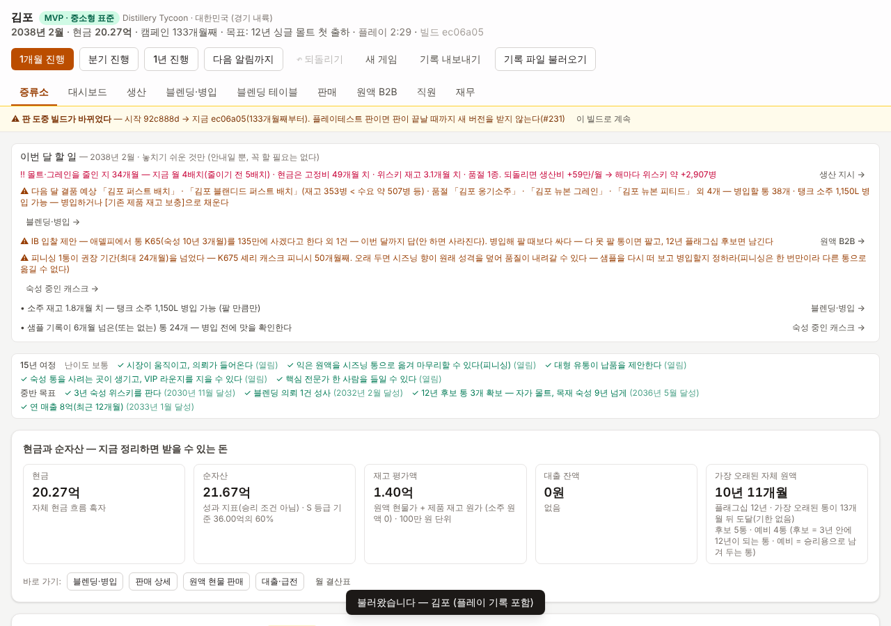
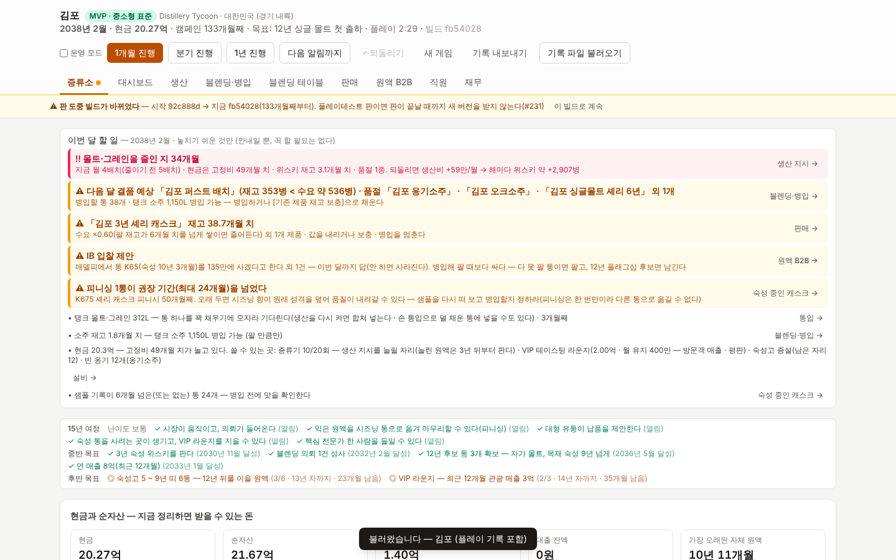

# 9차 판 — ARCH 분석

> 설계 세션(ARCH). PM 요청(2026-11-24) ①~⑥ 순서. 판이 진행 중이라 **한 시점(64개월 중간 기록) 관찰만 적고 판단은 얹지 않는다.** 수리안은 `[제안]`이고 코드는 draft(빌드 고정 #294).
> 기록: `distillery-mvp-standard-y6m5-202611240759.json`(64개월 · 빌드 `92c888d`). 화면 확인은 main `5524a2a` 빌드(게임 코드가 고정 빌드와 같다 — `src` 차이는 시험 2파일)에 이 세이브를 불러 1,280 너비로 봤다.
> 표기: `[사실]` 기록 · 코드 · 화면에서 직접 확인 / `[추정]` 기록에 근거가 없거나 간접 / `[확인 필요]` 다른 세션 · 오너 몫.

## 64개월 중간 기록 (2026-11-24)

### ① N1 — 자동 통입 (반복)

**N1 표** (`playlog-report` #855 draft를 이 기록에 돌린 값) `[사실]`

| 판 | 손 통입 | 월당 | 자동 통입 설정을 처음 바꾼 달 | 결산에 "자동 통입 n통"이 처음 남은 달 |
|---|---|---|---|---|
| 7차 | 405회 | 2.61 | 없음 | 없음 |
| 9차 64개월 | 178회 | 2.78 | 없음 | 없음 |

**화면 사실**
- 64개월 할 일 둘째 줄(warn)에 「탱크 몰트·그레인 1,388L 통입 대기 …」가 있고, 그 아래에 주황 **[자동 통입 켜기]** 빠른 버튼이 보인다 `[사실 — 화면, arch-64m-home.png]`.
  - 이 버튼은 기본 설정 `{}`으로 켠다(매달 · 몰트·그레인 · 새 통 먼저 · 63.5%).
  - 통입 카드의 설정 줄도 꺼져 있고 원액이 기다리면 노랗게 칠해진다(7차 뒤 수리).
- 자동 통입 설정에는 간격 · 원액(몰트/그레인) · 빈 통 순서(새 통 먼저/재사용 먼저) · 통입 도수만 있다. **통 종류(버번 / 셰리 벗)는 고를 수 없다** `[사실 — 코드 autoFill.ts · AutoFill.tsx]`.
  - 같은 순서 안에서는 활성도 높은 통 → id 순이다. 이 판처럼 새 버번과 새 벗이 섞여 있으면(둘 다 활성도 1.00) 어느 원액이 벗에 들어갈지 플레이어가 정할 수 없다.
- 자동 통입은 **소주를 다루지 않는다** `[사실 — 코드]`. 지금 원액이 든 통 가운데 소주가 든 나무 통 13개 · 옹기 6개가 있다(오크소주 · 옹기소주). 이 통입은 자동 통입을 켜도 손으로 해야 했다. 178회 가운데 소주 통입 수는 행동 인자가 기록에 없어 셀 수 없다 `[확인 불가]` — 지금 남아 있는 통으로 본 하한은 19회다.
- 지금 몰트가 든 통의 통 종류 `[사실]`
  - 피티드: 버번 13 · 벗 8
  - 언피티드: 버번 11 · 벗 9
  - 그레인: 버번 15 · 벗 3
  - 원액별로 한 통 종류만 쓰는 패턴은 없다. 오너가 통입마다 통 종류를 골랐는지는 이것만으로 알 수 없다 `[추정 불가]`.
- 통입은 3 ~ 6개월마다 몰아서 했다(PM README 1.2). 64개월에는 그레인 522L이 6개월째 탱크에 있다 `[사실]`.

**`[제안 P-ARCH-82]` "화면 한 곳" 수리안 — 오너 답(PM이 "봤나 · 왜 안 켰나"를 여쭘)에 따라 고른다.** 지금 draft는 만들지 않는다. 답에 따라 손댈 곳이 달라서다.

| 오너 답 | 안 | 손댈 곳 · 몫 | 크기 |
|---|---|---|---|
| (가) "통 종류를 직접 고르려고" | 자동 통입 설정 줄에 **원액별 통 종류**(몰트 → 셰리 벗 먼저 / 버번 먼저 / 가리지 않음)를 더한다. 선택 필드 `AutoFillSettings.caskType?`(버전 올림 없음 #187) | PROD `autoFill.ts` · `AutoFill.tsx` (설정 줄 한 곳) | 작음 |
| (나) "못 봤다 · 몰랐다" | 빠른 버튼은 64개월 화면에 이미 보인다. 그래서 할 일이 아니라 **켜는 순간 설명**을 고친다: 버튼 확인 글에 "버번 · 벗을 가리지 않고 활성도 순으로 넣는다 — 통 종류를 고르려면 손 통입" 한 줄 | ARCH `alerts.ts` 빠른 버튼 문구 | 한 줄 |
| (다) "몰아서 하는 게 편했다" | 고치지 않는다. 대신 N1의 재는 값을 **"손 통입 횟수"에서 "원액이 탱크에서 기다린 개월"로** 바꾼다. 통입 횟수는 문제가 아니고, 숙성 시작이 늦어지는 것이 비용이다 | ARCH `playlog-report` (측정) | 작음 |

- 반론: (가)는 설정이 하나 늘어 자동 통입 줄이 복잡해진다. 또 소주 통입은 그대로 손으로 남는다. N1 횟수가 크게 줄지 않을 수 있다.
- 리스크: 답이 셋 다 아닐 수도 있다. 그때는 판 끝 기록에서 원액의 탱크 대기 개월((다)의 값)을 다시 본다.

### ② `handfillIdle` 화면 숫자 ≠ 기록

**원인** `[사실 — 기록 · 코드]`
- 핸드필 판매 메모: 결산 27 ~ 44(통 K16, 44에 "비었다") → 46 ~ 48(통 K306, 48에 "남은 155L")에서 끝난다. K306은 "비었다" 메모 없이 지정이 풀렸다.
- K306은 지금 `fills 2 · filledMonth 59`다. 48 ~ 59 사이에 한 번 비었다가 다시 채워졌다.
- 판매가 멈춘 그달(결산 49 직전 턴)의 행동은 **병입 4번뿐**이다(`playlog.turns`). 자동 납품 · 원액 판매(`bulk.ts`) · 자동 보충(`economics.ts`)은 핸드필 통을 건너뛴다. 피니싱은 61개월에 열렸다.
  - 그래서 손 병입이 K306을 비운 것으로 본다 `[추정 — 행동 인자(어느 통)는 기록에 없다]`.
- 손 병입(`executeBlend`)은 핸드필 통을 막지 않는다. 통이 비면 `emptyCask`(maturation.ts 176)가 `handfill`을 **메모 없이** 지운다 `[사실 — 코드]`.
  - 병입 · 블렌딩 화면에는 "핸드필" 표시가 없다(`src/ui`에서 핸드필을 쓰는 화면 파일은 홈 · 할 일 · 소식 · CaskCare · Handfill 패널뿐).
- `handfillIdle`은 마지막 "비었다" 메모(결산 44)부터 센다. 그래서 「20개월째」가 나왔다. 기록상 마지막 판매는 결산 48이라 16개월이다.

**수리(draft, `arch/handfill-idle`)**
- `handfillIdle`이 마지막 핸드필 **판매** 달부터 센다.
- 문구를 「핸드필 판매가 멈춘 지 n개월째(그 전 월 약 …)」로 바꾼다.
- 시험: 9차 세이브 16개월(새로 넣음), 6차 세이브 16개월(그대로).
- 결과: test 984 · build 통과 · `ui:reach` REACH_OK.

**15 ~ 20개월 지정하지 않은 까닭 — 화면 쪽 사실** `[사실 — 화면 · 코드]` (왜 안 했는지는 오너 답 몫)
- 이 warn은 64개월 할 일의 **첫 줄**이고 「통 고르기 →」(숙성고로 이동)가 붙어 있다. 그 자리에서 고르는 빠른 버튼은 없다. 숙성고 머리에는 「핸드필 통 없음 — 펼쳐서 고르기」 배지가 있다.
- 지정이 풀린 **그달 소식 창에는 아무것도 뜨지 않았다.** 소식 창은 「핸드필 … 비었다」 메모만 줍는데(TurnBrief 31), 병입으로 비면 그 메모가 없다. warn은 다음 달부터 할 일에 떴다.
- 핸드필 통 고르기 목록의 첫 후보는 **K226 · 품질 100**(샘플 추정 100 ±14)이다. K226은 아직 모르는 TCA 오염 통이다(숨은 값, `musty` 22.5). 화면은 아는 값만 쓰므로 규칙대로다. 기록만 남긴다.

**`[제안 P-ARCH-83]` (PROD 몫 — 병입 쪽)**
- 병입 화면 원액 목록에서 핸드필 통에 「핸드필」 표시를 붙인다.
- 병입으로 핸드필 통이 비면 결산 메모 「핸드필 통 K306이 병입으로 비었다 — 다음 핸드필 통을 지정하세요」를 남긴다. 소식 창이 지금 패턴(`핸드필 .*비었다`)으로 줍는다.
- 반론: 핸드필 통을 일부러 병입하는 것도 정당한 선택이라 막지는 않는다. 알리기만 한다.

### ③ 12년 준비가 화면에서 전해지는가

**힌트 조건** `[사실 — 코드]`
- `flagshipCaskHint`(gradeHints.ts)는 **v16 판 · 24개월 전**(`EARLY_CASK_HINT_MONTHS = 24`)에만 통입 카드의 몰트 · 그레인 원액 줄에 뜬다(MvpHome 594). 그래서 64개월 null은 설계대로다.
- 몰트를 첫 통(활성도 1.00)에 넣은 달은 2 ~ 16이다(K10 ~ K19 · K66 · K73 · K74 · K75 등). 이 달들은 힌트가 뜨는 기간 안이다.
  - 힌트가 실제로 화면에 보였는지는 화면 기록이 없어 모른다 `[추정 — 코드상 몰트 원액 통입 카드에 표시]`.

**지금(64개월) 화면이 보이는 것** `[사실 — 화면]`
- 숙성 중 통 표의 각 줄: 「활성도 1.00 · 12년 감점 약 19」(버번), 「… 약 31」(벗), 「… 약 34」(37개월 벗)
- 빈 통 관리(CaskCare): "12년용은 2~5번 쓴 통(활성도 0.6~0.13)을 그대로 둔다" · 빈 통마다 "다음에 채우면 12년 감점 약 4"(1번 쓴 버번) / "약 17"(1번 쓴 벗)
- 플래그십 예비 4통(자동): K10 · K12 · K13 · K74 — 모두 첫 통 · 감점 19 / 31
- 피니싱(61개월에 열림) 줄의 탄닌 전망: 0회 사용이라 화면 확인 대상이 아니다

**`tanninOutlook` 값(이 세이브)** `[사실]`
- 가장 오래된 몰트 통 18개 모두 활성도 1.00 · 첫 통이다.
- 144개월 탄닌 68(버번) / 84 ~ 87(벗), 상한 45, 감점 19 ~ 20(버번) / 31 ~ 34(벗)

**"품질 80으로 갈 길"이 화면에 보이는가** `[확인 필요 — PROD]`
- 감점은 보이지만, 지금 가진 첫 통 원액을 12년용으로 낫게 만드는 행동이 화면에 있는지는 확인하지 못했다. 후보 행동은 원액 빼기 → 재사용 통에 다시 넣기, 피니싱이다. 다만 `tanninOutlook`이 쌓인 탄닌을 어떻게 이어 세는지 ARCH가 확인하지 않았다.
- 새로 넣는 원액을 1번 쓴 통에 넣으면 감점 약 4다(빈 통 관리 줄).

**오염 통** `[사실 — 기록 · 코드]`

| 통 | 오염 · 알게 된 결산 | 몰트 숙성 | `musty` | 화면 샘플 추정 | 예비 |
|---|---|---|---|---|---|
| K11 버번 | 곰팡이 · 13 (QC) | 62개월 | **40(상한)** | 41 ±8 | 아님 |
| K75 벗 | 곰팡이 · 41 (QC) | 59개월 | **40(상한)** | 38 ±10 | 아님 |
| K226 벗 | TCA · 모름 | 44개월 | 22.5 | 100 ±14 | 아님 |

- **계속 숙성하면:** 오염 통은 매달 `musty`가 +1(곰팡이) / +1.5(TCA) 늘고 상한은 40이다(warehouse.ts 184). `musty`는 결점 향 합(`offnoteLoad`)에 그대로 들어간다. K11 · K75는 이미 상한이라 더 나빠지지 않고, 나무 숙성 개월만 는다.
- **화면이 권하는 것:** 아는 오염 통 줄에 「오염」 배지와 [원액 빼기] · [폐기] · [피니싱] 버튼이 있다. 문구로 권하는 행동은 없다. 빈 통이 된 뒤 CaskCare만 "재탄화해야 다시 쓸 수 있다"고 쓴다.
- **막히는 것 / 안 막히는 것** `[사실 — 코드]`

| 막힌다 | 안 막힌다 |
|---|---|
| 자동 예비 보호(tags.ts 48) | **손 병입**(`executeBlend`에 오염 검사 없음) |
| 블렌딩 위임(blendTable 480) | **12년 적격 · 후보 셈**(`caskEligibility` · `isCampaignCandidate`) |
| 핸드필 지정(handfill.ts 39) | |

  - 그래서 오염 통이 후보 지평에 들면 홈 「후보」 수(`reserveCandidateCount`)가 아는 오염 통도 셀 수 있다 `[사실 — 코드]`. 지금 홈은 「후보 0통」이라 화면 차이는 없다. 후보가 생기는 때 다시 본다.

**오너 안건 준비 — 아는 오염 통을 손 병입 · 12년 적격 · 후보 셈에서 어떻게 할까** (PM 2026-11-24 · 판 뒤 안건 · 규칙 변경)

- **공통:** 대상은 **아는 오염**(`contaminationKnown`)만이다. 모르는 오염은 세 안 모두 그대로 쓴다. F5b [결정 #310]의 "QC로 알게 될 때까지 모르는 통에 넣는 것이 규칙"과 정보 비대칭(I1 · I2)을 지키기 위해서다.
- **옛 판(legacy-v15):** 세 안 모두 그대로다. 막기 · 경고 모두 `usesObservedValuation(s)`(v16 판)로 가른다. X0L 바이트 동일이 기대값이다.

| 안 | 내용 | 손댈 곳 · 몫 | v16 봇 출력 |
|---|---|---|---|
| (가) 막는다 | 손 병입에서 아는 오염 통을 원액으로 못 고르고(오류 문구), 12년 적격 · 후보 셈에서도 뺀다 | `blending.ts executeBlend`(PROD — 위임 `delegatePlan`과 같은 거르기) · `ledger.ts caskEligibility` · `isCampaignCandidate`(코어 — 원장 헬퍼) · 병입 화면 원액 표(PROD — 고를 수 없음 표시) | **바뀔 수 있다** — 봇은 빈 오염 통에는 넣지 않지만, 숙성 중 오염이 드러난 통은 병입할 수 있다. 구현 PR에서 v16 X0 전후를 재야 한다 `[확인 필요]` |
| (나) 경고만 | 규칙은 그대로 두고, 병입 화면 원액 표에 「오염 — 결점 향(musty)이 섞인다」 표시와 확인을 붙인다. 홈 「후보」 수는 아는 오염 통을 빼고 센다(표시만) | 병입 화면(PROD) · `progress.ts reserveCandidateCount`의 화면 쪽 셈 또는 홈 표시(ARCH) | 그대로(sim 판정 불변) |
| (다) 그대로 | 결점 향(`musty` ≤ 40)이 품질을 깎는 것이 대가다. 화면은 지금처럼 「오염」 배지 · [폐기]만 둔다 | 없음 | 그대로 |

- **반론**
  - (가)는 "오염 통도 섞어서 희석해 쓴다"는 선택을 없앤다. 실제 증류소에서도 하는 일이고, 품질 셈이 이미 대가를 매긴다.
  - (다)는 12년 승리를 오염 통으로 가져갈 수 있게 둔다. 승리는 적격만 보고, 판정 품질에서 깎일 뿐이다.
  - (나)는 그 사이다. 지금 화면의 빈틈(병입 화면에 오염 표시 없음 · 후보 수에 섞임)만 메운다.
- **사실:** 이 판에서 아는 오염 통 둘(K11 · K75)은 가장 오래된 몰트 통 여섯 가운데 둘이다. K11은 QC 뒤 51개월째 숙성 중이다. 오너가 일부러 두었는지는 오너 답 몫이다.

### ④ F5d — 「블랜디드 퍼스트 배치」 리뷰 0

- 제품 P327(첫 병입 결산 27 · 누적 6,610병)을 결산 64에 1,123병 보충했다(로트 `P327:64:0`). 지금 표시는 「품질 추정 60 ±12 (병입 때)」 · 리뷰 0이다(참 68.2) `[사실]`.
- **#346 규칙대로다** `[사실 — 코드]`: `restockPrior`는 보충 원액의 레시피 목록이 제품과 같을 때만 지금 추정 · 리뷰를 잇는다. 다르면 전역 사전값으로 다시 시작한다. 결정문의 "같은 레시피만 잇는다" 그대로다.
- **화면이 "왜 다시 모르게 됐는지" 알려 주는가 — 알려 주지 않는다** `[사실 — 코드 검색]`
  - 병입 화면은 같은 레시피일 때 이은 값(`carried`)을 보이기만 한다. "구성이 달라 리뷰 n건을 잇지 않는다"는 문구가 없다.
  - 판매 화면 품질 줄은 「(리뷰 n건)」에서 「(병입 때)」로 말없이 바뀐다.
- `[제안 P-ARCH-84]` (PROD 병입 화면 · 한 줄)
  - 보충 대상이 있고 레시피가 다르면 병입 확인 줄에 "이 제품과 원액 구성이 달라 리뷰 n건 추정을 잇지 않는다 — 보충 뒤 「병입 때」 추정(±σ)으로 다시 시작" 을 넣는다.
  - 반론: 정보만 늘고 선택은 바뀌지 않을 수 있다. 다만 6,610병을 판 대표 제품의 리뷰가 0이 되는 것은 큰 변화라 미리 아는 편이 맞다고 본다.
- 가린 제품 6개의 추정 − 참(README 1.6)은 표본이 6개라 치우침을 판단하지 않는다.

### ⑤ #360 미리 보기 — #884 빌드로 이 세이브

- 「숙성고 공간 — 통 105 · **132 / 150칸** (큰 통 27개는 2칸 · 빈 통 22)」 · 남은 자리 **18칸** · 증설 「+100칸」 · 「+45칸」 `[사실 — 화면]`
- 넘치지 않는다. 할 일 warn `slots-over`는 뜨지 않는다.
- 지금 빌드에서 남은 자리는 **45통**이다. #884가 들어가면 같은 세이브에서 **18칸**으로 줄어든다 `[사실]`. 할 일 「통입 대기」의 "남은 자리"도 45통 → 18칸이 된다.

### ⑥ 피니싱 — 기록만

- 결산 60(61개월째)에 단계 `y5_finish`가 열렸고, 소식 메모가 같은 달 이벤트 단계 열림과 함께 남았다 `[사실]`.
- 64개월까지 `transferCask`는 0번이다 `[사실]`.
- 빈 셰리 벗은 7개(새 5 · 1번 쓴 2)다 `[사실]` — 그중 FinishRow가 옮길 곳으로 보이는 통 수는 확인하지 않았다.
- 판 끝 기록에서 다시 본다.

## 다음 (판 끝 기록에서 다시 볼 것)

1. N1: 자동 통입을 켰는가. 켜지 않았다면 오너 답에 따라 `[제안 P-ARCH-82]` 가 · 나 · 다 중 하나.
2. 핸드필: 다시 지정했는가. `[제안 P-ARCH-83]` 병입 알림이 필요한가.
3. 12년: 첫 통 원액을 어떻게 했는가. 후보가 생길 때 후보 수에 오염 통이 섞이는가.
4. F5d: 보충으로 리뷰가 끊긴 제품의 추정이 다시 좁혀지는 속도.
5. 피니싱 사용 여부.

## 오너 답 뒤 — ARCH 제안 (2026-11-24 · 결정 #365 ~ #371 발급 뒤)

> 오너 답(PM 전달): 자동 통입 "타이밍을 내가 조정하고 싶었다. 200L가 안 되는데 마음대로 통입해 쓸데없이 통을 낭비한 사례가 있어 불신" · 핸드필 warn "못 봤다"(일반 데스크톱 모니터) · 「12년 감점」 "의미를 몰랐다".

### `[제안 P-ARCH-85]` 자동 통입 — 「꽉 차는 통만」을 약속으로 (P-ARCH-82 대체)

**지금 코드** `[사실 — autoFill.ts autoFillPlan]`
- 그 원액을 만드는 생산 지시가 **켜져 있으면** 꽉 차지 않을 통은 건너뛰고, 끝자리는 탱크에 둔다(`minLastFill = 1`, 2026-11-19부터). 그 전에는 0.5였다(52% 통이 계속 생겼다).
- 생산 지시가 **꺼져 있으면** 남은 몫도 지금 다 넣는다. 덜 찬 통이 생기는 길은 이 경우 하나다.
- 9차 판에서 `setAutoFill`은 0번이다. 오너가 본 "200L 안 되는데 통입"은 이 판의 자동 통입이 아니다. 앞선 판의 0.5 시절이거나 손 통입 미리 보기로 본 것일 수 있다 `[추정]`.

**안 (PROD `autoFill.ts` · `AutoFill.tsx` — 설정 줄 한 곳)**
- (가) 지시가 꺼져도 **덜 찰 통은 넣지 않는다.** 끝자리는 탱크에 두고, 할 일 「통입 대기」에 "꽉 차지 않아 대기 n L"로 보인다. 예외를 없애 "200L가 모이기 전에는 넣지 않는다"를 규칙 한 줄로 만든다.
- (나) 켜는 순간 약속을 보인다. 할 일 빠른 버튼과 설정 줄 버튼의 확인 글을 "꽉 차는 통만 넣는다 — 통 하나를 채울 만큼 모이기 전에는 넣지 않는다 · 간격(매달 · 3 · 6개월)은 직접 정한다"로 바꾼다. 문구는 ARCH(할 일)와 PROD(설정 줄)가 같은 문장을 쓴다.
- (다) "타이밍을 조정": 간격 선택은 이미 있다. 설정 줄에 **다음 자동 통입 달 · 넣을 통 수**(지금 미리 보기 `autoFillPreview`)를 늘 보인다.
- 권장은 (가) + (나) + (다)다. (가)만 sim이 바뀐다.
  - v16 봇은 자동 통입을 쓰지 않아 출력이 같을 것으로 본다 `[추정 — 구현 PR에서 확인]`.
  - 옛 판도 같은 함수를 쓰므로 `rulesVersion`으로 가를지 PROD가 정한다(사람 세이브가 옛 판일 때만 차이).
- 반론: 지시를 끈 원액(예: 단종한 레시피)의 마지막 몇십 L는 탱크에 영영 남을 수 있다. 할 일 줄에 "손으로 넣거나 뉴본으로 병입"을 함께 보인다(#370 탱크 자동 병입과 이어진다).

### `[제안 P-ARCH-86]` 할 일 warn을 눈에 띄게 (#365 "잘 보이게"와 같은 문제)

**지금** `[사실 — AlertsView.tsx MonthTodo]`
- 할 일은 **증류소 탭 맨 위 카드에만** 있다.
- 줄 글자는 모두 `text-xs`(12px)다. warn은 호박색 글자 하나, info는 회색으로, 크기 · 배경 차이가 없다.
- 헤더(모든 탭)에는 할 일 표시가 없다.
- 매달 뜨는 소식 창(TurnBrief)은 할 일을 다루지 않는다(새 기능 · 결산 메모 · 이벤트만).
- 9차 64개월: warn 2줄 · info 1줄. 핸드필 warn이 첫 줄인데도 "못 봤다".

**안 (모두 ARCH 화면 — `AlertsView.tsx` · `TurnBrief.tsx` · `App.tsx`)**
- (가) **카드 안 무게.** warn · danger 줄은 `text-sm` · 옅은 배경(호박 / 장미) · 왼쪽 굵은 테두리로 바꾸고, info만 지금처럼 작은 회색으로 둔다. 한 줄 요약을 굵게 두고, 긴 설명은 그 아래 작은 글자로 나눈다(지금은 한 문장이 2 ~ 3줄로 이어진다).
- (나) **소식 창 연동.** 그달 **새로 생긴** warn · danger(지난달 할 일에 없던 id)만 소식 창 맨 아래 「새 할 일」로 한 줄씩 보이고 [보기]로 잇는다. 계속 떠 있는 warn은 "할 일 n개 계속" 한 줄로 묶는다(매달 같은 줄이 반복되면 무시하게 된다).
- (다) **헤더 칩.** 모든 탭 헤더의 진행 버튼 옆에 「할 일 ⚠2」 칩을 두고, 누르면 증류소 탭 할 일로 간다. 다른 탭에 머무는 사람에게도 보인다.
- 권장은 (가) + (나)다. (다)는 헤더가 이미 버튼 6개라 좁은 창에서 줄바꿈 리스크가 있어 `ui:reach`로 보고 정한다.
- 반론: 7차 판 오너는 소식 창도 0 · 0 · 10초에 넘겼다(새 기능 소식). (나)만으로는 부족할 수 있어 (가)를 함께 한다.
- 이 틀은 #365 오염 경고에도 그대로 쓴다. 병입 화면 표시는 PROD이고, 홈 쪽은 같은 warn 모양이다.

### `[제안 P-ARCH-87]` 「12년 감점」 풀이 한 줄 (#367과 별개 — 요령은 알리지 않음)

**지금** `[사실 — MvpHome.tsx TanninLine]`
- 통 줄에 「활성도 1.00 · 12년 감점 약 19」가 있고, 뜻은 마우스를 올려야 보이는 `title`에만 있다. 화면에 늘 보이는 풀이는 없다.

**안 (ARCH `MvpHome.tsx` — 숙성 중 통 표 머리 한 줄, 통마다가 아니라 한 번)**
- 문구: 「**12년 감점** — 지금 통 그대로 12년(144개월)까지 두면 나무 맛(탄닌)이 위스키 상한을 넘어 품질에서 깎일 것으로 보이는 점수(어림). 활성도가 높은 새 통일수록 크다.」
- #367에 따라 "빼서 재사용 통에" 같은 요령은 넣지 않는다. 빈 통 관리의 "다음에 채우면 감점 약 n"은 지금처럼 둔다.
- PROD와 맞출 것: 옮긴 원액(피니싱 · 원액 빼기 뒤)은 감점 숫자를 감추고 「옮긴 원액 · 이 통에서 12년까지 탄닌 +x」로 보인다(PROD `tanninOutlook` `moved` 제안 · ARCH 화면 동의 2026-11-24). 풀이 한 줄은 두 경우에 모두 맞게 쓴다.

### #365 ARCH 몫 — 홈 「후보」 수 확인 필요 `[사실 — 코드]`

- 홈 「후보 n」과 중반 목표 「12년 후보 통 3개 확보」는 같은 함수 `reserveCandidateCount`(progress.ts 179)를 쓴다. 목표 **달성 판정**(progress.ts 172)도 이 함수다.
- #365는 "sim 판정은 그대로 · 홈 후보 수는 아는 오염 통을 빼고 보인다"다. 화면에서만 빼면 **목표는 달성(3/3, 오염 1통 포함)인데 화면은 2/3**인 어긋남이 생긴다.
- `[제안]` 화면은 빼지 않고 **함께 보인다**: 「후보 3/3 — ⚠ 그중 1통은 아는 오염(결점 향이 섞인다)」. 판정과 숫자가 같고, 경고는 P-ARCH-86 (가)의 warn 모양으로 눈에 띄게 한다.
- 결정문과 다르므로 PM 확인 뒤 구현한다. 결정문대로 빼려면 목표 판정도 함께 빼야 하는데, 그것은 규칙 변경이라 #365 범위 밖이다.

## 134개월 기록 (2026-11-24 · 종반 · 판 진행 중)

> 기록 `distillery-mvp-standard-y12m2-202611241000.json`(결산 0 ~ 132 · 빌드 `92c888d`). 화면은 main 빌드(게임 코드가 고정 빌드와 같다)에 이 세이브를 불러 1,280 너비로 봤다. 한 판 관찰이라 판단은 얹지 않는다 — 수리안은 `[제안]`.

### ① 종반 화면 — 지금 무엇을 권하나 `[사실 — 화면, arch-134m-home.png]`

- **할 일 (warn 이상 4줄)**
  1. ‼ danger: 「몰트·그레인을 줄인 지 34개월 — 지금 월 4배치(줄이기 전 5배치) · 현금은 고정비 49개월 치 · 위스키 재고 3.1개월 치 · 품절 1종. 되돌리면 생산비 +59만/월 → 해마다 위스키 약 +2,907병」
  2. ⚠ 결품 예상 「퍼스트 배치」 · 「블랜디드 퍼스트 배치」 · 품절 7종 — 「병입할 통 38개 · 탱크 소주 1,150L」
  3. ⚠ IB 입찰(K65 10년 3개월 135만 외 1건)
  4. ⚠ 피니싱 K675 50개월째(권장 최대 24개월)
- **15년 여정:** 다섯 단계가 모두 「열림」이다. **중반 목표:** 넷 모두 ✓이고, 마지막은 「12년 후보 통 3개」(2036년 5월 = 약 112개월째)다.
- **남은 목표:** 머리글 「목표: 12년 싱글 몰트 첫 출하」와 대시보드 카드 「플래그십 12년 · 가장 오래된 통이 13개월 뒤 도달(기한 없음) · 후보 5통 · 예비 4통」뿐이다.
- **"다음에 할 일이 없다"로 읽히는가 — 반반이다.**
  - 할 일은 비어 있지 않다. 생산 복구 danger와 결품이 있다.
  - 다만 **새로 겨눌 목표는 13개월 뒤 12년 하나**다. 중반 목표 · 여정이 모두 끝나 다음 목표 칸이 없다.
  - 현금 20억을 쓸 곳을 말하는 화면도 없다(MGT 몫). 생산 복구 danger는 34개월째 같은 줄로 떠 있어 무게가 줄었을 수 있다 `[추정]`.

### ② N1 · N2 판 끝 값 `[사실 — playlog-report #855 · PROD playtest-prod]`

| 값 | 9차 134개월 | 9차 64개월 | 7차 |
|---|---|---|---|
| 손 통입 | 262회 · 월 2.0 | 178회 · 월 2.78 | 405회 · 월 2.61 |
| 자동 통입 처음 켠 달 | **86개월**(결산에 "자동 통입 n통" 첫 87개월 · 지금 3개월 간격) | 없음 | 없음 |
| 통입한 턴 · 간격 | 34턴 · 평균 3.8개월 · 최장 11 | 24턴 · 2.6 · 7 | 35턴 · 3.9 · 11 |
| 지금 탱크 대기(FIFO) | 언피티드 303L 2개월 · 그레인 125L 2개월 · 피티드 230L 3개월 | 그레인 522L 6개월 | 몰트 1,754L 20개월 |
| N2 | C 34 → R 61 → B 62 · **N2 = 1개월** · **C → 첫 복구 = 9개월**(첫 복구 43 — 현금 회복 전) | — | ≥ 80개월 |

- 자동 통입을 켠 뒤(87 ~ 132)에도 손 통입이 있다. 소주(옹기 · 오크소주)는 자동 통입 대상이 아니다.
- 덜 찬 통 비율은 P-ARCH-88(#930) 전 기록이라 셀 수 없다.

### ③ 핸드필 공백 · 품절 알림 `[사실 — 기록]`

**핸드필:** 지정 8번(턴 28 · 47 · 65 · 78 · 84 · 92 · 108 · 130). 판매가 끊긴 구간은 다섯이다.

| 판매 끊김(결산) | 길이 | 그 앞 "비었다" 메모 | 읽기 |
|---|---|---|---|
| 48 → 64 | 15개월 | 없음 | 64개월 분석 ② — 병입으로 비어 지정이 메모 없이 풀림 `[추정]` |
| 79 → 83 | 3 | 없음 | 같은 꼴 `[추정]` |
| 87 → 91 | 3 | 87 | |
| 103 → 107 | 3 | 103 | |
| 118 → 129 | **10** | 118 | 메모 · 소식 창 · 할 일 warn이 다 있었는데도 10개월 |

- 메모가 없던 두 번(15 · 3개월)은 #904(판매 달부터 셈) · PROD #910(병입 메모) · #916(메모 그릇)이 다룬다.
- 메모가 있던 10개월 공백은 #373(warn 눈에 띄게 · 소식 창 「새 할 일」)이 겨냥한 문제와 같다.

**9년 차 품절**
- 결산 96 ~ 107에서 수요 − 판매 = 542 · 850 · 38 · 190 · 553 · 123 · 0 · 0 · 907 · 1,328 · 384 · 0병이다. 판매 제품 수는 12 → 4종으로 줄었다.
- `stockoutSoon`(할 일 「결품 예상 · 품절」)은 이 빌드에 있었다. 재고 0인 제품과 다음 달 수요보다 적은 제품을 매달 warn으로 띄운다. 그래서 그 기간 warn이 떠 있었을 것이다 `[추정 — 화면 기록 없음 · 판정 함수 같음]`.
- 이 빌드의 결품 판정은 참 품질 수요로 센다(L2 — #880에서 아는 품질로 고침). 품절 판정(재고 0)은 품질과 무관하다.
- **지금 「품절」 7종 가운데 셋은 오래전에 끊긴 제품이다:** 뉴본 그레인 · 피티드(결산 100) · 언피티드(98)는 마지막 판매 뒤 33 ~ 35개월이다. 그런데도 매달 「품절」 목록에 남는다 → `[제안 P-ARCH-89]`(아래).

### ④ 12년 후보 표시 · 144개월째 `[사실 — 화면 · sim 진행]`

- **홈 표시:** 「후보 5통 · 예비 4통」 — **양(L · 병)은 보이지 않는다.**
  - 후보 5: K10 126L / 200 · K675 131L / 500(피니싱 중) · K12 94L / 200 · K74 360L / 500 · K14 30L / 200 = 약 741L. 모두 첫 채움(활성도 1.00)이다.
  - 예비 4는 K10 · K675 · K12 · K74다. K14(30L)는 예비 밖이다.
- **이 세이브를 아무 행동 없이 넘기면**(sim `advanceMonth` × 14)
  - 146개월째(+13)에 K10 · K675가 목재 144개월에 닿아 적격 2통이 된다(120L + 126L).
  - 할 일 warn 「12년 적격 통 2개(플래그십 예비 2통 포함) — 이 통들로 싱글 몰트를 병입해 팔면 캠페인 승리」가 뜬다. 소식 창의 「12년 병입 가능」 줄도 같은 판정(`flagshipReady`)이다.
  - **막히는 곳은 없다:** 기한 없음, 적격 판정은 피니싱 중인 K675도 포함, 오염 통(K388)은 후보 밖이다.
  - 다만 손을 대지 않으면 그 사이 위스키 재고가 0.1개월 치로 떨어지고 품절이 12종으로 는다(행동 없는 진행이라 당연).
- **승리 양:** 적격 첫 두 통 ≈ 246L → 46% 700ml로 약 450병 `[추정 — 병입 도수 · 손실에 따라]`. 첫 유상 출하 1병이면 승리라 양은 승리 조건과 무관하다. 다만 결과 화면 연표 · 등급(품질)은 이 로트로 정해진다.
- `[제안 P-ARCH-90]` 홈 카드에 후보 원액 양을 함께 보인다: 「후보 5통 · 약 741L(약 1,300병 · 덜 찬 통 3)」.
  - 덜 찬 통이 섞인 것을 보이면 "12년 플래그십이 몇 병 나오나"를 미리 알 수 있다.
  - 화면만 바뀌고 공개 정보(부피)만 쓴다.

### ⑤ #884(400L 이상 2칸) 빌드로 이 세이브

- 통 111(큰 통 27 · 그중 빈 통 15) → **138칸 / 150**. 넘치지 않는다.
- 지금 빌드의 「자리 111/150」(남은 39)이 **남은 12칸**이 된다. 빈 벗 15개가 30칸을 차지한다.

### ⑥ 숙성 재고 허리 — 화면이 알릴 수 있었나 `[사실]` · `[제안]` (PROD와 나눔)

- 찬 몰트 · 그레인 통의 목재 개월 분포: 0 ~ 11개월 12 · 12 ~ 35개월 17 · 36 ~ 59개월 13 · **60 ~ 119개월 3** · 120개월 이상 9
- **지금 화면에 연령 분포는 없다.** 「가장 오래된 자체 원액」 한 숫자와 통 표의 줄별 숙성 개월뿐이다.
- `[제안 P-ARCH-91]` (ARCH 화면) 숙성고 카드 머리에 **연령 띠** 한 줄: 「0–2년 29 · 3–4년 13 · 5–9년 3 · 10년+ 9」
  - 띠 하나가 바로 아래 띠의 1/3 미만이면 호박색으로 표시하고, "12년 출하 뒤 이을 원액이 얇다"를 덧붙인다. 공개 정보(목재 개월)만 쓴다.
  - **PROD 몫(제안 요청):** 그 띠를 메우는 행동(생산 · 통입 속도)과의 연결, 그리고 문턱 값.
  - 반론: 5 ~ 9년이 얇은 것은 2 ~ 4년 차 현금 위기로 생산을 줄인 결과다(N2 C 34). 경고가 나와도 그때는 되돌릴 수 없었다. 띠는 "앞으로"를 계획하는 정보다.
- `[제안 P-ARCH-89]` (ARCH 할 일) 「품절」 목록은 **최근 12개월 안에 판 제품만** 센다. 오래 끊긴 제품(9차: 뉴본 3종, 33 ~ 35개월)이 매달 warn을 채워 실제 결품을 묻는 것을 줄인다.
  - 반론: 일부러 끊은 제품과 잊은 제품을 가를 수 없다. 12개월이 지나면 "더 안 판다"로 본다.

**판 뒤 ARCH 몫(제안 · 결정 대기):** P-ARCH-89 품절 목록 12개월 · P-ARCH-90 후보 원액 양 · P-ARCH-91 연령 띠 — 셋 다 화면만, 출력 동일.

### 안건 준비 — 「오염 원액 꼬리표」(PROD `prod.md` §8 · K675) `[사실 — 코드]` · `[제안]`

**지금**
- 아는 오염은 **통**에만 붙는다(`Cask.contaminationKnown`). 원액(`SpiritLot`)에는 오염 표지가 없다.
- 피니싱(`transferCask`)은 **옮겨 갈 통**만 오염을 검사한다. 아는 오염 통에서 원액을 꺼내 옮기는 것은 막지 않는다.
- 원액 빼기(`unfillCask`)도 원액만 탱크로 보내고, 표지는 빈 통에 남는다.
- 그래서 9차 K11(아는 곰팡이) → K675(깨끗한 벗, 83개월째 피니싱)는 곰팡내 40(상한)을 그대로 가진 채 **어떤 화면에도 「오염」 없이** 12년 후보 · 예비로 세어진다.
- `CaskStint`(원액의 통 이력)는 통 **종류**와 개월만 남기고 통 id는 없다. 그래서 "어느 통에서 왔나"로 거꾸로 찾을 수도 없다.
- 화면에 남는 신호는 샘플 추정(K675 「22 ±19.6」)뿐이다. 품질이 낮다는 것은 보이지만 까닭(오염)은 보이지 않는다.

**선택지**

| 안 | 내용 | 손댈 곳 | 판정 · 출력 |
|---|---|---|---|
| (가) 원액 꼬리표 | `SpiritLot.knownTaint?: { kind; share }` — 아는 오염 통에서 꺼낼 때(피니싱 · 원액 빼기) 붙인다. 탱크 합치기 · 블렌딩은 LPA 몫으로 `share`를 섞는다. 화면은 `share ≥ 0.05`면 「오염 원액(k%)」 · #365 warn · 후보 카드에 함께 센다 | 코어 `types.ts` 선택 필드(버전 올림 없음 #187) · PROD `actions.prod` 꺼냄 두 곳 · 합치기(`blending` · 탱크) · ARCH 화면(#924 틀) | sim 판정 그대로(#365 "막지 않음") · 봇 출력 동일 기대 |
| (나) 이력으로 추적 | `CaskStint.caskId?`를 더하고, 화면이 이력의 통 가운데 **지금** 아는 오염 통이 있으면 표시 | 코어 `types.ts` · `historyAfterTransfer` · ARCH 화면 | 그대로. 다만 빈 통을 재탄화하면 표지가 지워져(maturation 183) 추적이 끊기고, 탱크로 뺀 원액은 이력이 없다 |
| (다) 그대로 | 샘플 추정이 낮게 보이는 것으로 둔다 | 없음 | 그대로 |

**I1 / I2 영향**
- (가) · (나) 모두 **아는 오염(`contaminationKnown`)만** 따라가야 한다. 모르는 오염(숨은 값)에서 꼬리표가 생기면 "QC로 알게 될 때까지 모른다"(#310)가 깨지고, I2 성질 시험(같은 공개 정보 → 같은 화면)에 걸린다.
- 시험 안: 같은 통 · 같은 원액에서 `contamination`만 있고 `contaminationKnown`이 없는 두 판은 옮긴 뒤에도 화면 출력이 같아야 한다.
- 꼬리표가 붙는 시점은 "옮길 때 그 통이 아는 오염"이다. 옮긴 **뒤에** 앞 통이 QC로 알려져도 원액에는 붙이지 않는다. 플레이어가 옮길 때 몰랐던 정보라서다.

**ARCH 의견**
- **(가)를 권한다.** (나)는 재탄화 · 탱크 경로에서 끊기고 같은 코어 변경이 든다.
- **#365 범위로 볼 수 있다.** #365는 "아는 오염 통은 막지 않고 경고만 — 꽤 잘 보이게"다. 원액을 옮기면 그 경고가 사라지는 것은 "잘 보이게"의 빈틈이다.
  - sim 판정은 그대로이고(12년 적격 · 후보 셈에서 빼지 않는다 — 결정 그대로), 표시만 원액을 따라간다.
- **다만 PROD 안의 "12년 후보 · 예비에서 뺀다"는 #365(빼지 않고 함께 보임)와 다르다.** 그 부분은 새 결정이 필요하다. 예비 보호에서만 빼는 것은 판정이 아니라 보호 대상 고르기라 이미 아는 오염 통을 빼고 있다(tags.ts 48). 같은 기준을 원액 꼬리표에 넓히는 것은 #365 안이라고 본다 `[추정 — PM 판단]`.
- 반론: 꼬리표가 섞기로 퍼지면(블렌딩 · 탱크) 많은 제품에 「오염 원액 n%」가 붙을 수 있다. 5% 문턱과 "몫"으로 묽어지게 둔다.

## 159개월 최종 기록 (2026-11-25 · 판 끝 — 승리 · A 등급)

> 기록 `distillery-mvp-standard-y14m4-202611250055.json`(159개월). 화면은 **오너가 133개월부터 쓴 빌드 `fb54028`**을 그대로 띄우고 두 세이브를 불러 1,440 × 900으로 봤다: 133개월(`y12m2` — 새 빌드로 넘어온 바로 그 달)과 159개월(끝).
> 값은 그 빌드의 sim 함수(`tanninOutlook` · `bandCounts` · `lateGoalProgress`)로 세이브를 읽어 셌다. PM 요청(①: 새 기능이 어떻게 보였나 · ②: 왜 안 눌렸나 · ③: T1 · T2 자리와 크기 · ④: PM 분석 정정). 한 판 · 한 사람의 기록이다. 수리안은 모두 `[제안]`이고 오너 결정 전에는 구현하지 않는다.

### 요약

- **새 편의 기능 넷은 모두 화면에 있었다. 다만 놓인 자리가 약했다.**
  - 운영 모드: 머리글의 12px 회색 체크박스. 알림이 없었다.
  - 새 시설 띠: 페이지 맨 아래(y ≈ 5,900).
  - 후반 목표 줄: 첫 화면 바닥의 회색 줄.
- **분기 진행을 안 쓴 것은 새 빌드 문제가 아니다.**
  - `분기 진행` · `1년 진행` 버튼은 판 처음(0개월)부터 있었다. 159턴 모두 1개월 진행이었다.
  - 가장 센 가설은 「손 병입이 달마다 있어서」다. 133 ~ 159개월 27턴 가운데 21턴에 병입이 있었다 `[추정]`.
- **「12년이 품질 최하위」는 화면에 미리 나와 있었다.**
  - 숙성 통 표에 K74 「12년 감점 약 31」(호박색)이 통을 채운 5개월째부터 나왔다. 133개월 샘플은 「위스키 53 ±8」이었다.
  - 다만 그 표는 접힌 칸 안(y ≈ 5,200)에 있었다. 그리고 중반 목표 「12년 후보 통 3개 확보」 ✓(112개월)가 그 통들을 칭찬하는 반대 신호를 냈다.
- **PM 분석 정정 하나.**
  - 끝 시점 「10년+ 4통」은 **모두 그레인**이다(K65 · K68 · K76 · K309). 가장 오래된 몰트는 K615 72개월이다.
  - 15년 · 18년 목표가 막힌 까닭은 과숙보다 **몰트 원액이 없어서**다.
  - 다음 12년 싱글 몰트는 아무리 빨라도 231개월(K615)에야 나온다.

### ① 새 빌드 26개월 동안 화면에 어떻게 보였나 `[사실 — 화면, arch-133m-fb54028-home.png]`

| 기능 | 놓인 자리(1,440 × 900, 첫 화면 = y 0 ~ 900) | 꺼진 상태 · 알림 |
|---|---|---|
| 운영 모드 #1016 | 머리글 오른쪽, 주황 [1개월 진행] 바로 왼쪽의 **「☐ 운영 모드」 12px 회색 글씨**(y ≈ 77) | 기본은 꺼짐(localStorage). 뜻은 마우스를 올려야 보이는 `title`에만 있다. 120개월에 열리는데 새 빌드가 133개월에 들어와서 「열림」 순간이 없었다. 할 일 · 소식에서도 운영 모드를 말하지 않는다(`grep` — TurnBrief 주석 1곳뿐). 꺼져 있으면 [분기 진행]은 예전과 같다 |
| 분기 · 1년 진행 | 같은 줄 흰 버튼 | **0개월부터 있던 버튼이다**(`92c888d` App.tsx 106 ~ 107). 바뀐 것은 운영 모드를 켰을 때 멈추는 조건과 주 버튼뿐이다 |
| 분기 요약 #1019 | 여러 달을 진행했을 때만 뜨는 「이번 분기 소식」 창 | 1개월 진행만 했으니 **한 번도 뜨지 않았다**. 연령 띠 · 목표 진척 줄도 이 창 안에만 있다 |
| 새 시설 알림 #1005 | ① 증류소 탭 옆 주황 점 ② 접힌 「레시피 · 크래프팅 레버 · 설비」 칸 머리의 「새로 열림 1 VIP 테이스팅 라운지」 — **y ≈ 5,940(133개월) / 6,090(159개월), 페이지 높이 약 6,000** | 탭 점은 오너가 이미 보고 있는 증류소 탭에 찍힌다. 그래서 다른 곳으로 끄는 힘이 없다 `[추정]` |
| 후반 목표 #1012 | 「15년 여정」 칸 마지막 줄, 12px 회색(y ≈ 680 ~ 760). 첫 화면 바닥에 걸친다 | 133개월: 「◎ 숙성고 5 ~ 9년 띠 6통 (3/6 · 23개월 남음) · ◎ VIP 라운지 — 최근 12개월 관광 매출 3억 (2/3 · 35개월 남음)」 |
| (참고) 놀고 있는 현금 줄 #385 | 할 일 목록 아래 회색 줄(y ≈ 475 ~ 555, 첫 화면 안) | 「현금 20.3억 — 고정비 49개월 치가 놀고 있다. 쓸 수 있는 곳: … **VIP 테이스팅 라운지(2.00억 · 월 유지 400만 …)** …」. 라운지는 **세 곳**(이 줄 · 후반 목표 · 새 시설 띠)에 나왔다 |

- **159개월 끝 화면:** 후반 목표 줄이 「**✓ 숙성고 5 ~ 9년 띠 6통 (2038년 11월 달성)**」으로 남는다. 그런데 실제 띠는 2통이다.
  - 띠가 얇다는 신호는 접힌 숙성 통 칸 머리의 「5–9년 2 ⚠」와, 뜨지 않은 분기 요약에만 있다.
  - 달성 ✓는 "다 됐다"로 읽힌다 `[추정]`.

### ② 왜 눌리지 않았나 — 가설 `[추정]` (오너 답 E6-2 ~ 4로 가린다)

| # | 가설 | 근거 `[사실]` | 반대 근거 |
|---|---|---|---|
| H1 | **손 병입 리듬** — 거의 달마다 병입 · 가격 조정을 해서 1개월 진행이 맞는 단위였다. 분기 진행은 자동 병입(자동 납품)이 켜져야 쓸모가 생긴다. 그런데 자동 병입은 8년 차 뒤로 꺼져 있었다 | 133 ~ 159개월 27턴 중 행동 0인 턴 4, 병입한 턴 21(병입 49번). 승리 뒤에는 가격 조정이 매달 3 ~ 7번 | 10년 차(109 ~ 120개월)는 12턴 중 9턴이 행동 1번 이하였다. 그런데도 분기 진행을 쓰지 않았다 → H1만으로는 설명되지 않는다 |
| H2 | **몰랐다 · 쓸모가 안 보였다** — 운영 모드는 12px 체크박스이고 알림이 없다. 켜도 "멈추는 조건이 는다"는 안전장치라 시간을 줄여 주는 기능으로 보이지 않는다 | ① 표 | 「분기 진행」 버튼 자체는 크게 보였다 |
| H3 | **습관 · 소식 창 리듬** — 0개월부터 매달 「이번 달 소식」 창 → 할 일 → 병입으로 굴렀다. 159개월 동안 한 번도 여러 달 진행을 쓰지 않았다(되돌리기는 1번) | 4 ~ 9차 기록에서도 분기 진행은 드물었다 `[확인 필요 — PM 기록 대조]` | — |
| H4 | **라운지는 계산상 안 짓는 게 맞았다** — 열림 문구 자체가 「본전까지 4 ~ 5년」이라 한다. 133개월이면 승리(12년 출하)까지 13개월이다 | 방문객 150 × 5만 원 = 월 750만 − 유지 400만 = 월 350만 → 2억 회수에 약 57개월(평판 효과 제외) | 후반 목표 `lounge_3`가 "지어라"라고 했지만 보상은 없다(#396) |
| H5 | **라운지 목표가 "거의 됐다"로 읽혔다** — 진척 「2/3」은 라운지 없이 이미 나는 관광 매출 2.0억이다. 라운지가 있어야 달성인데 그 말은 마우스 풀이에만 있다 | `lateGoalProgress('lounge_3')` = 관광 매출만 센다. `lateGoalMet`은 라운지 가동 AND 3억 | 오너가 그렇게 읽었는지는 `[확인 불가]` |

- **함의**
  - 편의 기능의 "발견"보다 **자동 병입 신뢰(H1)가 먼저**다. 자동 병입을 켜지 않으면 분기 진행은 품절만 늘린다.
  - 10차 판 안내에서 둘을 **묶어서** 한 번 써 보시게 하는 것이 맞다. 이 안은 §7.28 #1077에 적는다.
  - 운영 모드 체크박스를 키우거나 알림을 넣는 것은 H2가 오너 답으로 확인된 뒤에 한다.

### ③ T1 · T2 — 한다면 어디에, 얼마나 `[제안]` (오너 결정 전 · 구현하지 않음)

**먼저 시점을 잡는다** `[사실 — fb54028 tanninOutlook, 김포 W0 맨 아래 칸]`

| 통(활성도) | 탄닌 상한 45를 넘는 목재 개월 | 96개월 탄닌 | 144개월 탄닌 → 감점 |
|---|---|---|---|
| 올로로소 벗 새 통(1.0) — K74 | **약 48** | 70.5 | 83.9 → 약 31 |
| ex-버번 배럴 새 통(1.0) — K10 | 약 74 | 53.3 | 68.1 → 약 19 |
| 올로로소 벗 한 번 쓴 통(0.6) | 약 80 | — | 66.5 → 약 17 |
| **ex-버번 리필 통(0.6, #408)** | 약 130 | — | 49.5 → **약 4** |

- **"6 ~ 8년 차에 「지금 옮기면」 알리기"는 늦다.**
  - 새 벗은 4년 차에 이미 상한을 넘는다. 96개월이면 탄닌 70이다.
  - 그래서 손쓸 수 있는 때는 **통을 채울 때**와 **처음 3년**뿐이다.
  - E5 T1의 세 번째 항목(숙성 중 「지금 옮기면 · 그대로 두면」)은 효과가 작고, 결정 #367(요령은 알리지 않음)과도 부딪친다.

**T1 안 — 두 자리, 화면만(sim · 출력 불변)**

- **T1-a (PROD 채우기 화면 + ARCH 홈 통입 카드)**
  - 손으로 통을 채울 때 고른 빈 통의 12년 전망을 한 줄로 보인다: 「이 통에서 12년이면 감점 약 31 — 3 ~ 6년 제품에 맞는 통」.
  - `tanninOutlook`(빈 통 = "지금 채우면")을 그대로 쓰고, 빈 통 표의 「다음에 채우면 감점」과 같은 값이다.
  - 크기: 줄 하나씩, PR 1개(PROD · ARCH 나눠서 2개도 가능).
- **T1-b (ARCH `alerts.ts` 할 일 · 홈 「후보」 줄)**
  - 12년 후보 · 예비 통(`reserveCaskIds`) 가운데 12년 전망 감점이 10 이상인 통이 있으면 할 일 줄 하나를 띄운다(info, 목재 48개월까지만).
  - 문구: 「12년 후보 K74 · K12 외 n — 지금 통 그대로면 12년 감점 약 19 ~ 31(새 통). 12년용으로는 활성도가 낮은 통(리필 통)에 따로 채워 두는 길이 있다」.
  - "원액 빼서 옮기기" 요령은 말하지 않는다(#367). 리필 통 사기(#408)는 정식 기능이라 말해도 된다고 본다. **이 판단 자체를 오너께 여쭌다.**
  - 크기: alerts.ts + 시험, PR 1개(약 80줄).
- **T1-c (규칙 — 결정 필요, 권하지 않음)**
  - 중반 목표 「12년 후보 통 3개 확보」가 감점이 큰 통도 센다. 그래서 반대 신호를 낸다.
  - 판정을 바꾸는 것은 규칙 변경이라 10차 전에는 권하지 않는다. 화면에서 「후보 3/3 (그중 12년 감점 큰 통 3)」으로 같이 보이는 것은 T1-b PR에 넣을 수 있다.
- **반론:** 10차 판은 리필 통(#408)이 처음부터 있다. 12년 후보를 리필 통에 채우는 판이면 T1 없이도 문제가 덜 생긴다. 그러니 T1은 **10차 판 기록을 보고 해도 늦지 않다.** 다만 T1-a는 작고 다른 결과가 없다.

**T2 안 — 이미 반쯤 있다** `[사실 — fb54028 Bottling.tsx 524 ~ 543, PROD #380]`

- 손 병입 미리 보기에 「숙성 사다리 — 표기 n년 제품에 그보다 2년 넘게 묵은 통 k개를 쓴다 · 병입 뒤 5 ~ 9년 a → b통 — 이 띠가 얇아진다」가 이미 있다.
  - 이 줄은 **통이 표기보다 24개월(`LADDER_SLACK_MONTHS`) 넘게 묵었을 때만** 뜬다.
  - 6 ~ 7년 통을 6년 표기 제품에 쓰면 띠가 얇아져도 뜨지 않는다.
- **T2-a (PROD `Bottling.tsx`):** 띠가 얇아지는 병입이면(`thinBands(after)`에 줄어든 띠가 들어가면) 여유 조건과 상관없이 같은 줄을 호박색으로 띄운다. 막지 않는다. 크기: 10줄 안팎 + 시험.
- **T2-b (ARCH `AlertsView.tsx` 후반 목표 줄):** 달성 ✓ 뒤에 지금 값이 기준 아래로 내려가면 「✓ … (2038년 11월 달성 · **지금 2/6**)」로 덧붙인다. 판정 · 기록은 그대로다. 크기: 3 ~ 5줄.
  - `ladder_mid`를 "지키는" 목표로 바꾸는 것(다시 판정 · 놓침)은 규칙 결정이다(#395 범위 밖).
- **T2-c (ARCH 할 일, 선택):** 연령 띠 경고는 지금 접힌 숙성 칸 머리와 분기 요약에만 있다. 5 ~ 9년 띠가 얇아진 달에 할 일 info 한 줄을 띄우는 안. 반론: 할 일이 이미 길다(133개월 warn 이상 5줄). T2-a · T2-b를 먼저 하고 10차 판을 본 뒤에 정한다.

**합계:** 화면만 PR 2 ~ 3개(T1-a · T1-b · T2-a/b). 코어 · 세이브 · 출력은 바뀌지 않는다. T1-b의 문구(#367과의 관계)와 T2-b 「지키는 목표」 여부가 오너 결정이다.

### ④ PM 분석(E1 ~ E5) 대조 · 정정

| PM 줄 | ARCH 확인 | 정정 · 보탬 |
|---|---|---|
| E2 「분기 · 1년 진행 0번 — 운영 모드 · 분기 진행이 있던 133 ~ 159개월에도」 | `[사실]` 맞다 | **분기 · 1년 진행은 0개월부터 있었다.** "새 기능을 안 썼다"가 아니라 "159개월 내내 쓰지 않았다"다. `다음 알림까지`도 0번이다(`advance` 값이 모두 `month`) |
| E3-1 「남은 12년+ 통 넷도 탄닌 69 ~ 85 · 벗 K76 53 ~ 54 · 15 · 18년 목표는 지금 통으로 가면 품질이 더 내려간다」 | **정정** | 10년+ 4통(K65 · K68 · K76 · K309)은 **모두 그레인**이다. 싱글 몰트 12 · 15 · 18년에 쓸 수 없다. 끝 시점 몰트는 K615(72개월)가 가장 오래됐다 → 다음 12년 싱글 몰트는 231개월(19년 차) 이후다. 15 · 18년 목표가 막힌 까닭은 **원액이 없어서**다 |
| E4 ① 「게임이 그것을 미리 알리지 않는다」 | **부분 정정** | 숙성 통 표의 「활성도 1.00 · 12년 감점 약 31」(호박색)이 9차 빌드 처음부터 있었다(fc54d18, P-PROD-66). 133개월 K74 샘플 「위스키 53 ±8」. 다만 **접힌 칸 안(y ≈ 5,200)**이고 할 일 · 소식으로는 한 번도 올라오지 않았다. 게다가 중반 목표가 같은 통을 「후보 확보 ✓」로 칭찬했다. → "알렸지만 묻혔고 다른 신호가 반대였다" |
| E3-1 · E6-1 「12년 병입 때 다른 길이 없다고 느끼셨는지」 | 보탬 `[사실]` | 133개월에 ex-버번 K10 · K12 · K14(샘플 77 ±7, 감점 약 19)가 있었다. 셋을 합쳐 250L이라 양이 적다. 오너는 양이 많은 벗(K74 360L · K675)을 골랐다. "품질 대신 양"을 고른 것인지 오너께 여쭐 만하다(E6-1에 붙임) |
| E3-3 「`ladder_mid` 142개월 달성 뒤 무너졌다」 | `[사실]` 맞다 · 보탬 | 133개월에 목재 50개월 몰트 6통(K72 · K174 · K182 · K228 · K230 · K608)이 있었다. 이 통들이 60개월을 넘으며 142개월에 6통이 됐다. 159개월에는 이 6통과 K388 · K609가 **모두 비었다**(병입 또는 IB 매각 — 입찰 수락 139 · 159개월. 어느 통인지 `[확인 불가]`). 끝 화면 목표 줄은 여전히 ✓ |
| E3-4 「VIP 라운지는 알림이 있었지만 짓지 않았다」 | `[사실]` 맞다 · 보탬 | 세 곳에 나왔다(① 표). 열림 문구가 「본전까지 4 ~ 5년」이고, 계산상 회수는 약 57개월이다. 승리까지 13개월 남은 때라 **안 짓는 쪽이 합리적**이었을 수 있다(H4). 「2/3」 진척은 라운지 없이 나는 관광 매출이다(H5) |
| E5 T1 「숙성 중 「지금 옮기면 · 그대로 두면」」 | 보탬 | 시점 표 — 새 벗은 48개월에 상한을 넘는다. 숙성 중 알림은 처음 3년 말고는 효과가 없다. T1-a(채울 때)가 먼저다 |
| E5 T2 | 보탬 | 병입 「숙성 사다리」 줄이 이미 있다(#380). 고칠 것은 뜨는 조건(여유 24개월)과 목표 줄의 「지금 n/6」이다 |
| E3-8 「못 채운 수요가 재고 0 뒤에 0」 | — | MKT 몫. ARCH 화면(할 일 「품절」)은 제품 재고 0을 따로 보므로 영향이 없다 |

### 다음

- 오너 답(E6-2 · 3 · 4)이 오면 H1 ~ H5를 가린다. T7(편의 기능)은 그 뒤에 정한다.
- 10차 판 전에 넣을 과제가 정해지면 §7.28(#1077)에 넣는다. 「꼭 한 번 써 봐 주세요」 묶음 안은 #1077에 적었다.
